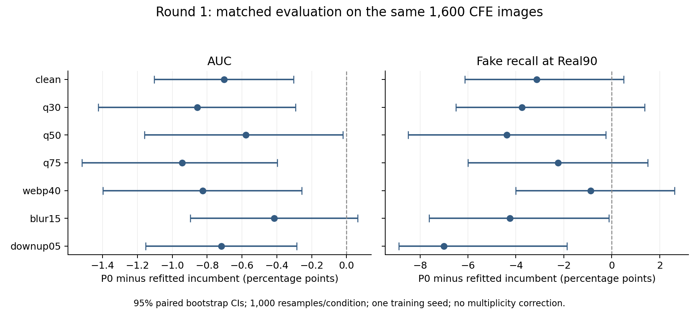

# Hậu kiểm notebook và kết quả P0 — 10/11/2026

**Kết luận: notebook hoàn thành đúng luồng đánh giá; P0 chưa cải thiện đủ để thay model hiện hành.** P0 đạt 4/8 tiêu chí G7.2, model cũ hiệu chuẩn lại đạt 6/8; cả hai đều FAIL. G7.3 vẫn pending vì thiếu tham chiếu tốt nhất theo từng điều kiện. Khép vòng `improvement_round1` như một kết quả thực nghiệm âm, giữ nguyên `task_7.15/current`.

## 1. File đã kiểm tra và nơi lưu

- Notebook gốc: [`notebooks/task/phase7_pilot_evaluation/phase7_pilot_evaluation_colab.ipynb`](../../../../../../../notebooks/task/phase7_pilot_evaluation/phase7_pilot_evaluation_colab.ipynb).
- Kết quả gốc: `wait/evaluation_results_without_weights/`, 90 file, 65.926.966 byte. Thư mục `wait/phase7_pilot_evaluation/` chỉ có hướng dẫn tiếp nhận.
- [`raw/`](raw/): bản sao nguyên byte của 90 file, bao gồm dự đoán, hiệu chuẩn, benchmark, latency, commands và step markers.
- [`evidence/phase7_pilot_evaluation_colab.ipynb`](evidence/phase7_pilot_evaluation_colab.ipynb): bản sao nguyên byte notebook đã chạy. SHA-256 `532f5f0eab6fafd821436bdc60c41445018cf4e5b58e5674119dcb6ed0259eb3`.
- [`import_manifest.json`](import_manifest.json): hash từng file nhập và 89 file được bảo vệ. Không đổi notebook, không dọn outputs, không thay kết quả/model cũ; giữ nguyên dữ liệu ở `wait`.

## 2. Notebook có chạy đúng không?

Có, trong phạm vi bằng chứng đã nộp. Ba code cell chạy theo thứ tự 1–2–3, đều có trạng thái `ok`, không có error output. Cell 1 mount Drive và nhận GPU NVIDIA L4; cell 2 checkout commit `977b282852120a7c5d1cb5d3cc110955edf00ce7`; cell 3 hoàn tất luồng `full`. Thời gian cell đánh giá khoảng 81,82 phút. Thông báo hoàn thành trong notebook được đối chiếu với `status.json`, 17 lệnh và 17 step markers, không chỉ dựa vào dòng thông báo cuối.

Hai model dùng cùng GPU, FP16, batch 16, CLIP preprocessing, 400 ảnh calibration cân bằng và 1.600 ảnh CFE cân bằng; calibration/evaluation không trùng ID. Mỗi model được đo trên 7 điều kiện CFE và 82.003 ảnh in-dist thuộc 18 tập. Batch không tự đổi giữa hai model. Dữ liệu được stage lên SSD Colab; kết quả và weights được lưu trên Drive tại:

```text
MyDrive/Fatformer/phase7/improvement_round1/evaluation/p0_eval_20261110_065901/
  candidate_p0/package/unified.pth
  incumbent_refit/package/unified.pth
  evaluation_results_without_weights.zip
```

Hậu kiểm đối chiếu 155 file source của commit đã chạy, hash plan và frozen splits; kiểm hash output theo step markers; tái tính chỉ số toàn bộ 186.406 lượt dự đoán (hai model × (7 × 1.600 + 82.003)) và chỉ số từng subset. Nhiệt độ được kiểm tra lại bằng tối ưu NLL nhị phân độc lập; ngưỡng CPU/GPU khớp trong sai số dưới `1e-6`. Chênh lệch làm tròn số thực CPU/GPU được ghi riêng, không dùng để sửa quyết định đã đo trên GPU.

Có **2.446 phép kiểm tra dữ liệu đạt** trong [`analysis/verification.json`](analysis/verification.json); đây không phải 2.446 unit test. Thêm **25 unit test đạt** cho công cụ hậu kiểm và workflow evaluation, xem [`analysis/validation/local_tests.xml`](analysis/validation/local_tests.xml). Lần thiết lập test ban đầu lỗi thư mục tạm của môi trường Windows; sau khi dùng thư mục tạm trong workspace, cả 25 test đạt. Log lần thiết lập lỗi cũng được giữ lại.

Gói nộp không có `.pth` hoặc ba archive dữ liệu đầy đủ. Vì vậy không băm lại weights/archives hoặc chạy forward model tại local. Báo cáo GPU ghi 1.200 tensor trùng khớp và 20 ảnh kiểm chứng có sai số xác suất 0; local kiểm chuỗi hash/báo cáo, giải mã 20 PNG và tái tính từ arrays đã nộp. Đây là giới hạn cần giữ khi viết báo cáo nghiệm thu.

## 3. Kết quả chất lượng và các tiêu chí còn thiếu

Các giá trị sau có đơn vị %, trừ khi ghi khác. Model đối chứng là **weights cũ được hiệu chuẩn lại** bằng cùng protocol. Điểm được làm tròn như báo cáo nguồn; dữ liệu chính xác hơn nằm trong JSON/CSV.

- Clean AUC: P0 **87,96**, đối chứng **88,66**.
- Clean Fake@Real90: P0 **61,00**, đối chứng **64,125** (báo cáo nguồn làm tròn 64,12); mục tiêu ≥65. P0 thiếu 4 điểm phần trăm.
- Q30 AUC: P0 **79,02**, đối chứng **79,88**.
- Q30 Fake@Real90: P0 **38,875**, đối chứng **42,625**; mục tiêu ≥40. P0 thiếu 1,125 điểm phần trăm.
- In-dist macro balanced accuracy, trung bình 18 tập: P0 **89,6794**, đối chứng **90,1018**; mục tiêu ≥90. P0 thiếu 0,3206 điểm phần trăm. Pooled accuracy 93,19% của P0 không thay thế tiêu chí macro này.
- Pooled Real accuracy: P0 **90,36**, đối chứng **90,41**; cả hai đạt ≥90.
- Worst-subset Fake accuracy trên CFE clean, `5_other_autoregressive`: P0 **21/81 = 25,93**, đối chứng **25/81 = 30,86**; mục tiêu ≥45. Đây là khoảng thiếu lớn nhất của cả hai, không phải worst-group validation dùng chọn P0 trong pilot train.
- ECE Q30: P0 **6,17%**, đối chứng **5,08%**; cả hai đạt ≤8%. ECE của 400 ảnh calibration là một phép đo khác, không lấy thay ECE Q30 cho gate.

P0 trượt clean Fake@Real90, Q30 Fake@Real90, macro in-dist và worst-subset Fake. Đối chứng chỉ trượt clean Fake@Real90 và worst-subset Fake. Chi tiết giá trị/ngưỡng từng tiêu chí: [`analysis/gates.csv`](analysis/gates.csv), tái tính từ [`analysis/recomputed_metrics.json`](analysis/recomputed_metrics.json).

Không công bằng nếu nói P0 kém ở mọi chỉ số: trên Q30, TPR tại FPR 1%/5% của P0 là 15,12%/29,00%, cao hơn 12,38%/28,25% của đối chứng. In-dist ECE/NLL của P0 là 6,76%/0,3121, tốt hơn 6,99%/0,3386. Các điểm tốt này chưa bù được bốn tiêu chí mục tiêu còn trượt. FPR 5% trên calibration cũng không đảm bảo FPR 5% ngoài tập đó: ở ngưỡng triển khai P0 có FPR clean 5,375%, Q30 8,5%.

## 4. Độ chắc chắn của so sánh

Đã chạy lại toàn bộ paired bootstrap trong `comparison.json`: 1.000 lần/điều kiện, seed 42, cùng chỉ số lấy mẫu cho hai model và phân tầng nhãn; thêm 10.000 bootstrap chênh lệch macro theo 18 tập. Tất cả kết quả tái lập, xem [`analysis/paired_verification.json`](analysis/paired_verification.json) và [`analysis/comparison.csv`](analysis/comparison.csv). Khoảng tin cậy marginal của riêng từng model trong báo cáo nguồn không được chạy lại toàn bộ tại local.

Chênh lệch dưới đây là **P0 trừ đối chứng**, đơn vị điểm phần trăm:

- Clean AUC: −0,7034; CI 95% [−1,1033; −0,3035]. Q30 AUC: −0,8575; CI [−1,4258; −0,2916].
- Clean Fake@Real90: −3,125; CI [−6,1281; +0,5000]. Q30: −3,750; CI [−6,500; +1,375]. Hai CI chứa 0, nên không kết luận mọi suy giảm recall đều có ý nghĩa thống kê.
- Macro in-dist: −0,4225; CI chẩn đoán theo tập [−0,8464; +0,0325], cũng chứa 0. CI này không thay luật gate đã chốt.

AUC điểm của P0 thấp hơn ở cả 7 điều kiện; 6/7 CI AUC chưa điều chỉnh nằm dưới 0. Tuy nhiên đây là một seed train, CI theo ảnh không bao quát phụ thuộc generator và chưa điều chỉnh nhiều phép so sánh. Tập test đã được xem trước đó, nên gọi đây là đánh giá hậu kiểm, không tuyên bố blind test mới. Kết luận đủ để không thay model trong vòng này, chưa đủ để kết luận mọi cấu hình train mới hoặc CLIP preprocessing đều thất bại.



Biểu đồ dùng số đã tái tính; script tạo lại: [`analysis/plot_paired_deltas.py`](analysis/plot_paired_deltas.py).

## 5. Đóng gói, độ trễ và model cuối

- P0 nguồn `9d97613c…`, gói evaluation `e26a16273d3da6f851a4fe41c994307b585339e9f5f7f9ac58c58a3621c863e2`; T=3,0949893; ngưỡng=0,76518965.
- Đối chứng nguồn `5cd49252…`, gói refit `de36061f4cc10e8b5a7b599842c160bfc5109e2a29bef2d659cf77388aaf1a5e`; T=2,7832491; ngưỡng=0,79185086.
- Gói deployment được giữ nguyên: `248690528f6e7ecadb06717fafbdb64ca5c101cb966ad3f06f8c00994c9245d0`, hồ sơ tại [`task_7.15/current`](../../../../task_7.15/current/README.md). Gói refit có hash khác, không tự động thay gói này.

Dù hash gói khác, toàn bộ IDs, logits, xác suất và nhãn của đối chứng refit giống hoàn toàn arrays cũ trên 8 quần thể: sai số xác suất tối đa 0, không đảo nhãn. Đây là bằng chứng tái lập dự đoán, không phải băm lại hai file `.pth` tại local. Xem [`analysis/incumbent_reproduction.json`](analysis/incumbent_reproduction.json).

Latency đo trên **L4**, 20 warmup và 200 cặp/batch, TF32 tắt; batch 1/8/16/32 đều có số đo thô. Batch 1: P0 tổng 44,53 ms/ảnh, median overhead 0,1511 ms/ảnh; đối chứng tổng 45,82 ms/ảnh, overhead 0,2051 ms/ảnh. Overhead đạt mục tiêu trên GPU đã cấp; đây không phải tổng inference dưới 5 ms, cũng không phải phép đo T4 hoặc bằng chứng kiến trúc P0 nhanh hơn. Chi tiết: [`analysis/latency.csv`](analysis/latency.csv).

G7.3 còn thiếu **verified best-by-condition reference**. So sánh với một incumbent không tự chứng minh incumbent đó tốt nhất từng điều kiện; không đổi G7.3 sang PASS từ kết quả này.

## 6. Việc nên làm tiếp

Không cần chạy lại notebook này chỉ để tìm điểm cao hơn. Giữ model cũ làm model báo cáo hiện hành, trình bày rõ G7.2 FAIL 6/8 và G7.3 pending. Ghi nhận vòng cải thiện này không chọn được model thay thế; không sửa kết quả cũ thành kết quả của P0.

Nếu tiếp tục nghiên cứu, trước khi tốn thêm GPU cần xác định giả thuyết mới trên train/validation: kiểm tra nhãn và độ phủ generator trong dữ liệu train, phân tích lỗi riêng trên `val_select`, rồi khóa một thí nghiệm có control và tiêu chí dừng. Pilot vừa rồi chỉ phủ một seed và hai preprocessing train; chưa cô lập nguyên nhân mô hình yếu. Không dùng CFE đã xem để chọn epoch/ngưỡng/seed hoặc lấy ảnh test vào train. Muốn kết luận tổng quát mạnh hơn cần dữ liệu holdout chưa dùng để điều chỉnh. Việc hoàn tất G7.3 là một nhánh công việc khác: thu thập baseline từng điều kiện có cùng split/protocol và provenance hợp lệ.

Quyết định có cấu trúc: [`analysis/decision.json`](analysis/decision.json). Công cụ tái lập hậu kiểm, không sửa file nguồn:

```powershell
python -m tools.audit_pilot_evaluation --source wait/evaluation_results_without_weights --notebook notebooks/task/phase7_pilot_evaluation/phase7_pilot_evaluation_colab.ipynb
```
