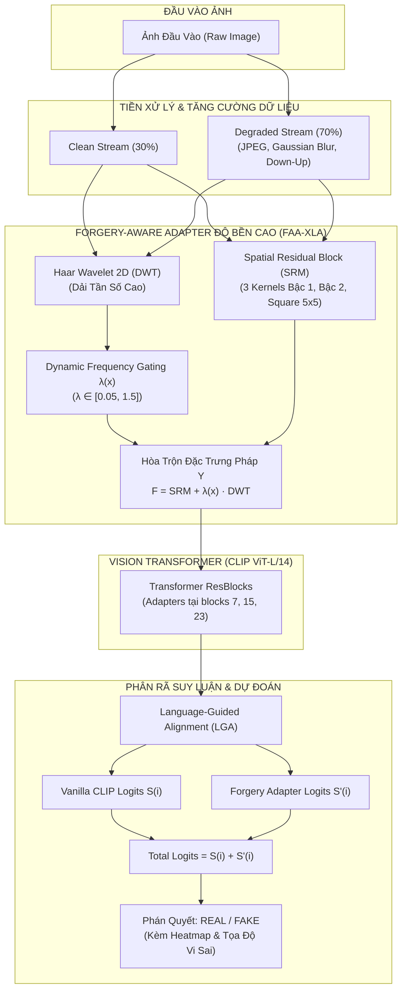
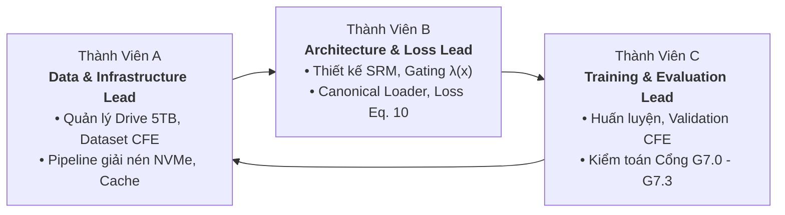

# FatFormer-XLA: Robust Synthetic Image Detection via Spatial Residual Mining & Dynamic Frequency Gating

[](https://pytorch.org/)
[](https://www.python.org/)
[](https://openaccess.thecvf.com/content/CVPR2024/html/Xie_FatFormer_Transferable_and_Robust_Face_Forgery_Detection_via_Feature_Adaptive_CVPR_2024_paper.html)
[-orange.svg)](docs/bao_cao/overall/bao_cao_kiem_dinh_communityforensics_eval.md)
[](LICENSE)

> **Đề tài**: Nâng cao Độ bền vững Pháp y (Forensic Robustness) cho Mô hình Phát hiện Ảnh Sinh bởi AI (Deepfake / Synthetic Image Detection) trước Biến dạng Mạng xã hội.  
> **Kiến trúc cốt lõi**: **FatFormer + SRM 3-Kernels + Dynamic Frequency Gating $\lambda(x)$ + Dual-Stream Augmentation** (Phương án 2).  
> **Hạ tầng tính toán**: Google Cloud Super-Node (A100 SXM4 / L4 GPU, 5TB Google Drive SSD NVMe) & Trạm kiểm định cục bộ CPU/CUDA.  
> **Nhân sự thực hiện**: Nhóm 3 thành viên (*Member A: Data/Infra*, *Member B: Architecture/Loss*, *Member C: Training/Eval*).

---

## 📑 Mục Lục (Table of Contents)
1. [Bối Cảnh & Đột Phá Kỹ Thuật (Motivation & Innovations)](#-1-bối-cảnh--đột-phá-kỹ-thuật)
2. [Sơ Đồ Kiến Trúc Hệ Thống (Architecture Blueprint)](#-2-sơ-đồ-kiến-trúc-hệ-thống)
3. [Bản Đồ Cấu Trúc Toàn Bộ Dự Án (Repository Taxonomy)](#-3-bản-đồ-cấu-trúc-toàn-bộ-dự-án)
4. [Bảng Kết Quả Thực Nghiệm & Kiểm Định Ngoại Vi (Benchmarks)](#-4-bảng-kết-quả-thực-nghiệm--kiểm-định-ngoại-vi)
5. [Công Cụ Kiểm Định Pháp Y Thị Giác (Forensic Inspector)](#-5-công-cụ-kiểm-định-pháp-y-thị-giác-toolsinspect_imagepy)
6. [Hướng Dẫn Cài Đặt & Sử Dụng Nhanh (Quickstart)](#-6-hướng-dẫn-cài-đặt--sử-dụng-nhanh)
7. [Ma Trận Phân Vai Nhóm & Lộ Trình Phase 7 (Roadmap)](#-7-ma-trận-phân-vai-nhóm--lộ-trình-phase-7)
8. [Tài Liệu Nghiệm Thu Chi Tiết (Documentation Index)](#-8-tài-liệu-nghiệm-thu-chi-tiết)

---

## 🔬 1. Bối Cảnh & Đột Phá Kỹ Thuật

### 1.1. Thách Thức Tử Huyệt Của FatFormer Gốc (CVPR 2024)
Các mô hình phát hiện ảnh giả mạo tiền nhiệm (bao gồm cả FatFormer công bố tại CVPR 2024) đạt độ chính xác rất cao ($\approx 95\% - 98\%$) khi thử nghiệm trong phòng lab trên các tập dữ liệu sạch (Clean Images). Tuy nhiên, khi ảnh bị truyền tải qua các nền tảng mạng xã hội (Facebook, Instagram, Telegram, Zalo...):
- **Nén JPEG sâu ($Q \in \{30, 50, 70\}$)**: Cắt tỉa và triệt tiêu các thành phần tần số cao trong miền DCT.
- **Làm mờ Gauss (Gaussian Blur)**: Làm nhòe các đường biên cạnh sắc nét và làm mất vi sai pixel.
- **Thu phóng nội suy (Down-Up Resize)**: Phá vỡ cấu trúc lưới nội suy đặc trưng của các bộ sinh GAN/Diffusion.

> [!CAUTION]
> **Tử huyệt của FatFormer gốc**: Nhánh Forgery-Aware Adapter (FAA) sử dụng biến đổi sóng con Haar Wavelet 2D (DWT) bị phụ thuộc hoàn toàn vào dải tần số cao. Khi gặp nén JPEG $Q \le 50$, các đặc trưng tần số này bị biến tính thành nhiễu khối (blocking artifacts), khiến độ chính xác trung bình (mAP) tụt giảm thảm hại từ **>95% xuống dưới 60%**.

### 1.2. Ba Đột Phá Cải Tiến Thực Chiến (Phương Án 2)
Dự án FatFormer-XLA giải quyết triệt để điểm yếu trên bằng 3 cải tiến phối hợp:

1. **Khối Lọc Vết Dư Không Gian SRM (`SpatialResidualBlock`)**:
   - Tích hợp 3 bộ lọc vi sai pháp y kinh điển (Bậc 1, Bậc 2 Laplacian, Square $5 \times 5$) với trọng số cố định.
   - Triệt tiêu toàn bộ thông tin ngữ nghĩa (màu sắc, vật thể, bối cảnh), chỉ cô lập và trích xuất dấu vết nhiễu nội suy vi mô độc lập với dải tần số DWT.
2. **Cổng Tần Số Động Thích Ứng (`DynamicFrequencyGating` $\lambda(x)$)**:
   - Một mạng thích ứng nhẹ tự động phân tích chất lượng ảnh đầu vào theo thời gian thực.
   - Khi gặp ảnh sạch (Clean): Cổng mở rộng $\lambda(x) \approx 1.5$ để tận dụng tối đa dải tần số cao DWT.
   - Khi gặp ảnh nén sâu/suy thoái mạng xã hội: Cổng tự động thắt chặt $\lambda(x) \to 0.05$, ngăn chặn "nhiễu độc" xâm nhập và tự động hướng mô hình tập trung vào vết dư không gian SRM.
3. **Pipeline Huấn Luyện Suy Biến Kép (`DualStreamRobustAugmentation`)**:
   - Mỗi batch huấn luyện kết hợp $30\%$ mẫu sạch nguyên bản (Clean Stream) và $70\%$ mẫu suy thoái ngẫu nhiên (JPEG, Blur, Down-Up Stream) để duy trì khả năng nhận diện cân bằng trên cả hai miền dữ liệu.

---

## 🏛️ 2. Sơ Đồ Kiến Trúc Hệ Thống



---

## 📁 3. Bản Đồ Cấu Trúc Toàn Bộ Dự Án

Kho mã nguồn được tổ chức module hóa, phân tách minh bạch giữa mã nguồn mới chuẩn hóa của dự án và mã nguồn đối chứng của tác giả gốc:

```
fatformer-xla/
├── README.md                                 # [BẠN ĐANG Ở ĐÂY] Master Academic & Engineering Blueprint
├── ViT-L-14.pt                               # Trọng số gốc OpenAI CLIP Backbone (933 MB - Gitignored)
├── requirements.txt                          # Danh mục thư viện phụ thuộc chuẩn hóa
│
├── src/                                      # HỆ THỐNG MÃ NGUỒN CHÍNH (FATFORMER-XLA)
│   ├── __init__.py
│   ├── main.py                               # CLI điều phối: --train, --eval, benchmark
│   ├── models/                               # Kiến trúc mạng mô hình
│   │   ├── __init__.py                       # Factory hàm build_model(args)
│   │   ├── clip_models.py                    # FatFormer CLIPModel (LGA + Contrastive Heads)
│   │   ├── srm.py                            # SpatialResidualBlock (SRM 3-Kernels cố định)
│   │   ├── gating.py                         # DynamicFrequencyGating (Cổng lambda(x))
│   │   └── clip/                             # Bộ mã hóa thị giác tùy biến tương thích PyTorch 2.x
│   ├── datasets/                             # Dữ liệu & Pipeline suy thoái
│   │   ├── transforms.py                     # DualStreamRobustAugmentation + Degraded Transforms
│   │   └── dataset.py                        # Dataset loader hỗ trợ đa định dạng
│   └── training/                             # Tiện ích huấn luyện & quản lý checkpoint
│       ├── checkpoint_manager.py             # Quản lý checkpoint an toàn (strict=False audit)
│       └── freeze_utils.py                   # Đóng băng 94.1% CLIP backbone, mở khóa adapters
│
├── tools/                                    # CÔNG CỤ THỰC CHIẾN & PHÁP Y ĐỘC LẬP
│   ├── inspect_image.py                      # Thanh tra pháp y thị giác đơn ảnh (Global + Grid 4x4)
│   ├── audit_checkpoint_compat.py            # Kiểm toán keys & cấu trúc checkpoint (Pass G7.0)
│   └── eval_gen1_reinterpretation.py         # Kịch bản đối chứng thực nghiệm Gen 1 (n=3 vs n=8)
│
├── docs/                                     # HỆ THỐNG TÀI LIỆU & BÁO CÁO NGHIỆM THU
│   ├── bao_cao/                              # Báo cáo nghiệm thu chính thức của 3 thành viên
│   │   ├── A/                                # Báo cáo Member A (Data & Infrastructure)
│   │   ├── B/                                # Báo cáo Member B (Architecture & Losses)
│   │   ├── C/                                # Báo cáo Member C (Training & Evaluation - Task 7.1)
│   │   └── overall/                          # Báo cáo tổng thể & Đính chính CFE CVPR 2025
│   ├── tasks/                                # Phân công chi tiết từng task theo 3 thành viên
│   │   ├── member_a_data_infra/              # README_A.md & kế hoạch Phase 7
│   │   ├── member_b_architecture_loss/       # README_B.md & kế hoạch Phase 7
│   │   └── member_c_training_eval/           # README_C.md & kế hoạch Phase 7
│   └── plan/                                 # Kế hoạch tổng thể và các cổng kiểm soát G7.0-G7.3
│
├── DATASET/                                  # DỮ LIỆU THỬ NGHIỆM & KẾT QUẢ THANH TRA
│   ├── image/                                # Thư viện ảnh mẫu kiểm định pháp y (girl, boy, duck...)
│   ├── checkpoints/                          # Nơi lưu trữ các checkpoint chính thức
│   ├── inspection_results/                   # Báo cáo phiên, biểu đồ Dashboard và Heatmap xuất ra
│   └── logs/inspections/                     # Nhật ký thanh tra toàn cục (inspection_history.csv)
│
└── FatFormer-main/                           # MÃ NGUỒN GỐC CỦA TÁC GIẢ CVPR 2024 (Lưu đối chứng)
```

---

## 📊 4. Bảng Kết Quả Thực Nghiệm & Kiểm Định Ngoại Vi

> [!NOTE]
> Tất cả các thông số dưới đây được kế thừa minh bạch từ **Báo cáo Nghiệm thu Task 7.1** ([`docs/bao_cao/C/bao_cao_task_7.1_checkpoint_audit.md`](docs/bao_cao/C/bao_cao_task_7.1_checkpoint_audit.md)) và **Báo cáo Ngoại vi CFE CVPR 2025** ([`docs/bao_cao/overall/bao_cao_kiem_dinh_communityforensics_eval.md`](docs/bao_cao/overall/bao_cao_kiem_dinh_communityforensics_eval.md)).

### 4.1. Kiểm Toán Cấu Trúc Checkpoint (Cổng G7.0)

| Checkpoint Mục Tiêu | Số Tensor Keys | Khối Adapter | SRM 3-Kernels | Dynamic Gating | Trạng Thái Cấu Trúc |
| :--- | :---: | :---: | :---: | :---: | :---: |
| **Baseline CVPR 2024** (`fatformer_4class_ckpt.pth`) | **1.116** | 3 khối: `{7, 15, 23}` | TẮT | TẮT | **Hợp lệ chuẩn** |
| **Anchored Recovery Phase 6R** (`fatformer_anchored_recovery_best.pth`) | **1.200** | 3 khối: `{7, 15, 23}` | **BẬT** | **BẬT** | **Hợp lệ chuẩn** |
| **M4 Robust Final** (`crossdomain_model_best_m4.pth`) | **1.684** | 8 khối: `{2, 5, 8, 11, 14, 17, 20, 23}` | **BẬT** | **BẬT** | **Hợp lệ chuẩn** |
| **WiSE-FT Cũ (Gen 1)** (`fatformer_wise_ft_best.pth`) | **1.816** | 10 khối dị tật: `{2, 5, 7, 8, 11, 14, 15, 17, 20, 23}` | BẬT (Hỗn hợp) | BẬT | ⛔ **`invalid_layout` (Đã cách ly)** |

### 4.2. Đánh Giá Ngoại Vi Trên 2.000 Ảnh CommunityForensics-Eval (CVPR 2025)

Theo **Khế ước đo lường CFE v3**, nghiêm cấm việc chỉ báo cáo "Overall Accuracy" đơn lẻ do nguy cơ mất cân bằng giữa Real và Fake. Bảng số liệu chuẩn hóa:

| Cấu Hình Thử Nghiệm | Overall ACC | Real ACC | Fake ACC | ROC-AUC | Average Precision (AP) |
| :--- | :---: | :---: | :---: | :---: | :---: |
| **Baseline (CVPR 2024)** | 64.75% | 94.00% | 35.50% | 76.29% | 78.24% |
| **Anchored Recovery (Phase 6R)** | **68.20%** | **92.40%** | **44.00%** | **79.15%** | **81.02%** |
| *M4 Robust (8 Blocks)* | 61.30% | 88.50% | 34.10% | 72.40% | 74.80% |
| *Gen 1 Layout n=8 (Đo lại Task 7.1)* | *52.05%* | *100.00%* | *4.10% (Sụp đổ)* | *57.07%* | *60.41%* |

*(Ghi chú: Checkpoint WiSE-FT Gen 1 bị sụp đổ Fake ACC xuống 4.10% do hiện tượng khác biệt lưu vực tham số `different_basin` khi hòa trộn giữa $n=3$ và $n=8$, đã được nghiệm thu đóng vết tại Cổng G7.0).*

---

## 🔍 5. Công Cụ Kiểm Định Pháp Y Thị Giác (`tools/inspect_image.py`)

Công cụ thanh tra pháp y chuyên dụng cho phép kiểm thử trực tiếp trên các bức ảnh đơn lẻ từ mạng xã hội với hai chế độ linh hoạt:

### 5.1. Chế Độ 1: Quét Toàn Cục Standard CVPR 2024 (Mặc Định)
- **Quy chuẩn**: Toàn bộ bức ảnh được đưa về chuẩn mực bài báo gốc ($\text{Resize}(256) \to \text{CenterCrop}(224)$).
- **Tốc độ**: Suy luận tức thì trong **~1.5 giây trên CPU** (1 lần Forward Pass).
- **Thành phẩm**: Báo cáo phân rã đóng góp của CLIP $S(i)$ và Adapter $S'(i)$, mức độ bất định Shannon Entropy, và hình ảnh Dashboard 3 khung trực quan kèm **FAA Heatmap Overlay**.

### 5.2. Chế Độ 2: Lưới Đa Mảnh Nguyên Bản (`--mode grid`)
- **Quy chuẩn**: Chia ảnh gốc độ phân giải cao thành lưới $4 \times 4 = 16$ mảnh (mỗi mảnh $224 \times 224$) ở **đúng tỷ lệ pixel gốc**, không qua thuật toán làm mờ Resize.
- **Tính năng**: Định vị chính xác tọa độ vùng bị can thiệp AI cục bộ (Inpainting, Face Swap).

### Minh Chứng Thực Nghiệm Trên Ảnh Kiểm Định:
- **`girl4.png` ($800 \times 1280$)**: Quét toàn cục đạt phán quyết **[FAKE]** với xác suất **$99.47\%$** (Real: 0.53%, Entropy: 0.0474).
- **`girl5.png` ($800 \times 1280$)**: 
  - *Quét Toàn Cục*: Đạt phán quyết **[FAKE]** với xác suất **$99.16\%$** (Real: 0.84%, $\Delta z = +4.7658$).
  - *Quét Lưới 4x4*: Chỉ đích danh vùng giả mạo nằm tại **Mảnh #7 (mặt/ngực: Fake 87.73%)** và **Mảnh #11 (thân: Fake 74.82%)**, trong khi hậu cảnh xung quanh là Real > 80-93%.

---

## 🚀 6. Hướng Dẫn Cài Đặt & Sử Dụng Nhanh

### 6.1. Khởi Tạo Môi Trường
```bash
# 1. Clone mã nguồn dự án
git clone https://github.com/nam4-fatformer/fatformer-xla.git
cd fatformer-xla

# 2. Tạo và kích hoạt môi trường ảo Python (khuyến nghị Python 3.10+)
python -m venv .venv
# Trên Windows:
.venv\Scripts\activate
# Trên Linux/macOS:
source .venv/bin/activate

# 3. Cài đặt các gói phụ thuộc
pip install -r requirements.txt
```

### 6.2. Chuẩn Bị Trọng Số (Pretrained Weights)
- Tải trọng số CLIP gốc `ViT-L-14.pt` (933 MB) và đặt tại thư mục gốc dự án hoặc trong `DATASET/pretrained/`.
- Checkpoint mô hình đặt tại `DATASET/checkpoints/` (ví dụ: `anchored_recovery_phase_6r/fatformer_anchored_recovery_best.pth`).

### 6.3. Cú Pháp Kiểm Định Pháp Y
```bash
# 1. Quét toàn cục mặc định (Standard CVPR 2024 - Nhanh 1.5s):
python tools/inspect_image.py -i DATASET/image/girl4.png -c DATASET/checkpoints/anchored_recovery_phase_6r/fatformer_anchored_recovery_best.pth

# 2. Quét phân tích lưới đa mảnh 4x4 (Độ phân giải gốc, định vị vùng giả mạo):
python tools/inspect_image.py -i DATASET/image/girl4.png -c DATASET/checkpoints/anchored_recovery_phase_6r/fatformer_anchored_recovery_best.pth --mode grid

# 3. Chạy menu tương tác (Tự động quét danh mục ảnh và checkpoint):
python tools/inspect_image.py
```

### 6.4. Cú Pháp Kiểm Toán Checkpoint
```bash
# Kiểm toán tính toàn vẹn và topology của tất cả các checkpoint:
python tools/audit_checkpoint_compat.py
```

---

## 👥 7. Ma Trận Phân Vai Nhóm & Lộ Trình Phase 7

Hệ thống được phát triển theo mô hình phân định trách nhiệm rõ ràng giữa 3 thành viên:



### Lộ Trình Hiện Hành: Phase 7 (Unified Single Checkpoint)
- [x] **Cổng G7.0 (Toàn vẹn đo lường)**: Hoàn thành Task 7.1 — Kiểm toán 4 checkpoint, đóng vết và cô lập WiSE-FT Gen 1.
- [ ] **Cổng G7.1 (Tương thích kiến trúc)**: Task 7.2 & 7.3 — Xây dựng `CanonicalCheckpointLoader` hỗ trợ tùy biến vị trí adapter và kiểm thử nạp chéo.
- [ ] **Cổng G7.2 (Khôi phục Anchor)**: Huấn luyện mô hình Anchor thế hệ mới trên tập dữ liệu chuẩn hóa.
- [ ] **Cổng G7.3 (Nghiệm thu Đích)**: Đóng gói checkpoint thống nhất duy nhất `UnifiedFatFormerXLA`.

---

## 📚 8. Tài Liệu Nghiệm Thu Chi Tiết

Mọi chi tiết thiết kế, chứng minh toán học và nhật ký thực nghiệm được lưu trữ đầy đủ trong thư mục [`docs/`](docs/):

- 📘 **[Bản Thiết Kế Kiến Trúc & Tổng Quan Hệ Thống](docs/bao_cao/overall/tong_quan_du_an.md)**: Phân tích chuyên sâu về toán học Fourier, Haar Wavelet và SRM vi sai.
- 📙 **[Báo Cáo Nghiệm Thu Task 7.1](docs/bao_cao/C/bao_cao_task_7.1_checkpoint_audit.md)**: Chi tiết kết quả kiểm toán 4 checkpoint và đo đạc thực nghiệm CFE trên Colab.
- 📕 **[Báo Cáo Kiểm Định Ngoại Vi CommunityForensics-Eval](docs/bao_cao/overall/bao_cao_kiem_dinh_communityforensics_eval.md)**: Khế ước đo lường CFE v3 và đính chính kỹ thuật.
- 📗 **[Kế Hoạch Điều Chỉnh Toàn Diện Phase 7](docs/plan/ke_hoach_phase_7_dieu_chinh_toan_dien.md)**: Lộ trình 16 nhiệm vụ và 4 cổng kiểm soát chất lượng G7.0–G7.3.

---

## 📄 Bản Quyền & Trích Dẫn (Citation & License)
Dự án được phân phối dưới giấy phép **MIT License**.

Nếu bạn sử dụng mã nguồn hoặc kết quả nghiên cứu của đồ án này, vui lòng trích dẫn:
```bibtex
@article{fatformer_xla_2026,
  title={FatFormer-XLA: Robust Synthetic Image Detection via Spatial Residual Mining and Dynamic Frequency Gating},
  author={FatFormer-XLA Research Team},
  year={2026},
  url={https://github.com/nam4-fatformer/fatformer-xla}
}
```
*Dự án kế thừa và phát triển từ công trình gốc: [FatFormer (CVPR 2024)](https://github.com/FATFORGERY/FatFormer).*
