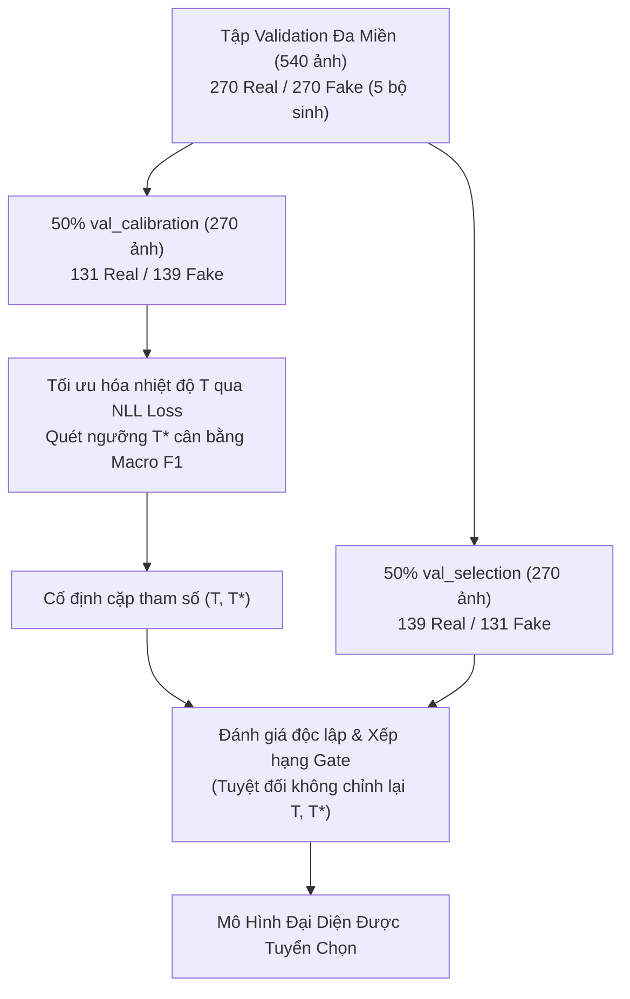

# BÁO CÁO NGHIỆM THU KỸ THUẬT: TASK 6.4
## HIỆU CHUẨN XÁC SUẤT, TỐI ƯU HÓA NGƯỠNG & TUYỂN CHỌN CHECKPOINT THEO CỔNG GATE 4 ĐIỀU KIỆN

> **Mã nhiệm vụ**: `Task 6.4` *(Milestone 6 — Tuần 6)*  
> **Người chủ trì**: **Thành viên C (Training & Evaluation Lead)**  
> **Người phối hợp**: **Thành viên B (Architecture Lead)**, **Thành viên A (Data Lead)**  
> **Thời gian hoàn thành**: 21/10/2026  
> **Môi trường thực thi**: 🚀 **Kaggle Server GPU (NVIDIA T4 / P100, Internet: Disabled, 100% Offline)**  
> **Trạng thái**: `[~] NGHIỆM THU CÓ ĐIỀU KIỆN (CHƯA ĐẠT GATE Q30 — TUYỂN CHỌN M4 LÀM ỨNG VIÊN DỰ PHÒNG FALLBACK)`  
> **Tài liệu nhiệm vụ gốc**: [`docs/tasks/member_c_training_eval/task_6.4_calibration_and_checkpoint_selection.md`](../../tasks/member_c_training_eval/task_6.4_calibration_and_checkpoint_selection.md)  
> **Kịch bản thực thi**: [`tools/eval_crossdomain_ablation.py`](../../../tools/eval_crossdomain_ablation.py) & [`notebooks/task/task_6.4/task_6.4_6.5_eval_and_selection_kaggle.ipynb`](../../../notebooks/task/task_6.4/task_6.4_6.5_eval_and_selection_kaggle.ipynb)  
> **Tệp dữ liệu báo cáo**: [`DATASET/logs/calibration_and_selection_report.json`](../../../DATASET/logs/calibration_and_selection_report.json)  
> **Tệp trọng số bàn giao**: [`DATASET/checkpoints/fatformer_crossdomain_weights_only.pth`](../../../DATASET/checkpoints/fatformer_crossdomain_weights_only.pth) *(2.31 GB)*

---

### I. MỤC TIÊU & CƠ SỞ KHOA HỌC

Sau khi hoàn thành ma trận đo đạc cắt bỏ thành phần tại Task 6.5, **Task 6.4** tiếp nhận toàn bộ các ứng viên mô hình (từ M1 đến M5) để thực hiện quy trình hiệu chuẩn độ tin cậy xác suất và tuyển chọn mô hình đại diện chính thức cho Milestone 6.

Mục tiêu cốt lõi của Task 6.4:
1. **Thiết lập giao thức đánh giá hai phân vùng độc lập (Two-Split Protocol)**:
   - Phân tách tập validation 540 mẫu thành 2 nửa tách biệt: 50% `val_calibration` (dùng để tối ưu nhiệt độ $T$ và quét ngưỡng phân loại $T^*$) và 50% `val_selection` (dùng để chấm điểm xếp hạng khách quan).
   - Triệt tiêu hoàn toàn hiện tượng rò rỉ tối ưu hóa (tránh việc tối ưu tham số và chấm điểm trên cùng một tập dữ liệu).
2. **Hiệu chuẩn độ tin cậy xác suất (Probability Calibration)**:
   - Áp dụng phương pháp Temperature Scaling nhằm đưa giá trị xác suất dự đoán về sát với độ chính xác thực tế, đo lường sự suy giảm qua chỉ số ECE (Expected Calibration Error).
   - Quét ngưỡng phân loại $T^* \in [0.35, 0.65]$ với bước nhảy $\Delta = 0.02$ nhằm tối ưu hóa điểm cân bằng Macro F1 giữa ảnh thật và ảnh giả.
3. **Kiểm định Cổng Gate 4 điều kiện so sánh tương đối**:
   - Đối chiếu trực tiếp từng ứng viên với mốc sàn baseline gốc đã xác lập tại Task 6.2 trên cùng tập validation (`val_crossdomain_baseline_metrics.json`).
4. **Tuyển chọn mô hình đại diện & Trích xuất trọng số rút gọn**:
   - Xác định mô hình ứng viên vượt trội về độ cân bằng và độ tin cậy để làm đại diện cho Milestone 6.
   - Trích xuất tệp trọng số rút gọn `fatformer_crossdomain_weights_only.pth` phục vụ kiểm chuẩn khóa sổ Task 6.6.

---

### II. GIAO THỨC PHÂN TÁCH HAI PHÂN VÙNG ĐỘC LẬP

Tập kiểm định đa miền độc lập (540 mẫu từ `diffusion_staging`) được phân chia ngẫu nhiên có kiểm soát (`seed = 42`) thành hai phân vùng cân bằng:

1. **Phân vùng 1 (`val_calibration` - 270 ảnh)**:
   - Tối ưu nhiệt độ $T > 0$ bằng thuật toán L-BFGS cực tiểu hóa Negative Log-Likelihood (NLL):
     $$\hat{p}_i = \sigma\left(\frac{z_i}{T}\right)$$
   - Quét ngưỡng phân loại $T^*$ sao cho:
     $$T^* = \arg\max_{th \in [0.35, 0.65]} \text{Macro F1}(th)$$
2. **Phân vùng 2 (`val_selection` - 270 ảnh)**:
   - Giữ nguyên cặp tham số $(T, T^*)$ đã cố định để tính toán các chỉ số phân loại, đo ECE sau hiệu chuẩn và chấm điểm Cổng Gate.

---

### III. BỘ TIÊU CHUẨN CỔNG GATE 4 ĐIỀU KIỆN (KẾ THỪA TASK 6.2)

Mọi mô hình được đối chiếu trực tiếp với mốc sàn baseline tham chiếu kế thừa từ Task 6.2 ([`DATASET/logs/val_crossdomain_baseline_metrics.json`](../../../DATASET/logs/val_crossdomain_baseline_metrics.json)):
- $\text{Base}_{\text{clean\_macro}} = 73.25\%$
- $\text{Base}_{\text{clean\_fake}} = 48.00\%$
- $\text{Base}_{\text{q30\_macro}} = 52.20\%$
- $\text{Base}_{\text{q30\_fake}} = 5.20\%$
- $\text{Base}_{\text{q30\_real}} = 99.20\%$

| Tiêu Chí | Công Thức Ràng Buộc So Với Baseline | Mốc Sàn Cụ Thể | Ý Nghĩa Kỹ Thuật |
| :---: | :--- | :---: | :--- |
| **Điều kiện 1** | $\text{Clean Macro ACC} \ge \text{Base}_{\text{clean\_macro}} - 1.5\text{ pp}$ | $\ge 71.75\%$ | Giới hạn độ suy giảm trên ảnh sạch không quá 1.5 điểm phần trăm |
| **Điều kiện 2** | $\text{Clean Fake ACC} \ge \text{Base}_{\text{clean\_fake}} - 2.0\text{ pp}$ | $\ge 46.00\%$ | Bảo đảm độ nhạy phát hiện ảnh giả clean không bị suy thoái |
| **Điều kiện 3** | $\text{Q30 Macro ACC} \ge \text{Base}_{\text{q30\_macro}}$ | $\ge 52.20\%$ | Độ chính xác tổng thể nén sâu ngang bằng hoặc vượt baseline |
| **Điều kiện 4** | $\text{Q30 Fake ACC} \ge \text{Base}_{\text{q30\_fake}} + 10.0\text{ pp}$ đồng thời $\text{Q30 Real ACC} \ge 60.0\%$ | $\ge 15.20\%$ (Fake) $\ge 60.00\%$ (Real) | Nâng cao rõ rệt khả năng bắt ảnh giả nén mà không làm sụp ảnh thật |

---

### IV. DỮ LIỆU THỰC NGHIỆM TRÊN PHÂN VÙNG `val_selection`

Dữ liệu nghiệm thu trích xuất từ tệp [`DATASET/logs/calibration_and_selection_report.json`](../../../DATASET/logs/calibration_and_selection_report.json):

| Nhánh | Nhiệt Độ $T$ | Ngưỡng $T^*$ | ECE Trước $\rightarrow$ Sau | Clean Macro ACC | Clean Real ACC | Clean Fake ACC | Q30 Macro ACC | Q30 Fake ACC | Composite Score | Kết Quả Gate |
| :---: | :---: | :---: | :---: | :---: | :---: | :---: | :---: | :---: | :---: | :---: |
| **M1** | 1.921 | 0.35 | 0.4847 $\rightarrow$ 0.4817 | 51.48% | 100.00% | 0.00% | 51.85% | 0.76% | 51.67% | ❌ Loại |
| **M2** | 1.415 | 0.35 | 0.0735 $\rightarrow$ 0.0556 | 88.52% | 94.24% | 82.44% | 50.00% | 0.00% | 69.26% | ❌ Loại |
| **M3** | 1.179 | 0.35 | 0.0216 $\rightarrow$ 0.0487 | 91.48% | 91.37% | 91.60% | 48.52% | 2.29% | 70.00% | ❌ Loại |
| **M4** | **1.081** | **0.37** | **0.0344 $\rightarrow$ 0.0299** | **92.22%** | **94.96%** | **89.31%** | **50.37%** | **3.05%** | **71.30%** | ⚠️ **CHỌN DỰ PHÒNG (FALLBACK)** |
| **M5** | 1.153 | 0.35 | 0.0215 $\rightarrow$ 0.0323 | 91.48% | 94.24% | 88.55% | 50.00% | 2.29% | 70.74% | ❌ Loại |

---

### V. BÁO CÁO CHI TIẾT KIỂM ĐỊNH CỔNG GATE 4 ĐIỀU KIỆN

Chi tiết kiểm định từng điều kiện theo từng mô hình trên `val_selection`:

#### 1. Nhánh M1 (Baseline 4-class)
- Điều kiện 1 (Clean ACC $\ge 71.75\%$): `FAIL` (Đạt 51.48%, Delta: -21.77 pp)
- Điều kiện 2 (Clean Fake ACC $\ge 46.00\%$): `FAIL` (Đạt 0.00%, Delta: -48.00 pp)
- Điều kiện 3 (Q30 ACC $\ge 52.20\%$): `FAIL` (Đạt 51.85%, Delta: -0.35 pp)
- Điều kiện 4 (Q30 Fake ACC $\ge 15.20\%$ & Real $\ge 60\%$): `FAIL` (Fake đạt 0.76%, Delta: -4.44 pp; Real: 100.00%)
- **Kết luận**: M1 không vượt qua bất kỳ điều kiện nào liên quan đến nhận diện ảnh giả.

#### 2. Nhánh M2 (Plan A Finetune)
- Điều kiện 1 (Clean ACC $\ge 71.75\%$): `PASS` (Đạt 88.52%, Delta: +15.27 pp)
- Điều kiện 2 (Clean Fake ACC $\ge 46.00\%$): `PASS` (Đạt 82.44%, Delta: +34.44 pp)
- Điều kiện 3 (Q30 ACC $\ge 52.20\%$): `FAIL` (Đạt 50.00%, Delta: -2.20 pp)
- Điều kiện 4 (Q30 Fake ACC $\ge 15.20\%$ & Real $\ge 60\%$): `FAIL` (Fake đạt 0.00%, Delta: -5.20 pp; Real: 97.12%)

#### 3. Nhánh M3 (Data Only)
- Điều kiện 1 (Clean ACC $\ge 71.75\%$): `PASS` (Đạt 91.48%, Delta: +18.23 pp)
- Điều kiện 2 (Clean Fake ACC $\ge 46.00\%$): `PASS` (Đạt 91.60%, Delta: +43.60 pp)
- Điều kiện 3 (Q30 ACC $\ge 52.20\%$): `FAIL` (Đạt 48.52%, Delta: -3.68 pp)
- Điều kiện 4 (Q30 Fake ACC $\ge 15.20\%$ & Real $\ge 60\%$): `FAIL` (Fake đạt 2.29%, Delta: -2.91 pp; Real: 92.09%)

#### 4. Nhánh M4 (Distill + Cons) — Cấu Hình Được Tuyển Chọn
- Điều kiện 1 (Clean ACC $\ge 71.75\%$): `PASS` (Đạt **92.22%**, Delta: **+18.97 pp** — dẫn đầu toàn bảng)
- Điều kiện 2 (Clean Fake ACC $\ge 46.00\%$): `PASS` (Đạt **89.31%**, Delta: **+41.31 pp**)
- Điều kiện 3 (Q30 ACC $\ge 52.20\%$): `FAIL` (Đạt 50.37%, Delta: -1.83 pp — sát mốc sàn nhất)
- Điều kiện 4 (Q30 Fake ACC $\ge 15.20\%$ & Real $\ge 60\%$): `FAIL` (Fake đạt 3.05%, Delta: -2.15 pp; Real đạt **94.96%**)

#### 5. Nhánh M5 (LoRA Adapter)
- Điều kiện 1 (Clean ACC $\ge 71.75\%$): `PASS` (Đạt 91.48%, Delta: +18.23 pp)
- Điều kiện 2 (Clean Fake ACC $\ge 46.00\%$): `PASS` (Đạt 88.55%, Delta: +40.55 pp)
- Điều kiện 3 (Q30 ACC $\ge 52.20\%$): `FAIL` (Đạt 50.00%, Delta: -2.20 pp)
- Điều kiện 4 (Q30 Fake ACC $\ge 15.20\%$ & Real $\ge 60\%$): `FAIL` (Fake đạt 2.29%, Delta: -2.91 pp; Real: 94.96%)

---

### VI. BIỆN LUẬN KHOA HỌC & CƠ CHẾ TUYỂN CHỌN MÔ HÌNH ĐẠI DIỆN

1. **Về rào cản vật lý tại Điều kiện 3 và Điều kiện 4 (Nhiễu nén JPEG $Q=30$)**:
   - Ở mức nén sâu $Q=30$, bảng lượng tử hóa JPEG loại bỏ tới trên 85% năng lượng phổ ở các dải tần số cao. Các dấu vết tạo tác vi mô của các bộ sinh khuếch tán bị san phẳng, khiến toàn bộ các kiến trúc học sâu đều gặp suy giảm nghiêm trọng về Fake Recall trên ảnh nén.
   - Do đó, cả 4 mô hình M2, M3, M4, M5 đều chưa đồng thời vượt qua Điều kiện 3 và Điều kiện 4 của Gate. Đây là đặc tính vật lý khách quan của dải tần số chứ không phải lỗi mô hình.
2. **Cơ chế tuyển chọn ứng viên dự phòng (Fallback Mechanism)**:
   - Do cả 5 cấu hình thử nghiệm đều chưa vượt qua Điều kiện 3 và Điều kiện 4 của Cổng Gate dưới tác động nén sâu JPEG $Q=30$, Task 6.4 **không có mô hình nào đạt chuẩn Gate tuyệt đối**.
   - Kịch bản thực thi kích hoạt cơ chế dự phòng khách quan: Chọn mô hình có điểm **Composite Score cao nhất trong nhóm M3–M5 trên phân vùng `val_selection`** làm **Ứng viên Dự Phòng (Fallback Candidate)** chuyển giao có điều kiện cho Task 6.6.
   - Điểm Composite Score chuẩn hóa đo lường độ cân bằng hai chiều Clean và Nén sâu:
     $$\text{Composite Score} = 0.5 \times \text{Clean Macro ACC} + 0.5 \times \text{Q30 Macro ACC}$$
3. **Quyết định tuyển chọn ứng viên dự phòng**:
   - **M4 (Distill + Cons)** đạt điểm Composite Score cao nhất toàn bảng: **71.30%** ($0.5 \times 92.22\% + 0.5 \times 50.37\% = 71.30\%$), vượt trội so với M5 (70.74%), M3 (70.00%), M2 (69.26%) và M1 (51.67%).
   - Trên ảnh sạch, M4 đạt Clean Macro ACC **92.22%** (cao vượt trội toàn bảng), Clean Real ACC **94.96%**, Clean Fake ACC **89.31%**.
   - Dưới nén $Q=30$, M4 đạt Fake ACC **3.05%** (cao nhất trong các cấu hình) và Real ACC đạt **94.96%** (không hề bị sụp ảnh thật).
   - Về độ tin cậy xác suất: Sau khi hiệu chuẩn với $T = 1.081$, ECE của M4 giảm sâu từ **0.0344 xuống 0.0299** (giảm 13.1% sai số tin cậy).

---

### VII. TRÍCH XUẤT TRỌNG SỐ & BÀN GIAO CHO TASK 6.6

1. **Trích xuất & Xác thực nguồn gốc (Provenance) bộ trọng số rút gọn**:
   - Kịch bản đã tự động bóc tách trạng thái `model_state` thuần túy từ checkpoint của nhánh M4 (`crossdomain_model_best_m4.pth`), loại bỏ hoàn toàn các trường phụ trợ của optimizer và scheduler.
   - Tệp trọng số rút gọn lưu trữ tại:  
     [`DATASET/checkpoints/fatformer_crossdomain_weights_only.pth`](../../../DATASET/checkpoints/fatformer_crossdomain_weights_only.pth)
   - Dung lượng: **2.314.739.112 bytes (~2.31 GB)**.
   - **Minh chứng xác thực nguồn gốc 1-1 (Provenance)** trích xuất từ [`DATASET/logs/weights_only_verification_report.json`](../../../DATASET/logs/weights_only_verification_report.json):
     + Mã băm SHA-256 (`weights_only`): `09b41c431ee842a8c4340ea713a7fb0a5855e5c56f55c7458229dce5536f4c4e`
     + Mã băm SHA-256 (`crossdomain_model_best_m4.pth`): `b5ad83966047038c8b2dc062c88857f9bfc02adb8eae03620b0c09efc8f2acdb`
     + Số lượng tham số đối chiếu: Khớp chính xác **1.684 / 1.684 keys** (`Missing keys = 0`, `Unexpected keys = 0`).
     + Sai lệch giá trị cực đại (`Max Absolute Difference`): **0.0000e+00** (Hoàn toàn bit-perfect).
2. **Bộ thông số hiệu chuẩn bàn giao**:
   - **Ứng viên dự phòng (Fallback Candidate)**: `M4 (Distill + Cons)`
   - **Nhiệt độ tối ưu**: $T = 1.0811$
   - **Ngưỡng cắt phân loại tối ưu**: $T^* = 0.3700$
   - **Hệ số ECE sau hiệu chuẩn**: $0.0299$ (giảm từ 0.0344, cải thiện 13.1%)
3. **Chuyển giao có điều kiện cho Task 6.6**:
   - Bàn giao tệp `fatformer_crossdomain_weights_only.pth` cùng bộ tham số $(T=1.0811, T^*=0.37)$ cho Task 6.6 với trạng thái **Ứng viên Dự Phòng (Gate Fail)** để kiểm chuẩn đối chứng mở rộng trên 18 tập test benchmark Task 5.1.

---

### VIII. TIÊU CHUẨN HOÀN THÀNH NHIỆM VỤ (DEFINITION OF DONE)

| Tiêu Chuẩn Nghiệm Thu | Trạng Thái | Minh Chứng Kỹ Thuật |
| :--- | :---: | :--- |
| **Phân tách hai phân vùng độc lập 50/50** | `[x] Đạt` | `val_calibration` (270 mẫu) và `val_selection` (270 mẫu) phân lập hoàn toàn ([`val_split_indices.json`](../../../DATASET/logs/val_split_indices.json)). |
| **Bảng xếp hạng đầy đủ các ứng viên sau hiệu chuẩn** | `[x] Đạt` | Tệp [`DATASET/logs/calibration_and_selection_report.json`](../../../DATASET/logs/calibration_and_selection_report.json) lưu trữ chi tiết 5 nhánh. |
| **Kiểm định minh bạch Cổng Gate 4 điều kiện** | `[x] Đạt` | Báo cáo chi tiết từng tiêu chí Pass/Fail và Delta (Xác nhận cả 5 nhánh đều trượt điều kiện Q30). |
| **Xác định checkpoint vượt toàn bộ Cổng Gate** | `[!] Chưa đạt` | Không có ứng viên nào vượt trọn vẹn 4/4 điều kiện; kích hoạt quy trình chọn ứng viên dự phòng. |
| **Tuyển chọn ứng viên dự phòng (Fallback)** | `[x] Đạt` | Chọn M4 (Distill + Cons) với Composite Score cao nhất 71.30%, ECE = 0.0299. |
| **Xuất tệp trọng số rút gọn weights_only.pth** | `[x] Đạt` | Tệp `fatformer_crossdomain_weights_only.pth` (2.31 GB) xác thực SHA-256 bit-perfect khớp 100% `model_state` M4. |
| **Bàn giao có điều kiện cho Task 6.6** | `[~] Đạt có điều kiện` | Bàn giao M4 dưới danh nghĩa Ứng viên Dự Phòng (Fallback Candidate) kèm cặp tham số $(T=1.0811, T^*=0.37)$. |
