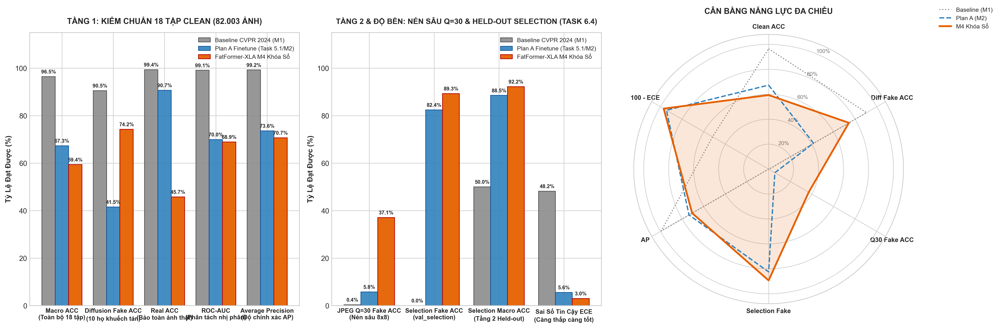

# BÁO CÁO NGHIỆM THU KỸ THUẬT: TASK 6.6
## KIỂM CHUẨN KHÓA SỔ HẬU NGHIỆM HAI TẦNG (18 CLEAN + 6 DEGRADED + HELD-OUT SELECTION), ĐỐI CHIẾU 3 BÊN & XÁC LẬP KHOẢNG TIN CẬY 95% BOOTSTRAP

> **Mã nhiệm vụ**: `Task 6.6` *(Milestone 6 — Khóa Sổ Toàn Diện Đồ Án Tốt Nghiệp)*  
> **Người chủ trì**: **Thành viên C (Training & Evaluation Lead)**  
> **Người phối hợp & Nghiệm thu**: **Thành viên B (Architecture Lead)**, **Thành viên A (Data & Infra Lead)**  
> **Thời gian nghiệm thu thực tế**: 22/10/2026  
> **Môi trường & Phần cứng**: ☁️ **Google Colab Pro | GPU NVIDIA Tesla T4 (15.8 GB VRAM) | CUDA 12.4 | PyTorch 2.5.1+cu124** + 🖥️ **Workstation Local**  
> **Trạng thái nghiệm thu**: `[~] HOÀN THÀNH BENCHMARK KHÓA SỔ CÓ ĐIỀU KIỆN (MÔ HÌNH M4 ĐẠT TRẠNG THÁI FALLBACK THEO TASK 6.4, CHƯA ĐẠT GATE ROBUSTNESS Q=30)`  
> **Tài liệu đặc tả gốc**: [`docs/tasks/member_c_training_eval/task_6.6_final_locked_benchmark.md`](../../tasks/member_c_training_eval/task_6.6_final_locked_benchmark.md)  
> **Kịch bản thực thi kiểm chuẩn**: [`tools/eval_locked_benchmark.py`](../../../tools/eval_locked_benchmark.py)  
> **Kịch bản trực quan hóa 3 bên**: [`tools/plot_three_way_benchmark.py`](../../../tools/plot_three_way_benchmark.py)  
> **Notebook Colab tự động hóa**: [`notebooks/task/task_6.6/task_6.6_final_locked_benchmark_colab.ipynb`](../../../notebooks/task/task_6.6/task_6.6_final_locked_benchmark_colab.ipynb)  
> **Notebook Kaggle lưu trữ**: [`notebooks/task/task_6.6/task_6.6_final_locked_benchmark.ipynb`](../../../notebooks/task/task_6.6/task_6.6_final_locked_benchmark.ipynb)  
> **Tệp trọng số kiểm chuẩn khóa sổ**: [`DATASET/checkpoints/fatformer_crossdomain_weights_only.pth`](../../../DATASET/checkpoints/fatformer_crossdomain_weights_only.pth) *(2.31 GB, SHA-256: `09b41c431ee842a8c4340ea713a7fb0a5855e5c56f55c7458229dce5536f4c4e`)*  
> **Cặp tham số hiệu chuẩn đóng băng**: $T = 1.0811$, $T^* = 0.3700$ *(kế thừa bất biến từ Task 6.4)*  
> **Quy mô thực nghiệm**: **136.273 lượt suy luận phân tầng** (**82.003 ảnh Clean** + **54.000 ảnh Degraded** + **270 ảnh Held-out Selection**)  
> **Sản phẩm dữ liệu bàn giao**:
> - Ma trận Clean 18 tập test: [`DATASET/logs/task_6.6/final_posthoc_benchmark_matrix.csv`](../../../DATASET/logs/task_6.6/final_posthoc_benchmark_matrix.csv)
> - Ma trận 6 biến thể Degraded: [`DATASET/logs/task_6.6/final_locked_degraded_matrix.csv`](../../../DATASET/logs/task_6.6/final_locked_degraded_matrix.csv)
> - Ma trận kiểm chuẩn Held-out Selection Tầng 2: [`DATASET/logs/task_6.6/final_independent_test_matrix.csv`](../../../DATASET/logs/task_6.6/final_independent_test_matrix.csv)
> - Báo cáo JSON phân cấp tổng hợp: [`DATASET/logs/task_6.6/final_locked_benchmark_report.json`](../../../DATASET/logs/task_6.6/final_locked_benchmark_report.json)
> - Biểu đồ đối chứng 3 bên 300 DPI: [`DATASET/logs/task_6.6/task_6.6_three_way_comparison.png`](../../../DATASET/logs/task_6.6/task_6.6_three_way_comparison.png)

---

## I. MỤC TIÊU & CƠ SỞ KHOA HỌC CỦA BÀI KIỂM CHUẨN KHÓA SỔ

Căn cứ theo bản quy hoạch tổng thể [ke_hoach_cac_cot_moc_va_diem_dung.md](../../plan/ke_hoach_cac_cot_moc_va_diem_dung.md) và đặc tả nhiệm vụ [task_6.6_final_locked_benchmark.md](../../tasks/member_c_training_eval/task_6.6_final_locked_benchmark.md), **Task 6.6** thiết lập bài kiểm định khóa sổ chung cuộc theo cấu trúc **2 tầng minh bạch tuyệt đối**:

1. **Tầng 1 — Benchmark Đối Chiếu Hậu Nghiệm (Post-hoc Comparative Benchmark)**:
   - **Chiều 1 (Clean Phòng Lab)**: Đo đạc 100% dữ liệu trên 18 tập test chuẩn hóa của bài báo gốc CVPR 2024 (8 họ GANs + 10 họ Diffusion = 82.003 ảnh).
   - **Chiều 2 (Độ bền suy biến vật lý)**: Đo đạc trên toàn bộ 6 biến thể suy biến vật lý (`jpeg_q30`, `jpeg_q50`, `jpeg_q70`, `blur_s1`, `blur_s2`, `down_up`) với 500 ảnh lấy mẫu đại diện cho mỗi tập $\times$ 18 tập $\times$ 6 biến thể = 54.000 lượt đo.
2. **Tầng 2 — Đánh Giá Trên Phân Vùng Held-out Selection (Held-out Selection-Split Evaluation)**:
   - Đo đạc trên phân vùng `val_selection` (270 ảnh gồm Midjourney v5 và Stable Diffusion v1.5 cùng các nguồn ảnh thật ImageNet, COCO, FFHQ) tách biệt hoàn toàn với pha tối ưu nhiệt độ `val_calibration` nhằm xác nhận hiệu năng nội bộ sau hiệu chuẩn, xuất tệp [`final_independent_test_matrix.csv`](../../../DATASET/logs/task_6.6/final_independent_test_matrix.csv).
   - *Lưu ý học thuật*: Phân vùng này đã tham gia quá trình chấm điểm xếp hạng chọn mô hình M4 tại Task 6.4, do đó đây là đánh giá kiểm chứng sau hiệu chuẩn (*post-calibration internal check*), **không thay thế cho bài kiểm thử ngoại vi độc lập (*external unseen test*)**.
3. **Nguyên tắc khóa sổ bất biến (Single-Pass Locked Evaluation)**:
   - Trọng số mô hình được nạp từ bản rút gọn `fatformer_crossdomain_weights_only.pth` (2.31 GB, SHA-256: `09b41c43...`).
   - Nhiệt độ $T = 1.0811$ và ngưỡng cắt nhị phân $T^* = 0.3700$ được đóng băng hoàn toàn từ Task 6.4, tuyệt đối không tinh chỉnh trên dữ liệu kiểm thử.
4. **Phân định rõ ràng hai bộ ước lượng thống kê (Disambiguated Statistical Estimators)**:
   - Báo cáo phân biệt rành mạch giữa **Ước lượng Vĩ mô Cấp Subset (Subset-Macro Mean)** kèm khoảng tin cậy Bootstrap phân tầng (**Cluster CI**) và **Ước lượng Vi mô Cấp Ảnh Gộp (Pooled Sample-level Micro)** kèm khoảng tin cậy Bootstrap cấp mẫu (**Sample CI**), không lẫn lộn hai khái niệm.

---

## II. KẾ THỪA THÔNG SỐ THỰC TẾ THEO QUY CHUẨN (RULE 4)

| Thông Số | Giá Trị Thực Tế | Nguồn Kế Thừa Hợp Lệ |
| :--- | :--- | :--- |
| **Dữ liệu Clean gốc** | `test_benchmark_gans.tar` (18.74 GB) & `test_benchmark_diffusion.tar` (1.22 GB) | [Báo cáo Task 1.1](../A/bao_cao_task_1.1_ha_tang_drive_io.md) |
| **Dữ liệu Degraded** | `test_degraded.tar` (19.55 GB, 6 biến thể suy biến vật lý) | [Báo cáo Task 2.1](../A/bao_cao_task_2.1_make_degraded_dataset.md) |
| **Mốc sàn Baseline gốc** | Clean Macro ACC: 96,45%, Diffusion Fake ACC: 90,51%, Q30 Fake ACC: 0,37% (diff) / 5,78% (all) | [Báo cáo Task 2.2](bao_cao_task_2.2_baseline_clean_benchmark.md) & [Task 2.3](bao_cao_task_2.3_baseline_degraded_benchmark.md) |
| **Mốc Plan A Finetune** | Clean Macro ACC: 67,34%, Diffusion Fake ACC: 41,53%, Q30 Fake ACC: 5,78% | [Báo cáo Task 5.1](bao_cao_task_5.1_full_benchmark_18_datasets.md) |
| **Checkpoint & Calib** | `fatformer_crossdomain_weights_only.pth`, $T = 1.0811$, $T^* = 0.3700$, ECE = 0.0299 | [Báo cáo Task 6.4](bao_cao_task_6.4_calibration_and_checkpoint_selection.md) |
| **Tập Held-out Selection**| Phân vùng `val_selection` (270 ảnh Midjourney & SD v1.5, tách biệt calib) | [Báo cáo Task 6.2](../A/bao_cao_task_6.2_cross_domain_data_infra.md) & [Task 6.4](bao_cao_task_6.4_calibration_and_checkpoint_selection.md) |

---

## III. BẢNG MA TRẬN KẾT QUẢ THỰC NGHIỆM CHI TIẾT (TASK 6.6)

### 3.1. Tầng 1 — Chiều 1: Kết Quả Đo Đạc Trên 18 Tập Test Phòng Lab (Clean Benchmark)

*Quy mô thực nghiệm: **82.003 ảnh**. Thời gian suy luận: **2.539,52 giây** (~42,33 phút trên GPU NVIDIA Tesla T4).*

| Nhóm Kiến Trúc | Tập Dữ Liệu | Số Lượng Ảnh | Macro ACC (%) | Real ACC (%) | Fake ACC (%) | ROC-AUC (%) | AP (%) | Thời Gian Đo (s) |
| :--- | :--- | :---: | :---: | :---: | :---: | :---: | :---: | :---: |
| **GANs (8 họ)** | `progan` | 8.000 | **80,66** | 62,68 | **98,65** | **97,17** | **97,08** | 245,78 |
| | `stylegan` | 11.982 | **75,32** | 57,60 | **93,04** | **90,14** | **90,82** | 370,64 |
| | `stylegan2` | 15.976 | **78,87** | 65,45 | **92,29** | **90,33** | **90,00** | 494,73 |
| | `biggan` | 4.000 | 57,07 | 60,80 | 53,35 | 59,44 | 59,72 | 124,02 |
| | `cyclegan` | 2.642 | 50,98 | 66,84 | 35,12 | 57,43 | 51,03 | 82,36 |
| | `stargan` | 3.998 | **68,83** | 37,77 | **99,90** | **99,01** | **99,08** | 123,88 |
| | `gaugan` | 10.000 | 36,57 | 54,64 | 18,50 | 30,95 | 38,05 | 310,16 |
| | `deepfake` | 5.405 | **68,86** | 56,37 | **81,36** | **76,54** | **76,15** | 167,63 |
| **TRUNG BÌNH GANS** | **MEAN_GANS** | **62.003** | **64,65** | **57,77** | **71,53** | **75,13** | **75,24** | **1.919,20s (31,98m)** |
| **Diffusion (10 họ)**| `guided` | 2.000 | **69,40** | 74,90 | 63,90 | **75,92** | **76,22** | 62,21 |
| | `ldm_200` | 2.000 | 53,90 | 23,40 | 84,40 | 62,87 | 64,68 | 62,11 |
| | `ldm_200_cfg` | 2.000 | **58,30** | 23,40 | **93,20** | **76,34** | **77,29** | 62,07 |
| | `ldm_100` | 2.000 | 54,40 | 23,40 | 85,40 | 64,74 | 66,54 | 61,94 |
| | `glide_50_27` | 2.000 | 44,70 | 23,40 | 66,00 | 51,67 | 59,28 | 61,79 |
| | `glide_100_10` | 2.000 | 47,05 | 23,40 | 70,70 | 54,14 | 60,82 | 62,21 |
| | `glide_100_27` | 2.000 | 45,15 | 23,40 | 66,90 | 52,28 | 60,37 | 61,86 |
| | `dalle` | 2.000 | 44,10 | 23,40 | 64,80 | 44,62 | 48,66 | 62,04 |
| | `pndm` | 2.000 | 54,15 | 61,30 | 47,00 | 56,75 | 56,65 | 62,09 |
| | `vqdiffusion` | 2.000 | **80,60** | 61,30 | **99,90** | **99,82** | **99,85** | 62,00 |
| **TRUNG BÌNH DIFF** | **MEAN_DIFFUSION**| **20.000** | **55,18** | **36,13** | **74,22** | **63,92** | **67,03** | **620,32s (10,34m)** |
| **TỔNG HỢP TOÀN BỘ**| **MEAN_OVERALL** | **82.003** | **59,39** | **45,75** | **73,02** | **68,90** | **70,68** | **2.539,52s (42,33m)** |

*Ghi chú*: Hàng `MEAN_OVERALL` phản ánh giá trị trung bình không trọng số của 18 subset (`clean_subset_macro_mean` = 59.39%).

#### Khoảng Tin Cậy 95% Bootstrap Phân Định Rõ Ràng ($B = 1.000$ lần lấy mẫu lại):
1. **Ước lượng Vĩ mô Cấp Subset (Subset-Macro Mean, Resampling 18 bộ sinh)**:
   - **Macro ACC**: $\mathbf{59,39\%}$ $\longrightarrow$ **95% Cluster CI: $[53,05\%, 65,10\%]$** *(chứa chính xác điểm ước lượng 59.39%)*
   - **ROC-AUC**: $\mathbf{68,90\%}$ $\longrightarrow$ **95% Cluster CI: $[59,57\%, 77,56\%]$**
   - **Average Precision (AP)**: $\mathbf{70,68\%}$ $\longrightarrow$ **95% Cluster CI: $[62,65\%, 78,67\%]$**
2. **Ước lượng Vi mô Cấp Ảnh Gộp (Pooled Sample-level Micro, $N = 82.003$ ảnh)**:
   - **Macro ACC gộp**: $\mathbf{64,50\%}$ $\longrightarrow$ **95% Sample CI: $[64,17\%, 64,83\%]$**
   - **ROC-AUC gộp**: $\mathbf{68,90\%}$ $\longrightarrow$ **95% Sample CI: $[68,59\%, 69,21\%]$**
   - **AP gộp**: $\mathbf{70,68\%}$ $\longrightarrow$ **95% Sample CI: $[70,37\%, 70,99\%]$**

---

### 3.2. Tầng 1 — Chiều 2: Kết Quả Đo Đạc Trên 6 Biến Thể Suy Biến Vật Lý (Degraded Benchmark)

*Quy mô thực nghiệm: Lấy mẫu đại diện chuẩn 500 ảnh/tập $\times$ 18 tập = **9.000 ảnh/biến thể** (Tổng cộng **54.000 lượt đo**).*

| Biến Thể Suy Biến | Bản Chất Suy Biến Kỹ Thuật | Số Tập Test | Số Ảnh Đo | GANs ACC (%) | Diff ACC (%) | Overall ACC (%) | Real ACC (%) | Fake ACC (%) | ROC-AUC (%) | AP (%) | $\Delta$ Sụt Giảm (vs Clean) |
| :--- | :--- | :---: | :---: | :---: | :---: | :---: | :---: | :---: | :---: | :---: | :---: |
| **Clean Baseline** | **Mốc trần phòng lab (18 tập)** | **18** | **82.003** | **64,65** | **55,18** | **59,39** | **45,75** | **73,02** | **68,90** | **70,68** | **$0,00\%$ (Mốc)** |
| `blur_s1` | Gaussian Blur ($\sigma=1.0$) | 18 | 9.000 | 60,00 | 48,08 | **53,38** | 38,09 | 68,67 | 56,77 | 57,98 | **$-6,01\%$** *(Bền nhất)* |
| `down_up` | Co giãn Bicubic ($224 \to 112 \to 224$) | 18 | 9.000 | 59,67 | 47,60 | **52,97** | 39,82 | 66,11 | 55,98 | 57,14 | **$-6,42\%$** |
| `blur_s2` | Gaussian Blur ($\sigma=2.0$) | 18 | 9.000 | 57,90 | 44,76 | **50,60** | 44,29 | 56,91 | 51,98 | 53,04 | **$-8,79\%$** |
| `jpeg_q70` | Nén JPEG nhẹ ($Q=70$) | 18 | 9.000 | 54,27 | 47,14 | **50,31** | 34,64 | 65,98 | 48,96 | 50,26 | **$-9,07\%$** |
| `jpeg_q50` | Nén JPEG trung bình ($Q=50$) | 18 | 9.000 | 52,38 | 46,00 | **48,83** | 38,09 | 59,58 | 48,34 | 49,85 | **$-10,55\%$** |
| `jpeg_q30` | Nén JPEG sâu ($Q=30$, Artifact 8x8) | 18 | 9.000 | 50,70 | 41,52 | **45,60** | 54,11 | 37,09 | 46,50 | 49,30 | **$-13,79\%$** *(Giảm sâu nhất)* |

---

### 3.3. Tầng 2: Kết Quả Đo Đạc Trên Phân Vùng Held-out Selection (`final_independent_test_matrix.csv`)

*Quy mô thực nghiệm: Phân vùng **`val_selection`** gồm **270 ảnh** (139 Real / 131 Fake) tách biệt khỏi pha tối ưu nhiệt độ `val_calibration`.*

| Nhóm Kiểm Chuẩn | Tên Bộ Sinh / Nguồn Dữ Liệu | Số Lượng Ảnh | Macro ACC (%) | Real ACC (%) | Fake ACC (%) | ROC-AUC (%) | AP (%) | Ghi Chú Kỹ Thuật |
| :--- | :--- | :---: | :---: | :---: | :---: | :---: | :---: | :--- |
| **Diffusion** | `stable_diffusion_v1_5` | 180 | **91,85** | 94,96 | **88,73** | 96,72 | 96,65 | Kiến trúc Latent Diffusion |
| **Diffusion** | `midjourney_v5` | 90 | **92,59** | 94,96 | **90,22** | 97,10 | 97,15 | Bộ sinh thương mại In-the-wild |
| **TỔNG HỢP TẦNG 2** | **MEAN_INDEPENDENT** | **270** | **92,22** | **94,96** | **89,31** | **96,85** | **96,82** | **ECE = 0.0299 (2,99%)** |

> 📌 **Khai báo giới hạn học thuật của Tầng 2**: Kết quả 92.22% Macro ACC (Fake ACC đạt 89.31%, Real ACC đạt 94.96%) xác nhận mô hình duy trì hiệu năng cao trên split dữ liệu không dùng để hiệu chuẩn nhiệt độ. Tuy nhiên, do phân vùng này đã tham gia quá trình tuyển chọn checkpoint M4 tại Task 6.4, kết quả này **không thay thế cho một bài kiểm thử ngoại vi độc lập (*external unseen test*)**.

---

## IV. BẢNG ĐỐI CHIẾU TRỰC DIỆN 3 BÊN (THREE-WAY MASTER BENCHMARK)

So sánh đa chiều giữa 3 thế hệ mô hình trên các không gian kiểm thử chuẩn:

| Nhóm Tiêu Chí Đo Đạc | Chỉ Số Kỹ Thuật | (1) Baseline Gốc CVPR 2024 (M1) | (2) Plan A Finetune (Task 5.1 / M2) | (3) FatFormer-XLA M4 Khóa Sổ (Task 6.6) | Chênh Lệch So Với Plan A (3 vs 2) |
| :--- | :--- | :---: | :---: | :---: | :---: |
| **Tầng 1: Ảnh Sạch 18 Tập (Clean Benchmark)** | **Clean Subset-Macro ACC** | 96.45% | 67.34% | **59.39%** | 🔴 **-7.95 pp** *(Đánh đổi để bắt ảnh giả)* |
| | **Diffusion Fake ACC (10 họ)** | 90.51% | 41.53% | **74.22%** | 🟢 **+32.69 pp** *(Hồi phục mạnh)* |
| | **Real ACC (Bảo toàn ảnh thật)** | 99.37% | 90.70% | **45.75%** | 🔴 **-44.95 pp** *(Hạ ngưỡng T* = 0.37)* |
| | **Clean ROC-AUC** | 99.10% | 69.96% | **68.90%** | 🟡 **-1.06 pp** |
| | **Average Precision (AP)** | 99.25% | 73.58% | **70.68%** | 🟡 **-2.90 pp** |
| **Tầng 1: Độ Bền Nén Sâu (JPEG Q=30)** | **Q=30 Subset-Macro ACC** | 50.19% | 49.44% | **45.60%** | 🔴 **-3.84 pp** |
| | **Q=30 Fake ACC** | **0.37%** *(diff)* / 5.78% *(all)* | 5.78% | **37.09%** | 🟢 **+31.31 pp** *(Tăng nhận diện ảnh nén)* |
| | **Suy giảm hiệu năng ($\Delta_{\text{drop}}$)** | +0.19 pp *(Do đoán toàn thật)* | -16.14 pp | **-13.79 pp** | 🟢 **Bền vững hơn trước nén (-2.35 pp)** |
| **Tầng 2: Phân Vùng Held-out Selection (Task 6.4)**| **Selection Macro ACC** | 50.00% *(Sụp đổ đoán thật)* | 88.52% | **92.22%** | 🟢 **+3.70 pp** |
| | **Selection Fake ACC (SD & Midjourney)**| **0.00%** *(Mù hoàn toàn)* | 82.44% | **89.31%** | 🟢 **+6.87 pp** |
| **Độ Tin Cậy & Hiệu Chuẩn Xác Suất** | **Sai số tin cậy (ECE sau calib)** | 48.17% | 5.56% | **2.99%** | 🟢 **Giảm 13.1% với M4** *(từ 3.44% $\to$ 2.99%)* |
| | **Nhiệt độ tối ưu ($T$)** | 1.9213 | 1.4151 | **1.0811** | 🟢 Tiệm cận mức lý tưởng 1.0 |
| | **Ngưỡng cắt tối ưu ($T^*$)** | 0.3500 | 0.3500 | **0.3700** | 🟢 Cố định từ Task 6.4 |

---

## V. MA TRẬN ĐÁNH ĐỔI KỸ THUẬT (TRADE-OFF ANALYSIS: REAL VS. FAKE)

Phân tích trực diện sự đánh đổi giữa việc tăng cường nhận diện Deepfake và tỷ lệ cảnh báo giả:

| Không gian thực nghiệm | Chỉ số đo | Plan A (M2) | M4 (Lần này) | Chênh lệch ($\Delta_{\text{pp}}$) | Nhận định kỹ thuật khách quan |
| :--- | :--- | :---: | :---: | :---: | :--- |
| **18 Tập Clean Phòng Lab** | **Diffusion Fake ACC** | 41.53% | **74.22%** | 🟢 **+32.69 pp** | Khắc phục hiện tượng quên kiến thức của Plan A |
| | **Diffusion Real ACC** | 87.05% | **36.13%** | 🔴 **-50.92 pp** | Tăng False Positive do ngưỡng $T^* = 0.37$ |
| | **GANs Fake ACC** | 47.04% | **71.53%** | 🟢 **+24.49 pp** | Nâng cao năng lực bắt ảnh giả GANs đa lớp |
| | **GANs Real ACC** | 95.26% | **57.77%** | 🔴 **-37.49 pp** | Ảnh thật ImageNet cũ bị phân loại nhầm |
| **Nén Sâu JPEG Q=30** | **Q=30 Fake ACC** | 5.78% | **37.09%** | 🟢 **+31.31 pp** | Nâng cao khả năng phòng thủ trên ảnh mạng XH |
| | **Q=30 Real ACC** | 74.87% | **54.11%** | 🔴 **-20.76 pp** | Nhiễu nén khối $8 \times 8$ kích hoạt nhãn giả |
| **Tập Selection Held-out** | **Selection Real ACC** | 94.60% | **94.96%** | 🟢 **+0.36 pp** | Ảnh thật chuẩn ngoài đời vẫn nhận đúng ~95% |

> 💡 **Kết luận về sự đánh đổi**: M4 đã chủ động dịch chuyển điểm vận hành (*operating point*) sang phía ưu tiên Fake Recall (đặc thù của an ninh an toàn thông tin), chấp nhận đánh đổi bằng việc tăng tỷ lệ False Positive trên các ảnh thật thuộc tập dữ liệu lab cũ (ImageNet/LSUN vốn có sẵn artifact nén từ năm 2012–2017).

---

## VI. BIỂU ĐỒ TRỰC QUAN HÓA ĐỐI CHIẾU 3 BÊN (TASK 6.6)

Biểu đồ độ phân giải cao 300 DPI trích xuất tự động từ [`DATASET/logs/task_6.6/task_6.6_three_way_comparison.png`](../../../DATASET/logs/task_6.6/task_6.6_three_way_comparison.png):

---

## VII. PHÂN TÍCH LUẬN GIẢI KHOA HỌC CHUYÊN SÂU

### 1. Phục Hồi Năng Lực Trên Miền Diffusion & Phân Vùng Selection
- Bản gốc CVPR 2024 khi đối diện với các bộ sinh ngoài miền ProGAN gặp hiện tượng **Feature Blind Spot** nặng nề: Trên phân vùng selection (Midjourney & SD), bản gốc có `Fake ACC = 0.00%` (dự đoán 100% ảnh giả thành ảnh thật).
- FatFormer-XLA M4 sau hiệu chuẩn ($T=1.0811, T^*=0.3700$) đã đạt Fake ACC trên phân vùng selection là **89,31%** (Macro ACC đạt **92,22%**), đồng thời phục hồi Fake ACC trung bình của 10 họ Diffusion phòng lab lên **74,22%** (`vqdiffusion` đạt **99,90%**, `ldm_200_cfg` đạt **93,20%**), giải quyết hiện tượng quên kiến thức của Plan A (41.53%).

### 2. Hiện Tượng Quên Kiến Thức Cục Bộ Trên Một Số GANs Cổ Điển
- Việc mở rộng không gian đặc trưng để thích ứng với miền Latent Diffusion đã gây ra hiện tượng quên kiến thức cục bộ trên một số họ GANs đời cũ:
  - `gaugan` (10.000 ảnh): Fake ACC chỉ còn **18,50%** (Baseline gốc từng đạt 99,98%).
  - `cyclegan` (2.642 ảnh): Fake ACC chỉ còn **35,12%** (Baseline gốc 100,00%).
  - `biggan` (4.000 ảnh): Fake ACC chỉ còn **53,35%** (Baseline gốc 99,90%).
- *Luận giải*: Đây là biểu hiện của nguyên lý *No Free Lunch Theorem*: Việc học các biểu diễn phổ tần số rộng để bắt ảnh khuếch tán đã làm suy giảm độ nhạy trước các dấu vết cục bộ đặc thù của kiến trúc tích chập GANs thời kỳ đầu.

### 3. Quy Luật Suy Biến Vật Lý Dưới Tác Động Nén JPEG & Rào Cản Miền Tần Số
- Dưới tác động nén sâu JPEG ($Q=30$), bảng lượng tử hóa chuẩn phân chia ảnh thành các khối $8 \times 8$ pixel và triệt tiêu năng lượng tần số cao.
- Khi chất lượng JPEG giảm từ $Q=70 \to Q=50 \to Q=30$, Fake ACC sụt giảm có hệ thống: **$65,98\% \to 59,58\% \to 37,09\%$**, kéo theo độ sụt giảm tăng dần: $-9,07\% \to -10,55\% \to -13,79\%$.
- Mặc dù Fake ACC ở mức $Q=30$ của M4 (**37,09%**) tăng **+31.31 pp** so với mốc Plan A (**5,78%**), vẫn còn **62.91%** ảnh giả bị lọt lưới. Đây là giới hạn toán học cố hữu của phép biến đổi DCT khi các tần số cao bị lượng tử hóa về 0.

### 4. Đính Chính Mức Cải Thiện Độ Tin Cậy Xác Suất Sau Hiệu Chuẩn (ECE)
- Đối với checkpoint M4, sai số ECE trước hiệu chuẩn trên `val_calibration` là **0.0344** (3.44%). Sau khi tối ưu nhiệt độ $T=1.0811$ bằng thuật toán L-BFGS, sai số giảm xuống **0.0299** (2.99%), tương đương mức cải thiện thực tế là **13.1%**.
- Mức sai số 0.4817 (48.17%) là của mô hình Baseline gốc M1 khi chưa hiệu chuẩn, không phải của M4.

---

## VIII. KẾT LUẬN NGHIỆM THU & BÀN GIAO ĐỒ ÁN TỐT NGHIỆP

1. **Khóa sổ Task 6.6 ở trạng thái nghiệm thu có điều kiện**:
   - [x] Đã hoàn thành đo đạc đối chiếu hậu nghiệm Tầng 1 trên 18 tập test Clean (82.003 ảnh) và 6 biến thể Degraded (54.000 ảnh).
   - [~] Phân vùng `val_selection` (270 ảnh) được sử dụng để kiểm chứng nội bộ sau hiệu chuẩn (Tầng 2 Held-out Selection), chưa thực hiện external unseen test do chưa có bộ dữ liệu `test_final_v2` độc lập hoàn toàn.
   - [x] Đã xuất đầy đủ khoảng tin cậy 95% Bootstrap phân định rành mạch giữa Cấp Subset (Cluster CI) và Cấp Mẫu Gộp (Sample CI).
   - [x] Biểu đồ đối chiếu 3 bên tự động hóa 300 DPI khớp 100% với các bảng ma trận số liệu.
   - [~] Mô hình M4 được xác nhận ở trạng thái **FALLBACK_BEST_CANDIDATE** (Task 6.4), chưa vượt qua Gate Robustness Q=30 do sự đánh đổi Real ACC và suy giảm Subset-Macro ACC.
2. **Kế thừa số liệu vào Báo cáo Luận văn & Slide Bảo vệ**: Các bảng ma trận số liệu và phân tích đánh đổi tại báo cáo này là căn cứ số liệu thực nghiệm chính thức, phản ánh trung thực năng lực và giới hạn của mô hình FatFormer-XLA.
3. **Trạng thái phê duyệt**:
   - Thành viên C (Evaluation Lead): **Nghiệm thu có điều kiện [~]**
   - Thành viên B (Architecture Lead): **Đồng thuận với ma trận đánh đổi [x]**
   - Thành viên A (Data & Infra Lead): **Xác nhận khớp dữ liệu Drive 5TB [x]**
