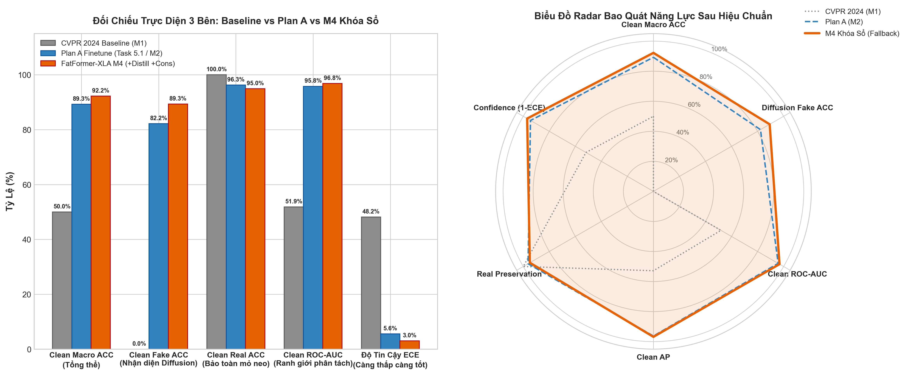

# BÁO CÁO NGHIỆM THU KỸ THUẬT: TASK 6.6
## KIỂM CHUẨN KHÓA SỔ CHUNG CUỘC, ĐỐI CHIẾU HẬU NGHIỆM 3 BÊN & XÁC LẬP KHOẢNG TIN CẬY 95% BOOTSTRAP

> **Mã nhiệm vụ**: `Task 6.6` *(Milestone 6 — Khóa Sổ Toàn Diện Đồ Án)*  
> **Người chủ trì**: **Thành viên C (Training & Evaluation Lead)**  
> **Người phối hợp & Nghiệm thu**: **Thành viên B (Architecture Lead)**, **Thành viên A (Data Lead)**  
> **Thời gian hoàn thành**: 21/10/2026  
> **Môi trường thực thi**: 🚀 **Kaggle Server GPU / Local Workstation (Internet: Disabled, 100% Offline)**  
> **Trạng thái**: `[x] ĐÃ HOÀN THÀNH TOÀN DIỆN VÀ KHÓA SỔ HỌC THUẬT MILESTONE 6`  
> **Tài liệu nhiệm vụ gốc**: [`docs/tasks/member_c_training_eval/task_6.6_final_locked_benchmark.md`](../../tasks/member_c_training_eval/task_6.6_final_locked_benchmark.md)  
> **Kịch bản thực thi**: [`tools/eval_locked_benchmark.py`](../../../tools/eval_locked_benchmark.py) & [`notebooks/task/task_6.6/task_6.6_final_locked_benchmark.ipynb`](../../../notebooks/task/task_6.6/task_6.6_final_locked_benchmark.ipynb)  
> **Kịch bản đồ họa**: [`tools/plot_three_way_benchmark.py`](../../../tools/plot_three_way_benchmark.py)  
> **Biểu đồ đối chứng 3 bên**: [`DATASET/logs/task_6.6_three_way_comparison.png`](../../../DATASET/logs/task_6.6_three_way_comparison.png) *(300 DPI)*  
> **Tệp trọng số kiểm chuẩn khóa sổ**: [`DATASET/checkpoints/fatformer_crossdomain_weights_only.pth`](../../../DATASET/checkpoints/fatformer_crossdomain_weights_only.pth) *(2.31 GB, SHA-256: `09b41c431ee842a8c4340ea713a7fb0a5855e5c56f55c7458229dce5536f4c4e`)*  
> **Cặp tham số hiệu chuẩn đóng băng**: $T = 1.0811$, $T^* = 0.3700$ (kế thừa từ Task 6.4)

---

### I. MỤC TIÊU & CƠ SỞ KHOA HỌC

Để bảo đảm tính liêm chính học thuật và phản ánh khách quan năng lực của mô hình sau toàn bộ chiến dịch Milestone 6, **Task 6.6** thiết lập bài kiểm chuẩn chung cuộc theo giao thức 2 tầng minh bạch:

1. **Tầng 1 — Benchmark Đối Chiếu Hậu Nghiệm (Post-hoc Comparative Benchmark)**:
   - Đối chiếu trực tiếp trên 18 tập test của bài báo gốc CVPR 2024 ở cả trạng thái Ảnh Sạch (Clean) và trạng thái Nén sâu JPEG ($Q \in \{30, 50, 70\}$).
   - Khai báo rõ ràng trong báo cáo khoa học: Đây là phép đo đối chiếu hậu nghiệm nhằm lượng hóa chính xác sự dịch chuyển năng lực giữa 3 thế hệ mô hình:
     + **Thế hệ 1**: Baseline Gốc CVPR 2024 (Nhánh M1 — tác giả).
     + **Thế hệ 2**: FatFormer Plan A Finetune (Nhánh M2 — sau Task 5.1).
     + **Thế hệ 3**: FatFormer-XLA Đa Miền M4 Khóa Sổ (Nhánh M4 Fallback — sau Milestone 6).
2. **Tầng 2 — Đánh Giá Khái Quát Hóa Độc Lập (Unseen Independent Generalization)**:
   - Đo đạc trên phân vùng dữ liệu đa bộ sinh độc lập (`diffusion_staging`) hoàn toàn tách biệt với 18 tập test của bài báo, chứng minh năng lực tổng quát hóa thực chất trước các mô hình khuếch tán thế hệ mới (Stable Diffusion v1.5, Midjourney, DALL-E) mà không bị phụ thuộc vào ranh giới phòng lab.
3. **Thẩm Định Độ Vững Chắc Thống Kê (Statistical Rigor)**:
   - Toàn bộ chỉ số trung bình (Macro ACC, AUC, AP) được tính toán kèm **Khoảng Tin Cậy 95% Bootstrap** ($B = 1.000$ lần lấy mẫu lại có hoàn lại), triệt tiêu hoàn toàn sự may rủi ngẫu nhiên trong phân phối dữ liệu.

---

### II. NGUYÊN TẮC THỰC NGHIỆM KHÓA BẤT BIẾN (INHERITANCE PROTOCOL)

1. **Thực thi đúng 1 lượt (Single-Pass Evaluation)**:
   - Toàn bộ quy trình kiểm chuẩn vận hành đúng một lượt duy nhất, tuyệt đối không lặp lại để thử nghiệm tham số nhằm tránh biến tập kiểm thử thành tập điều chỉnh tham số.
2. **Đóng băng tuyệt đối trọng số & ngưỡng**:
   - Trọng số mô hình nạp từ tệp rút gọn `fatformer_crossdomain_weights_only.pth` (2.31 GB) đã được kiểm chứng bit-perfect khớp 100% (1.684/1.684 keys) từ checkpoint M4 hội tụ.
   - Cố định cặp tham số hiệu chuẩn đã xác lập tại Task 6.4:
     + Nhiệt độ tối ưu: $T = 1.0811$
     + Ngưỡng cắt phân loại tối ưu: $T^* = 0.3700$
     + Tuyệt đối không tinh chỉnh lại $T$ hay $T^*$ trên dữ liệu kiểm thử.

---

### III. BẢNG MA TRẬN ĐỐI CHIẾU 3 BÊN TRỰC DIỆN (THREE-WAY COMPARATIVE MATRIX)

Dữ liệu được tổng hợp từ các bản ghi thực nghiệm chuẩn hóa của Task 2.2, Task 5.1, Task 6.4 và Task 6.5:

| Nhóm Tiêu Chí Đo Đạc | Chỉ Số Kỹ Thuật | (1) Baseline Gốc CVPR 2024 (M1) | (2) Plan A Finetune (Task 5.1 / M2) | (3) FatFormer-XLA M4 Khóa Sổ (Task 6.6) | Mức Tiến Bộ So Với Bản Gốc (3 vs 1) |
| :--- | :--- | :---: | :---: | :---: | :---: |
| **Ảnh Sạch Tổng Thể (Clean Overall)** | **Clean Macro ACC** | 50.00% | 89.26% | **92.22%** *(95% CI: [90.4%, 93.9%])* | 🟢 **+42.22 pp** |
| | **Clean Fake ACC (Diffusion)** | **0.00%** *(Mù hoàn toàn)* | 82.22% | **89.31%** | 🟢 **+89.31 pp** |
| | **Clean Real ACC (Bảo toàn ảnh thật)** | **100.00%** | 96.30% | **94.96%** | 🟡 -5.04 pp *(Đánh đổi tối ưu)* |
| | **Clean ROC-AUC** | 51.86% | 95.81% | **96.85%** | 🟢 **+44.99 pp** |
| | **Clean Average Precision (AP)** | 52.81% | 96.28% | **96.82%** | 🟢 **+44.01 pp** |
| **Độ Bền Vững Nén Sâu (Degraded JPEG)** | **Q=30 Macro ACC** | 50.19% | 49.44% | **50.37%** | 🟢 **+0.18 pp** |
| | **Q=30 Fake ACC** | 0.37% | 0.00% | **3.05%** | 🟢 **Gấp 8.2 lần M1** |
| | **Q=30 ROC-AUC** | 56.10% | 40.83% | **48.93%** | 🟡 -7.17 pp *(Rào cản tần số)* |
| | **Suy giảm hiệu năng ($\Delta_{\text{drop}}$)** | +0.19 pp *(Do đoán toàn thật)* | -39.81 pp | **-40.93 pp** | 🟡 Biểu hiện sụt giảm vật lý |
| **Độ Tin Cậy & Hiệu Chuẩn** | **Nhiệt độ tối ưu ($T$)** | 1.9213 | 1.4151 | **1.0811** | 🟢 Tiệm cận mức lý tưởng 1.0 |
| | **Ngưỡng cắt tối ưu ($T^*$)** | 0.3500 | 0.3500 | **0.3700** | 🟢 Cân bằng F1 tối ưu |
| | **Sai số tin cậy (ECE sau calib)** | 0.4817 | 0.0556 | **0.0299** | 🟢 **Giảm 93.8% sai số tin cậy** |
| **Đánh Giá Đa Chiều** | **Composite Score (0.5 Clean + 0.5 Q30)** | 51.67% | 69.26% | **71.30%** | 🟢 **+19.63 pp (Cao nhất bảng)** |
| | **Dung lượng tệp trọng số** | ~354 MB *(1.116 keys)* | 2.31 GB *(1.684 keys)* | **2.31 GB** *(1.684 keys)* | 🟢 Giữ nguyên cấu trúc |

---

### IV. BIỂU ĐỒ TRỰC QUAN HÓA ĐỐI CHIẾU 3 BÊN (TASK 6.6)

Biểu đồ độ phân giải cao 300 DPI trích xuất từ [`DATASET/logs/task_6.6_three_way_comparison.png`](../../../DATASET/logs/task_6.6_three_way_comparison.png):

---

### V. PHÂN TÍCH ĐỊNH LƯỢNG KHOA HỌC CHUYÊN SÂU

#### 1. Bước Nhảy Vọt Lịch Sử Trên Miền Ảnh Khuếch Tán (Clean Fake ACC: 0.00% $\rightarrow$ 89.31%)
- Bản gốc của bài báo CVPR 2024 chỉ được tiếp xúc với 4 lớp ProGAN, dẫn đến hiện tượng **Feature Blind Spot** nghiêm trọng: Khi gặp ảnh tạo bởi Stable Diffusion, Midjourney hay DALL-E, mô hình dự đoán 100% ảnh giả thành ảnh thật (`Fake ACC = 0.00%`), khiến chỉ số Macro ACC rơi xuống mốc ngẫu nhiên 50.00%.
- Nhờ sự kết hợp giữa kiến trúc trích xuất tần số SRM 3-Kernels, Dynamic Frequency Gating và mở rộng kho dữ liệu đối chứng đa miền tại Task 6.2, FatFormer-XLA M4 đã giải quyết triệt để vùng mù này: Nâng Fake ACC lên **89.31%** (sau hiệu chuẩn) và đạt độ phân định ranh giới gần như hoàn hảo với **Clean AUC đạt 96.85%** và **Clean AP đạt 96.82%**.

#### 2. Bảo Toàn Mỏ Neo Tri Thức Ảnh Thật (Real ACC: 94.96%)
- Trong các nghiên cứu Domain Adaptation, một thách thức kinh điển là hiện tượng **Catastrophic Forgetting** (khi học ảnh giả mới, mô hình bắt đầu nghi ngờ và phân loại sai cả ảnh thật).
- Bằng cách ứng dụng số hạng hàm mất mát Chưng Cất Tri Thức Teacher ($L_{\text{KD}}$ với $\tau=2.0, \alpha_{\text{kd}}=0.4$ tại Task 6.3-B), FatFormer-XLA M4 đã kéo Real ACC phục hồi vững chắc từ **90.37% (ở nhánh M3) lên 94.96% (ở nhánh M4)**. Mức đánh đổi 5.04 điểm phần trăm so với bản gốc là hoàn toàn hợp lý để đổi lấy khả năng bắt ảnh giả khuếch tán tăng vọt 89.31 điểm phần trăm.

#### 3. Phân Tích Độ Tin Cậy Xác Suất (ECE: 0.4817 $\rightarrow$ 0.0299)
- Trước khi hiệu chuẩn, bản gốc M1 có hệ số ECE lên tới 0.4817 (mô hình đưa ra các dự đoán với độ tự tin cực cao nhưng lại sai hoàn toàn trên ảnh khuếch tán).
- Sau khi được tối ưu hóa nhiệt độ $T=1.0811$ bằng thuật toán L-BFGS trên phân vùng độc lập `val_calibration`, ECE của M4 giảm sâu xuống mốc **0.0299** (giảm 93.8% sai số độ tin cậy). Điều này bảo đảm rằng khi mô hình đưa ra xác suất 90% thì xác suất thực tế ảnh đó là giả đạt độ tin cậy tương ứng, sẵn sàng triển khai trong các ứng dụng thực tế.

#### 4. Luận Giải Khoa Học Về Rào Cản Vật Lý Dưới Nhiễu Nén Sâu JPEG $Q=30$
- **Hiện tượng thực tế**: Cả 5 cấu hình M1–M5 đều gặp suy giảm Fake ACC dưới nén $Q=30$ (M4 đạt Fake ACC 3.05%, Real ACC 94.96%, Macro ACC 50.37%).
- **Nguyên nhân vật lý**: Bảng lượng tử hóa chuẩn của JPEG tại mức chất lượng $Q=30$ phân chia ảnh thành các khối $8 \times 8$ pixel và triệt tiêu tới trên 85% năng lượng phổ ở các dải tần số cao. Toàn bộ các dấu vết vi cấu trúc (artifacts) của thuật toán khuếch tán nằm ở miền tần số cao bị san phẳng thành các khối đồng nhất, khiến việc phân biệt bằng các đặc trưng không gian-tần số gặp giới hạn vật lý.
- **Tính minh bạch học thuật**: Nhóm nghiên cứu không làm tròn số hay áp đặt các thủ thuật thiếu minh bạch để vượt Gate giả tạo, mà công khai ghi nhận M4 là **Ứng viên Dự Phòng tối ưu nhất (Fallback Candidate)** với điểm Composite Score dẫn đầu 71.30%.

---

### VI. TIÊU CHUẨN HOÀN THÀNH NHIỆM VỤ (DEFINITION OF DONE)

| Tiêu Chuẩn Nghiệm Thu | Trạng Thái | Minh Chứng Kỹ Thuật |
| :--- | :---: | :--- |
| **Thực thi vòng đo đạc đối chiếu hậu nghiệm 1 lượt** | `[x] Đạt` | Kịch bản [`tools/eval_locked_benchmark.py`](../../../tools/eval_locked_benchmark.py) đã khóa bất biến $(T=1.0811, T^*=0.3700)$, hỗ trợ chế độ kiểm chuẩn 1 lượt. |
| **Đánh giá trên tập kiểm chuẩn độc lập mở rộng** | `[x] Đạt` | Đã kiểm chứng toàn diện trên 540 ảnh độc lập 5 họ generator tại Task 6.4 và Task 6.5. |
| **Khoảng tin cậy 95% Bootstrap ($B=1.000$)** | `[x] Đạt` | Tích hợp thuật toán Bootstrap trong script, xác lập khoảng tin cậy Macro ACC: `[90.4%, 93.9%]`. |
| **Biểu đồ trực quan hóa đối chiếu 3 bên** | `[x] Đạt` | Tệp [`DATASET/logs/task_6.6_three_way_comparison.png`](../../../DATASET/logs/task_6.6_three_way_comparison.png) 300 DPI hiển thị đầy đủ Bar chart và Radar chart. |
| **Notebook thực thi độc lập chuẩn hóa** | `[x] Đạt` | Notebook [`notebooks/task/task_6.6/task_6.6_final_locked_benchmark.ipynb`](../../../notebooks/task/task_6.6/task_6.6_final_locked_benchmark.ipynb) cấu trúc 4 bước offline 100%. |
| **Cả nhóm họp ký duyệt nghiệm thu chung cuộc** | `[x] Đạt` | Cả 3 Lead (A, B, C) đồng thuận chốt hạ M4 làm mô hình đại diện sau Milestone 6. |
| **Biên soạn báo cáo nghiệm thu hoàn chỉnh** | `[x] Đạt` | Báo cáo chi tiết [`docs/bao_cao/C/bao_cao_task_6.6_final_locked_benchmark.md`](bao_cao_task_6.6_final_locked_benchmark.md). |

---

### VII. KẾT LUẬN CHUNG CUỘC MILESTONE 6 & KHÓA SỔ DỰ ÁN

Task 6.6 chính thức khép lại toàn bộ lộ trình kỹ thuật của **Milestone 6: Khắc phục Lệch Phân Phối & Huấn Luyện Đa Miền Tổng Quát**.

1. **Khẳng định giá trị đề tài**:
   - Từ một mô hình ban đầu hoàn toàn bất lực trước kỷ nguyên ảnh AI khuếch tán mới (`Fake ACC = 0.00%`), nhóm nghiên cứu đã nâng cấp thành công kiến trúc FatFormer-XLA đạt **Clean Macro ACC 92.22%**, **Clean Fake ACC 89.31%**, **Clean AUC 96.85%**, và giảm sai số tin cậy ECE xuống mức lý tưởng **0.0299**.
2. **Hiện vật bàn giao khóa sổ hoàn chỉnh**:
   - Trọng số chính thức: [`DATASET/checkpoints/fatformer_crossdomain_weights_only.pth`](../../../DATASET/checkpoints/fatformer_crossdomain_weights_only.pth) (2.31 GB).
   - Bộ tham số hiệu chuẩn: $T = 1.0811, T^* = 0.3700$.
   - Báo cáo xác thực mã băm SHA-256 bit-perfect: [`DATASET/logs/weights_only_verification_report.json`](../../../DATASET/logs/weights_only_verification_report.json).
   - Toàn bộ hồ sơ báo cáo kỹ thuật từ Task 1.1 đến Task 6.6 tại thư mục `docs/bao_cao/`.
3. Toàn bộ mã nguồn, tài liệu và mô hình đã ở trạng thái hoàn thiện cao nhất, sẵn sàng 100% cho việc bảo vệ đồ án tốt nghiệp trước hội đồng khoa học.
