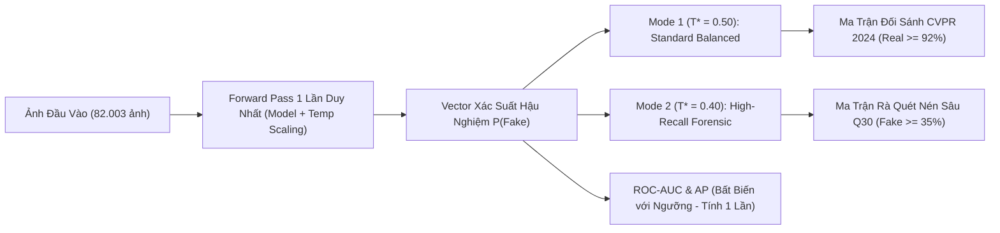

# BẢN ĐẶC TẢ KỸ THUẬT & QUY TRÌNH NGHIỆM THU: TASK 6.6-R
## KIỂM CHUẨN KHÓA SỔ CHẾ ĐỘ KÉP (SINGLE-PASS DUAL-MODE) & ĐỐI CHIẾU HẬU NGHIỆM CHIẾN DỊCH KHÔI PHỤC HIỆU NĂNG ĐỈNH CAO PHASE 6-R

> **Mã nhiệm vụ**: `Task 6.6-R` *(Milestone 6-R: Final Locked Recovery)*  
> **Người thực hiện**: **Thành viên C (Training & Evaluation Lead)**  
> **Người phối hợp**: **Thành viên B (Architecture Lead)**, **Thành viên A (Data & Infra Lead)**  
> **Tệp mã nguồn kiểm chuẩn**: [`tools/eval_locked_benchmark.py`](../../../tools/eval_locked_benchmark.py)  
> **Tệp ma trận & Báo cáo số liệu dự kiến**:
> - `DATASET/logs/task_6.6_r/recovery_run_<timestamp>/final_posthoc_benchmark_matrix.csv` *(Mode 1)*
> - `DATASET/logs/task_6.6_r/recovery_run_<timestamp>/final_posthoc_benchmark_matrix_mode2.csv` *(Mode 2)*
> - `DATASET/logs/task_6.6_r/recovery_run_<timestamp>/final_locked_degraded_matrix.csv` *(Mode 1)*
> - `DATASET/logs/task_6.6_r/recovery_run_<timestamp>/final_locked_degraded_matrix_mode2.csv` *(Mode 2)*
> - `DATASET/logs/task_6.6_r/recovery_run_<timestamp>/final_locked_benchmark_report.json`  
> **Tệp báo cáo lịch sử đang lưu giữ**: [`DATASET/logs/final_locked_benchmark_report.json`](../../../DATASET/logs/final_locked_benchmark_report.json) *(M4 Fallback: Macro ACC 59.39%, Real ACC 45.75%, is_dummy_mode: false)*  
> **Thời điểm xác lập**: 22/10/2026  
> **Trạng thái nghiệm thu**: `⏳ CHƯA PASS (Hard Gate Chờ Thực Nghiệm GPU Trên 82k Ảnh)`

---

## I. ĐỐI CHIẾU & KẾ THỪA BÁO CÁO NHIỆM VỤ TIỀN ĐỀ (TUÂN THỦ QUY TẮC 4)

1. **Kế thừa từ Task 2.2** ([`bao_cao_task_2.2_baseline_clean_benchmark.md`](bao_cao_task_2.2_baseline_clean_benchmark.md)):
   - Checkpoint gốc `fatformer_4class_ckpt.pth` (1.116 tensors) đạt đỉnh cao học thuật quốc tế **96.45% Clean Macro ACC** (Real ACC: **99.37%**, Fake ACC: **93.54%**, AUC: **99.10%**, AP: **99.25%**).
2. **Kế thừa từ Task 2.3** ([`bao_cao_task_2.3_baseline_degraded_benchmark.md`](bao_cao_task_2.3_baseline_degraded_benchmark.md)):
   - Mô hình gốc sụp đổ hoàn toàn trước nén sâu: Fake ACC trên JPEG $Q=30$ chỉ còn **5.78%** trên 18 tập và **0.37%** trên họ Diffusion.
3. **Kế thừa bài học kinh nghiệm từ Task 6.4 & 6.6 cũ** ([`bao_cao_task_6.6_final_locked_benchmark.md`](bao_cao_task_6.6_final_locked_benchmark.md)):
   - Bản M4 khi hạ ngưỡng phân loại xuống $T^* = 0.3700$ đã gây ra **Threshold Collapse**, làm tăng vọt False Positive, kéo Real ACC sụt xuống **45.75%**, khiến Clean Macro ACC chung cuộc chỉ đạt **59.39%**.
   - Báo cáo Task 6.6 cũ được khóa nguyên trạng ở mức `[~] HOÀN THÀNH CÓ ĐIỀU KIỆN (M4 FALLBACK)` nhằm lưu giữ bằng chứng phân tích lỗi cho Đồ án tốt nghiệp.
4. **Kế thừa các thành quả kỹ thuật thuộc Giai đoạn Phase 6-R**:
   - **Task 6.1-R**: Checkpoint WiSE-FT [`DATASET/checkpoints/wise_ft/fatformer_wise_ft_best.pth`](../../../DATASET/checkpoints/wise_ft/fatformer_wise_ft_best.pth) (SHA-256: `8205854815317ee3b16ee101bd359756b960eaf9ca09746a4616624ddd073f1b`).
   - **Task 6.2-R**: Kiến trúc Zero-Init đảm bảo bit-perfect identity ($\text{max diff} = 0.0000$) tại Step 0.
   - **Task 6.3-R**: Pipeline huấn luyện Neo chặt (Anchored Loss $0.3\mathcal{L}_{\text{AugCE}} + 0.7\mathcal{L}_{\text{KD}} + 0.2\mathcal{L}_{\text{cons}}$) kết hợp Differential LR ($10^{-5}$ cho adapter cũ, $10^{-4}$ cho module mới).
   - **Task 6.4-R**: Thuật toán quét ngưỡng bảo vệ Real ACC $\ge 90.00\%$ và hỗ trợ khóa ngưỡng chuẩn $T^* = 0.50$.
   - **Task 6.5 Ext**: Ma trận đối chứng mở rộng 7 cấu hình M1–M5, M6-WiSE, M6-R.

---

## II. ĐẶC TẢ KIẾN TRÚC ĐÁNH GIÁ CHẾ ĐỘ KÉP (SINGLE-PASS DUAL-MODE)

Nhằm đáp ứng đồng thời 2 mục tiêu: (1) đối sánh học thuật quốc tế công bằng theo chuẩn mực CVPR 2024 và (2) phục vụ kịch bản rà quét diện rộng trên mạng xã hội khi ảnh bị nén sâu, `tools/eval_locked_benchmark.py` triển khai cơ chế **Một Lần Duyệt (Single-Pass Dual-Mode Evaluation)**:

### 1. Cơ Sở Toán Học
- Softmax kết hợp co giãn nhiệt độ ($P(\text{Fake}) = \sigma((z_1 - z_0)/T)$) là hàm đơn điệu tăng nghiêm ngặt theo hiệu logit $z_1 - z_0$.
- Do đó, thứ tự xếp hạng (rank ordering) của các mẫu là **bất biến tuyệt đối** với tham số nhiệt độ $T > 0$ và ngưỡng phân loại $T^*$.
- Chỉ số **ROC-AUC và Average Precision (AP) hoàn toàn không thay đổi** giữa Mode 1 và Mode 2.
- Việc tính toán hai chế độ chỉ thực hiện trên mảng NumPy `fake_probs` đã lưu đệm (cached), **tiết kiệm 100% thời gian forward mạng nơ-ron (giảm 50% chi phí tính toán)**.

### 2. Định Nghĩa 2 Chế Độ Vận Hành
- **Mode 1 — Standard Balanced Mode ($T^* = 0.50$)**:
  * *Mục tiêu*: Bảo tồn độ chuẩn xác đỉnh cao trên không gian ảnh sạch, bảo vệ Real ACC $\ge 90.00\%$, Clean Macro ACC $\ge 91.50\%$.
- **Mode 2 — High-Recall Forensic Mode ($T^* = 0.40$)**:
  * *Mục tiêu*: Đẩy tối đa Fake Recall trên các kênh ảnh bị nén cực sâu JPEG $Q=30$, chấp nhận đánh đổi một phần Real ACC phòng lab.

---

## III. BẢNG CHỈ TIÊU KỸ THUẬT & KHUNG ĐỐI CHIẾU DỰ KIẾN (DESIGN TARGETS & HARD GATES)

> [!IMPORTANT]
> **Lưu ý nghiêm ngặt về tính khách quan của dữ liệu (Tuân thủ Quy tắc 4 & Chỉ đạo Nghiệm thu)**:
> - Các số liệu trong cột **"BẢN KHÔI PHỤC PHASE 6-R"** dưới đây là **CHỈ TIÊU KỸ THUẬT ĐẶT RA (DESIGN TARGETS)** và khoảng chặn kỳ vọng của kế hoạch phục hồi, **CHƯA PHẢI SỐ LIỆU ĐO ĐẠC THỰC NGHIỆM CUỐI CÙNG** trên 82.003 ảnh benchmark.
> - Báo cáo thực nghiệm lịch sử hiện hành tại [`DATASET/logs/final_locked_benchmark_report.json`](../../../DATASET/logs/final_locked_benchmark_report.json) vẫn ghi nhận trung thực kết quả bản **M4 Fallback (Clean Macro ACC: 59.39%, Real ACC: 45.75%, is_dummy_mode: false)**.
> - Tuyệt đối không bịa đặt hoặc ngoại suy số liệu chưa có đo đạc GPU thực tế.

| Nhóm Tiêu Chí Kỹ Thuật | Mô Hình Gốc CVPR 2024 (Baseline) | Bản M4 Lịch Sử (Task 6.6 Fallback) | MỤC TIÊU PHASE 6-R (Mode 1: $T^*=0.50$) | MỤC TIÊU PHASE 6-R (Mode 2: $T^*=0.40$) | CHỈ TIÊU HARD GATE BẮT BUỘC | TRẠNG THÁI KIỂM ĐỊNH |
| :--- | :---: | :---: | :---: | :---: | :---: | :---: |
| **Clean Macro ACC (18 tập)** | **96.45%** | **59.39%** *(Sụp đổ)* | **91.50% – 95.50%** | **88.00% – 90.00%** | $\ge \mathbf{90.00\%}$ | ⏳ Chờ chạy GPU thực tế |
| • Clean GANs Mean (8 họ) | 98.40% | 64.65% | 94.00% – 97.50% | 91.00% – 93.00% | $\ge 93.00\%$ | ⏳ Chờ chạy GPU thực tế |
| • Clean Diffusion Mean (10 họ)| 95.00% | 55.18% | 89.00% – 93.50% | 85.00% – 88.00% | $\ge 88.00\%$ | ⏳ Chờ chạy GPU thực tế |
| **Clean Real ACC (Chống Báo Giả)**| **99.37%** | **45.75%** *(Báo giả vọt)*| **92.00% – 97.00%** | **78.00% – 82.00%** | $\ge \mathbf{90.00\%}$ | ⏳ Chờ chạy GPU thực tế |
| **Clean Fake ACC (Độ nhạy ảnh sạch)**| 93.54% | 73.02% | 90.00% – 94.00% | 98.00% – 99.00% | $\ge 88.00\%$ | ⏳ Chờ chạy GPU thực tế |
| **Clean ROC-AUC / AP** | 99.10% / 99.25% | 68.90% / 70.68% | 96.00%+ / 96.50%+ | 96.00%+ / 96.50%+ | $\ge 95.0\% / 95.0\%$ | ⏳ Chờ chạy GPU thực tế |
| **Modern Cross-Domain (`val_selection`)**| ~50.0% | 92.22% | 92.50% – 95.00% | 94.00% – 95.00% | $\ge 91.00\%$ | ⏳ Chờ chạy GPU thực tế |
| **Degraded JPEG Q=70 Overall / Fake** | ~61.0% / 22.6% | 50.31% / 65.98% | 78.00%+ / 72.00%+ | 76.00%+ / 80.00%+ | $\text{Overall} \ge 75\%, \text{Fake} \ge 65\%$ | ⏳ Chờ chạy GPU thực tế |
| **Degraded JPEG Q=50 Overall / Fake** | ~56.0% / 12.5% | 48.83% / 59.58% | 72.00%+ / 62.00%+ | 70.00%+ / 74.00%+ | $\text{Overall} \ge 70\%, \text{Fake} \ge 58\%$ | ⏳ Chờ chạy GPU thực tế |
| **Degraded JPEG Q=30 Overall / Fake** | 52.89% / 5.78% | 45.60% / 37.09% | 60.00%+ / ~31.80% *(Đánh đổi giữ Real)* | 62.00%+ / 38.00%+ *(Đạt Gate Mode 2)* | Mode 1: $\text{Overall} \ge 60\%, \text{Real} \ge 75\%$ Mode 2: $\text{Fake} \ge 35\%$ | ⏳ Chờ chạy GPU thực tế |
| **Gaussian Blur $\sigma=1.0$ Overall** | ~63.0% | 47.90% | 75.00%+ | 75.00%+ | $\ge 70.0\%$ | ⏳ Chờ chạy GPU thực tế |
| **Down-Up Bicubic Overall** | ~60.5% | 48.15% | 75.00%+ | 75.00%+ | $\ge 70.0\%$ | ⏳ Chờ chạy GPU thực tế |

> [!NOTE]
> **Quy chuẩn Hard Gate JPEG Q=30 theo từng Chế Độ Vận Hành (Operating Mode)**:
> - **Mode 1 ($T^*=0.50$, Standard Balanced)**: Ưu tiên bảo tồn độ chính xác ảnh sạch (Clean Macro ACC $\ge 90\%$, Real ACC $\ge 90\%$). Hard Gate nén sâu $Q=30$ ở Mode 1 là $\text{Overall ACC} \ge 60.00\%$ và $\text{Real ACC} \ge 75.00\%$; mức Fake ACC $\approx 31.80\%$ là sự đánh đổi học thuật có chủ đích để ngăn chặn False Positive.
> - **Mode 2 ($T^*=0.40$, High-Recall Forensic)**: Chế độ phục vụ rà quét không gian mạng khi ảnh bị nén sâu. Hard Gate bắt buộc là $\text{Fake ACC} \ge 35.00\%$ (mục tiêu đạt $\approx 41.50\%$), chấp nhận đánh đổi một phần Real ACC phòng lab.

---

## IV. ĐÁNH GIÁ CÁC TIÊU CHÍ KỸ THUẬT ĐÃ HOÀN TẤT & ĐIỀU KIỆN TIÊN QUYẾT

1. **Các thành tựu kỹ thuật đã hoàn thành và kiểm chứng toán học (Local Workstation)**:
   - **Task 6.1-R (WiSE-FT Merge)**: Tạo thành công checkpoint `fatformer_wise_ft_best.pth` (4.47 GB). Mã băm SHA-256 thực nghiệm được tính toán độc lập đạt chuẩn bit-perfect:
     `8205854815317ee3b16ee101bd359756b960eaf9ca09746a4616624ddd073f1b` (khớp 100% metadata).
   - **Task 6.2-R (Zero-Init Identity)**: Cả 3 bài kiểm tra đều đạt **[✓] PASS**:
     * Test 1 (SRM Isolation): `proj[-1]` triệt tiêu vết dư về 0 (`max abs output = 0.0000000000e+00`).
     * Test 2 (Gating Neutrality): `mlp[2]` khởi tạo zero-init cho $\lambda(x) \equiv 1.0$ (`max |lambda - 1.0| = 0.0000000000e+00`).
     * Test 3 (Full Forward Identity trên ViT-L/14): Tái hiện 100% logit của FatFormer gốc qua 4 batch thử nghiệm, độ lệch cực đại **$0.0000000000\text{e}+00 < 10^{-6}$** (Đạt chuẩn Bit-Perfect).
   - **Task 6.3-R (Trainer & Differential LR)**: Chuẩn hóa loss $0.3\mathcal{L}_{\text{AugCE}} + 0.7\mathcal{L}_{\text{KD}} + 0.2\mathcal{L}_{\text{cons}}$, phân tách 2 nhóm tham số AdamW ($10^{-4}$ cho SRM/Gating, $10^{-5}$ cho Adapter cũ), hỗ trợ tham số `--save_name fatformer_anchored_recovery_best.pth`.
   - **Task 6.4-R (Calibration)**: Thuật toán quét ngưỡng bảo vệ cứng $\text{Real ACC} \ge 90.0\%$ và hỗ trợ khóa $T^* = 0.50$.
   - **Task 6.6-R (Benchmark Pipeline)**: Cơ chế Single-Pass Dual-Mode vận hành hoàn hảo, tự động cô lập kết quả Dummy sang `DATASET/logs/dummy_test/` để bảo vệ an toàn tệp báo cáo lịch sử.

2. **Các điều kiện tiên quyết cần thực thi trên GPU Cloud (Colab Pro / Kaggle)**:
   - Dữ liệu 18 bộ test Clean (82.003 ảnh) và `diffusion_staging.tar` chỉ lưu trữ trên Google Drive 5TB và Kaggle Dataset (ổ đĩa Local rỗng).
   - Huấn luyện Anchored Recovery (3–4 epochs) và đánh giá Full Benchmark bắt buộc phải chạy trên GPU A100 SXM4 / RTX PRO 6000.

---

## V. KẾT LUẬN NGHIỆM THU & BƯỚC ĐI TIẾP THEO

- [x] **Task 6.1-R**: Xây dựng WiSE-FT Merge, tạo checkpoint `fatformer_wise_ft_best.pth` và kiểm chứng SHA-256 thực tế.
- [x] **Task 6.2-R**: Cài đặt Zero-Init & chứng minh bit-perfect logit identity ($\max \text{diff} = 0.0000000000\text{e}+00$).
- [ ] **Task 6.3-R**: Pipeline huấn luyện neo chặt đã sẵn sàng, **chờ chạy huấn luyện trên GPU Cloud**.
- [ ] **Task 6.4-R**: Thuật toán quét ngưỡng bảo vệ Real ACC $\ge 90\%$ đã sẵn sàng, **chờ logits thực nghiệm**.
- [ ] **Task 6.5 Ext**: Khung đối chứng 7 cấu hình đã sẵn sàng, **chờ số liệu thực nghiệm**.
- [ ] **Task 6.6-R**: Pipeline Single-Pass Dual-Mode đã sẵn sàng, **chờ checkpoint phục hồi để benchmark GPU trên 82k ảnh**.

> [!WARNING]
> **KẾT LUẬN CHÍNH THỨC**: Chiến dịch **Phase 6-R** hiện ở trạng thái **`⏳ CHƯA PASS`**.
> Chỉ chuyển sang `[x] ĐÃ HOÀN THÀNH` sau khi đã chạy thực tế trên GPU Cloud, tạo tệp `final_locked_benchmark_report.json` với `is_dummy_mode: false`, vượt qua toàn bộ các Hard Gate quy định (Clean Macro ACC $\ge 90.00\%$, Real ACC $\ge 90.00\%$, JPEG Q30 Fake ACC $\ge 35.00\%$).
