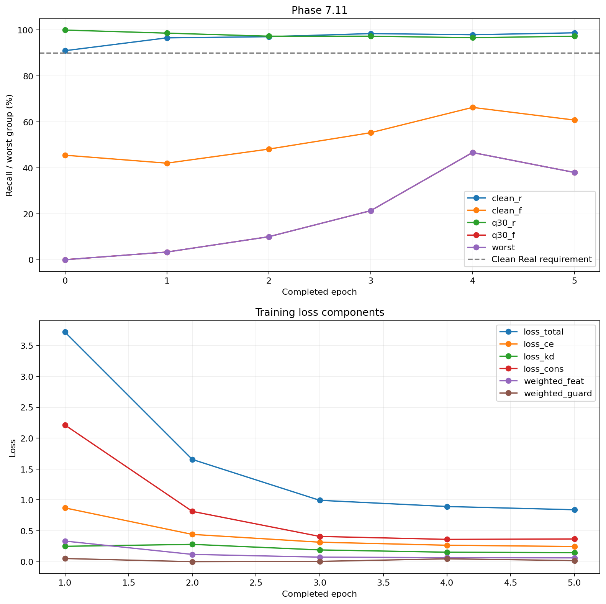

# BÁO CÁO KẾT QUẢ HUẤN LUYỆN: TASK 7.11

## Anchored Recovery v2 — run `anchored_v2_run1`

> **Ngày cập nhật**: 10/11/2026; phần log train bên dưới là hồ sơ gốc ngày 05/11.
> **Trạng thái**: `[~] Có log 5 epoch; source Anchored v2 sau đó được đóng gói/đo ở run corrected 09/11: G7.2 FAIL 6/8, G7.3 pending. Không đồng nghĩa toàn bộ DoD train đã đóng.`
> **Phạm vi**: Đối chiếu hiện vật đã lưu trong repo; không phải kết quả chạy lại huấn luyện hoặc nạp lại checkpoint trên Drive.

## 1. Nguồn bằng chứng và giới hạn xác minh

Cập nhật sau huấn luyện: package hiện hành nguồn `5cd49252…` là `24869052…`, xem [báo cáo 7.15](bao_cao_task_7.15_unified_packaging.md). Pilot preprocessing mới ngày 09/11 chọn P0 epoch 5 nhưng matched evaluation ngày 10/11 chỉ đạt 4/8 tiêu chí; không thay checkpoint/report hiện hành. [Báo cáo vòng cải thiện](bao_cao_phase7_improvement_round1_va_chan_doan_vong2.md) giữ riêng log mới có optimizer trace và log cũ có NaN; không suy ngược telemetry cũ hoặc coi pilot là huấn luyện lại chính run này.

Bộ hiện vật tại [`DATASET/logs/anchored_v2_run1/`](../../../DATASET/logs/anchored_v2_run1/) gồm 9 tệp:

- [`preflight_train.json`](../../../DATASET/logs/anchored_v2_run1/preflight_train.json): trạng thái kiểm tra trước train.
- [`train_benchmark_100steps.json`](../../../DATASET/logs/anchored_v2_run1/train_benchmark_100steps.json): benchmark GPU và fingerprints đầu vào.
- [`run_config.yaml`](../../../DATASET/logs/anchored_v2_run1/run_config.yaml): cấu hình runtime đã lưu.
- [`source_commit.txt`](../../../DATASET/logs/anchored_v2_run1/source_commit.txt): commit `7af186cb1b475425e241ad0360eb1fdfce567a6e`.
- [`train_history.csv`](../../../DATASET/logs/anchored_v2_run1/train_history.csv): 5 dòng epoch, 42 cột.
- [`val_groups.csv`](../../../DATASET/logs/anchored_v2_run1/val_groups.csv): validation epoch 0–5.
- [`m7_convergence.png`](../../../DATASET/logs/anchored_v2_run1/m7_convergence.png): biểu đồ hai panel.
- [`checkpoint_latest.pth.sha256`](../../../DATASET/logs/anchored_v2_run1/checkpoint_latest.pth.sha256): chuỗi checksum của latest; không kèm tệp `.pth` trong bộ hiện vật này.
- [`task_7.11_train_anchored_v2_colab.ipynb`](../../../DATASET/logs/anchored_v2_run1/task_7.11_train_anchored_v2_colab.ipynb): notebook có output chọn L4, resume và bảng validation. Output subprocess chi tiết của preflight/training không được lưu đầy đủ trong notebook.

Theo `run_config.yaml`, nơi backup là `/content/drive/MyDrive/Fatformer/checkpoint/phase7/anchored_v2_run1/`, tên best là `fatformer_anchored_v2_best.pth`. Bộ hiện vật train ngày 05/11 riêng lẻ chưa xác minh nội dung best/latest. Các run GPU corrected/matched sau đó ràng buộc source best SHA `5cd49252…`, canonical load và package verification; local vẫn không có file source để băm/forward lại. Sidecar checksum riêng lẻ không thay cho kiểm chứng checkpoint.

## 2. Cấu hình thực tế đã lưu

Manifest gồm **14.400 mẫu**, chia thành **12.240 train**, **1.080 val_calib**, **1.080 val_select**, theo preflight. Số mẫu dùng cho train là 12.240, không phải toàn bộ 14.400. Preflight ghi nhận ảnh staged khớp SHA256 và audit cách ly đạt trong phạm vi kiểm tra; không suy rộng thành bảo đảm không có mọi dạng rò rỉ dữ liệu.

Các giá trị dưới đây lấy từ `run_config.yaml` và log, không thay bằng siêu tham số của kế hoạch ban đầu:

| Thành phần | Giá trị đã lưu |
| :--- | :--- |
| Student khởi tạo / teacher | Cùng đường dẫn baseline `fatformer_4class_ckpt.pth` |
| Model | CLIP:ViT-L/14, 2 lớp, bật SRM và gating |
| Epoch / seed | 5 / 42 |
| Mini-batch / accumulation | 16 / 2; batch hiệu dụng danh định 32 |
| LR ban đầu | Nhóm mới `1e-4`; adapter cũ `1e-5`; `min_lr=1e-6` |
| AMP / gradient clipping | Bật AMP; `grad_clip_norm=1.0` |
| CE clean / CE degraded | `0.3` / `0.3` |
| KD / Consistency | `0.7` / `0.2` |
| Feature / Guard | `0.3` / `0.5` |
| Nhiệt độ loss / label smoothing | `2.0` / `0.05` |
| Degradation | `configs/degradation_v2.yaml`; preflight ghi `clean_prob=0.60` |
| Validation chọn checkpoint | `val_select`; tối đa 300 mẫu Q30 |
| Operating point validation | Threshold `0.9127`, temperature `1.6402`, từ calibration baseline |
| Điều kiện chọn best | Tối đa worst-group, với `clean_r >= 0.90` |

Công thức loss ứng với cấu hình này:

`L = 0.3 CE_clean + 0.3 CE_deg + 0.7 KD_raw + 0.2 Cons_raw + 0.3 Feat_raw + 0.5 Guard_raw`.

`loss_kd` và `loss_cons` trong CSV đã có trọng số; không nhân thêm lần nữa. `loss_feat` và `loss_guard` là giá trị chưa nhân trọng số; `weighted_feat` và `weighted_guard` là phần đóng góp vào tổng. Nhiệt độ loss 2.0 khác nhiệt độ calibration 1.6402.

Tài liệu tiền đề: [Task 7.7](../A/bao_cao_task_7.7_kho_du_lieu_v2.md), [Task 7.8](../A/bao_cao_task_7.8_degradation_v2.md), [Task 7.9](../B/bao_cao_task_7.9_loss_v2_realguard.md), [Task 7.10](../B/bao_cao_task_7.10_selection_metric_v2.md).

## 3. Preflight và benchmark

`preflight_train.json` ghi `ready_to_train=true`, 8/8 gate PASS:

- 14.400 ảnh staged giải mã được và khớp SHA256 manifest.
- Audit gắn với manifest và config dữ liệu gốc được ghi nhận đạt.
- Degradation v2 và calibration cố định hợp lệ theo công cụ kiểm tra.
- Loss tests: 26 passed; selection tests: 31 passed.
- Baseline canonical load: missing/unexpected = 0/0.
- Các split tách biệt theo path và SHA256.
- GPU: **NVIDIA L4, 21.66 GiB trống**.

Đây là kết quả kiểm tra trước train đã lưu, không phải xác minh checkpoint sau train. Các test trên không được chạy lại trong lần chỉnh báo cáo này.

Benchmark JSON ghi **NVIDIA RTX PRO 6000 Blackwell Server Edition**, 100 mini-batch sau 5 warmup steps, **162.04 ms/step**, peak allocated **18.23 GiB**, peak reserved **18.82 GiB**. Với 765 mini-batch/epoch, ước lượng là **2.07 phút/epoch**, **10.33 phút/5 epoch**; chưa gồm validation và backup.

Tên GPU của benchmark khác preflight/notebook. Notebook hiện lưu output `Resume detected: benchmark skipped and the original epoch horizon retained.` Bộ hiện vật chưa đủ để xác định đầy đủ GPU và thời điểm của từng phiên trước/sau resume. Vì vậy, không gán tốc độ benchmark Blackwell cho L4 hoặc khẳng định cả run dùng cùng một GPU.

Peak allocated 18.23 GiB không chứng minh 14 GiB trống là đủ tránh OOM. Mức 14 GiB chỉ là ngưỡng gate hiện có; chưa có bằng chứng cấu hình này chạy được trên T4 16 GB.

## 4. Kết quả validation và lựa chọn epoch

Nguồn: `val_groups.csv`. Mỗi epoch đánh giá **1.080 mẫu clean** và **300 mẫu Q30**. Q30 được ghi là `in_memory_jpeg30_post_resize`; đây là phép đo phục vụ selection, không thay benchmark Q30 độc lập. Các recall sử dụng cùng threshold 0.9127 và temperature 1.6402.

| Epoch | Clean Real (%) | Clean Fake (%) | Q30 Real (%) | Q30 Fake (%) | Worst-group (%) |
| :---: | ---: | ---: | ---: | ---: | ---: |
| 0 | 91.02 | 45.51 | 100.00 | 0.00 | 0.00 |
| 1 | 96.61 | 42.04 | 98.67 | 3.33 | 3.33 |
| 2 | 97.12 | 48.16 | 97.33 | 10.00 | 10.00 |
| 3 | 98.47 | 55.31 | 97.33 | 21.33 | 21.33 |
| **4** | **97.97** | **66.33** | **96.67** | **46.67** | **46.67** |
| 5 | 98.81 | 60.82 | 97.33 | 38.00 | 38.00 |

**Epoch 4 tốt nhất trong các epoch đã ghi theo luật worst-group kèm ràng buộc Clean Real.** Đây là cơ sở chọn epoch; việc tệp best chứa đúng trọng số epoch này vẫn cần nạp lại để xác minh.

So với epoch 0, epoch 4 tăng Clean Real **6.95 điểm phần trăm**, Clean Fake **20.82 điểm phần trăm**, Q30 Fake/worst-group **46.67 điểm phần trăm**; Q30 Real giảm **3.33 điểm phần trăm**. Kết quả cho thấy cải thiện trên validation ở operating point đã dùng, đồng thời vẫn còn bỏ sót **33.67% fake clean** và **53.33% fake Q30**.

Q30 Fake = 0% tại epoch 0 chỉ là recall bằng 0 tại ngưỡng này; không chứng minh mô hình không có khả năng xếp hạng hay AUC bằng 0. Clean Fake không tăng liên tục: giảm tại epoch 1 và epoch 5. Từ epoch 4 sang 5, worst-group giảm **8.67 điểm phần trăm** trong khi loss tổng tiếp tục giảm. Chưa đủ cơ sở gọi quá trình hội tụ ổn định hoặc kết luận nguyên nhân suy giảm là overfitting.

Các số trên dùng chính tập chọn checkpoint, chưa có CI hoặc kết quả nhiều seed trong bộ hiện vật. Chưa thể suy rộng sang CFE, 18 tập in-dist hay mọi họ bộ sinh; cũng chưa thể quy cải thiện cho riêng Guard, Feature hoặc Consistency khi chưa có ablation.

## 5. Loss, gradient và thời gian đã ghi

Nguồn: `train_history.csv`. Bảng dùng đúng tên trường; `loss_kd` và `loss_cons` đã có trọng số, `loss_feat` và `loss_guard` chưa có trọng số.

| Epoch | loss_total | loss_ce | loss_kd | loss_cons | loss_feat | loss_guard | grad_norm | time_sec |
| :---: | ---: | ---: | ---: | ---: | ---: | ---: | :---: | ---: |
| 1 | 3.7163 | 0.8705 | 0.2489 | 2.2118 | 1.1125 | 0.1025 | NaN | 130.54 |
| 2 | 1.6549 | 0.4417 | 0.2808 | 0.8143 | 0.3936 | 0.0000 | 16.4625 | 129.79 |
| 3 | 0.9934 | 0.3156 | 0.1904 | 0.4088 | 0.2459 | 0.0096 | 12.0754 | 130.40 |
| 4 | 0.8931 | 0.2661 | 0.1534 | 0.3611 | 0.2199 | 0.0933 | NaN | 129.93 |
| 5 | 0.8406 | 0.2459 | 0.1472 | 0.3680 | 0.2054 | 0.0358 | 14.3260 | 720.83 |

Loss tổng và các recall đã ghi đều hữu hạn. Tuy nhiên, **grad_norm là NaN tại epoch 1 và 4**, và benchmark cũng có `grad_norm: NaN`. Đây là dấu hiệu cần điều tra, không được bỏ qua khi đánh giá độ ổn định. Chưa có log GradScaler/optimizer-step đủ chi tiết để xác định nguyên nhân hoặc số lần cập nhật bị bỏ qua; không kết luận run hỏng hay hoàn toàn ổn định từ các giá trị trung bình này.

Theo [mã nguồn](../../../src/training/train_crossdomain.py), grad_norm được lấy từ `clip_grad_norm_`, là norm trước clipping. Các norm hữu hạn lớn hơn 1 không tự chứng minh clipping không hoạt động.

`guard_active_ratio=1.0` trong cả 5 epoch nghĩa là mỗi batch có mẫu Real để tính guard theo [cài đặt loss](../../../src/training/loss.py), không có nghĩa mọi batch đều có penalty dương. Epoch 2 có guard loss bằng 0. Chưa có đối chứng để kết luận Guard là nguyên nhân giữ được Clean Real.

Tổng `time_sec` là **1,241.50 giây = 20.69 phút**. Theo mã nguồn, mỗi giá trị đo từ đầu train epoch đến sau validation, trước thao tác lưu/backup checkpoint của epoch đó. Tổng này không phải toàn bộ thời gian phiên Colab; không gồm staging, preflight, benchmark, toàn bộ checkpoint I/O hoặc thời gian gián đoạn giữa phiên. Epoch 5 chậm hơn rõ rệt, chưa có bằng chứng xác định nguyên nhân. Không xác nhận khoảng giờ bắt đầu/kết thúc 19:48–20:07 từ các hiện vật hiện có.

Biểu đồ khớp CSV và có hai panel. Biểu đồ loss không hiển thị grad_norm nên không thể dùng nó để khẳng định không có NaN trong quá trình train.

## 6. Đối chiếu DoD và G7.2

Đối chiếu với [đặc tả Task 7.11](../../tasks/member_c_training_eval/phase_7/task_7.11_train_anchored_v2.md), giữ nguyên các yêu cầu chưa được chứng minh:

| Hạng mục | Bằng chứng hiện có | Trạng thái |
| :--- | :--- | :--- |
| Preflight 8 PASS | JSON ghi đầy đủ 8 gate PASS | Có bằng chứng đã lưu |
| Benchmark 100 steps | JSON đo Blackwell; khác GPU preflight/notebook | Có số đo; cần làm rõ lịch sử phiên |
| History và validation | 42 cột, 5 epoch train; validation epoch 0–5 | Có; còn NaN gradient cần điều tra |
| Biểu đồ hai panel | PNG tồn tại và khớp CSV | Có bằng chứng |
| Best/best-effort tồn tại | Config có tên/đường dẫn; CSV hỗ trợ chọn epoch 4; chưa trực tiếp kiểm tệp `.pth` | Chưa xác minh đầy đủ |
| Checkpoint cuối canonical 0/0, layout.n=3, dropped=[] | Chưa có kết quả nạp lại checkpoint sau train trong bộ hiện vật | Chưa đủ bằng chứng |
| Thời gian mỗi epoch và tổng | Tổng 20.69 phút train+validation được ghi; thiếu tổng wall-clock toàn phiên | Có trong phạm vi đã nêu |
| Quyết định đòn bẩy và số epoch | Log có 5 epoch, worst-group cải thiện; chưa có bằng chứng chạy đòn bẩy riêng | Log không cho thấy trì trệ theo ngưỡng theo dõi |
| Báo cáo | Có báo cáo này, ghi rõ kết quả và phần còn thiếu | Đã cập nhật; chưa đóng toàn bộ DoD |

**G7.2 chưa có kết luận đạt/trượt cho checkpoint v2 này.** Theo [kế hoạch Phase 7 §II.3](../../plan/ke_hoach_phase_7_dieu_chinh_toan_dien.md), gate còn cần CFE clean Fake@Real90 >=65%, AUC clean >=78%, AUC Q30 >=60%, CFE Q30 Fake@Real90 >=40%, macro ACC 18 tập >=90%, Real ACC 18 tập >=90%, worst-subset Fake ACC CFE >=45%, ECE <=0.08. Bộ hiện vật run này chưa có kết quả đáp ứng các phép đo đó.

Clean Fake 66.33% trên `val_select` ở ngưỡng baseline không thay cho CFE Fake@Real90. Clean Real 97.97% trên `val_select` cũng không thay cho Real ACC trên 18 tập test. Không suy diễn việc bảo toàn toàn miền clean từ một split validation.

## 7. Kết luận và phần cần bổ sung

Log ghi nhận run đến epoch 5. Epoch 4 tốt nhất theo tiêu chí validation đã định, cho thấy cải thiện so với epoch 0 ở Clean Real, Clean Fake và Q30 Fake, trong khi Q30 Real giảm nhẹ. Khả năng phát hiện fake Q30 vẫn còn hạn chế. Kết quả hiện tại chưa chứng minh G7.2 hoặc đóng góp riêng của từng thành phần loss.

Để nghiệm thu đầy đủ cần:

1. Nạp lại best/latest trên Drive; lưu SHA256 đối chiếu với tệp thực, metadata epoch, canonical missing/unexpected, layout và dropped keys. Đánh giá lại best để đối chiếu với epoch 4.
2. Điều tra grad_norm NaN bằng log gradient/GradScaler và optimizer updates; ghi nguyên nhân và ảnh hưởng đã xác minh. Nếu cần chạy lại, lưu thành run riêng, giữ nguyên hiện vật gốc.
3. Làm rõ lịch sử benchmark Blackwell và phiên resume L4; không dùng số đo của GPU này đại diện GPU khác.
4. Thực hiện [Task 7.12](../../tasks/member_c_training_eval/phase_7/task_7.12_ablation_mini_v2.md) theo thiết kế đối chứng, cùng ngân sách epoch và siêu tham số ngoài các loss cần ablate. Chưa quy công cho từng thành phần trước khi có kết quả.
5. Bổ sung phép đo G7.2 theo khế ước đánh giá, có calibration tách biệt và CI cho các chỉ số yêu cầu. [Task 7.14](../../tasks/member_c_training_eval/phase_7/task_7.14_locked_benchmark_phase7.md) là bước locked benchmark; không ghi như kết quả đã có của Task 7.11.

**Trạng thái bàn giao: có kết quả validation để tiếp tục kiểm chứng; nghiệm thu toàn bộ DoD và G7.2 còn mở.**
