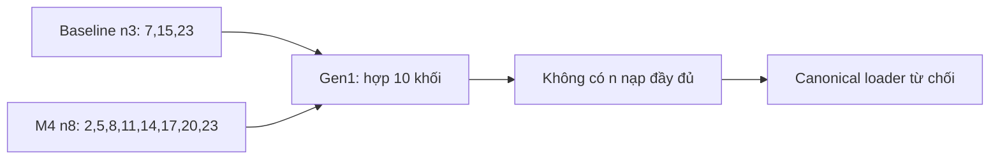

# Slide 1 — Vì sao phải kiểm tra lại cách đo? (45 giây)

Gen 1 có hợp 10 khối không biểu diễn được; không lấy ACC của partial load làm chất lượng model. Số Gen 1 cũ là `invalid_layout`, chỉ để tham khảo lịch sử.

Nguồn: [checkpoint_structure_audit.json](../../../DATASET/logs/phase7/wise_ft_sweep/checkpoint_structure_audit.json) `/checkpoints`. Hình là minh họa cấu trúc, không phải số đo chất lượng/CI.

---

# Slide 2 — Cách sửa và protocol (50 giây)

- Canonical final load: nạp đủ hoặc từ chối có tên; không im lặng ép layout.
- 400 CFE calibration tách 1.600 evaluation; train v2/val_calib 1.080 là nguồn khác.
- NLL có kiểm tra hội tụ; calibration và chấm dùng FP16/CUDA/batch 16. Latency đo riêng batch 1/8/16/32.
- Lưu logits, xác suất, nhãn, ID và hash; CI95 bootstrap 1.000 lần/seed 42.
- Router tắt, dùng fixed fallback; không có chiến thắng router held-out.

Nguồn: [JSON tổng hợp có nguồn/hash](../../../DATASET/logs/phase7/task_7.16/final_phase7_report.json), `/calibration`, `/environment`, `/source_reports`.

---

# Slide 3 — G7.0 và G7.1: sửa phép đo không tự bảo đảm quick win (50 giây)

G7.0: canonical core có bằng chứng, DoD legacy toàn repo còn pending. G7.1: **FAIL**, không có cấu hình đạt các mốc clean/Q30 đã định.

| Cấu hình 7.6 | Clean AUC % [CI95] | Clean Fake@Real90 % [CI95] | Q30 AUC % [CI95] |
| :--- | :--- | :--- | :--- |
| baseline | 76,20 [73,97; 78,49] | 44,25 [39,65; 48,93] | 42,33 [39,58; 44,99] |
| anchored | 79,25 [77,00; 81,43] | 38,38 [21,37; 51,22] | 45,66 [42,72; 48,36] |
| wise_ft_v2 | 81,78 [79,88; 83,74] | 48,88 [42,49; 55,20] | 43,67 [41,04; 46,24] |
| ensemble | 80,71 [78,51; 82,76] | 42,75 [38,24; 51,62] | 46,10 [43,14; 48,88] |

Gen 2 selected α=0,55, β=0,35; actual hash khớp metadata nhúng và matrix. Nguồn: [cfe_v3_baseline_matrix.json](../../../DATASET/logs/phase7/wise_ft_sweep/cfe_v3_baseline_matrix.json) `/results`; lưu ý key ngưỡng raw cũ được giải thích trong hồ sơ, không đổi raw.

---

# Slide 4 — G7.2: 6/8, tổng thể FAIL (65 giây)

| Tiêu chí G7.2 | Điểm % | Mốc % | CI95 nếu có trong nguồn | Kết quả |
| :--- | ---: | :--- | :--- | :--- |
| CFE_clean_Fake@Real90 | 64,12 | >=65.0% | [59,25; 69,77] | **FAIL** |
| CFE_clean_AUC | 88,66 | >=78.0% | [87,11; 90,16] | PASS |
| CFE_Q30_AUC | 79,88 | >=60.0% | [77,65; 82,07] | PASS |
| CFE_Q30_Fake@Real90 | 42,62 | >=40.0% | [37,87; 47,91] | PASS |
| InDist_Macro_ACC | 90,10 | >=90.0% | Chưa có CI riêng trong gate | PASS |
| InDist_Real_ACC | 90,41 | >=90.0% (cứng) | Chưa có CI riêng trong gate | PASS |
| Worst_Subset_Fake_ACC | 30,86 | >=45.0% | Chưa có CI riêng trong gate | **FAIL** |
| ECE_Post_Calibration | 5,08 | <=8,00 | Chưa có CI riêng trong gate | PASS |

Thiếu Clean Fake@Real90 **0,88 pp** và worst-subset Fake ACC **14,14 pp**. Không đổi gate theo kết quả. Nguồn: [JSON tổng hợp có nguồn/hash](../../../DATASET/logs/phase7/task_7.16/final_phase7_report.json) `/gates/G7.2`, `/cfe`.

---

# Slide 5 — Một package đã chạy; G7.3 vẫn pending (55 giây)

- Hash package `24869052…`; log đối chiếu1.200 tensor và 20 ảnh lấy từ calibration (10 real + 10 fake), sai số xác suất0. Đây là kiểm tra nhất quán đóng gói, không phải tập test chất lượng độc lập mới.
- L4/FP16: overhead batch 1 **0,188055 ms/ảnh**, p95 **2,481857 ms/ảnh**; tổng package **44,98 ms/ảnh**.
- 200 cặp đo sau 20 warmup, không gồm I/O/preprocessing; CI latency không được báo, p95 không phải CI.
- Chưa có best-reference cùng điều kiện trong 1,5 pp; do đó **không chốt G7.3 PASS**.

Nguồn: [JSON tổng hợp có nguồn/hash](../../../DATASET/logs/phase7/task_7.16/final_phase7_report.json) `/latency/batches/1`, `/real_image_verification`, `/gates/G7.3`. Weights ở Drive, local không có file mới để băm lại.

---

# Slide 6 — Hạn chế và việc tiếp theo (35 giây)

- CFE chỉ 1.600 evaluation/5 subset; post-hoc, không phải blind test. CI theo ảnh không bao hết phụ thuộc generator/dataset.
- FPR Q30 **8,625%** dù calibration 5%; in-dist macro chỉ vượt 90% khoảng 0,10 pp, mean-subset Real thấp hơn pooled.
- Một seed ablation; chưa chứng minh contribution loss hoặc router thắng; gradient telemetry còn NaN.
- Bổ sung reference phù hợp, thí nghiệm nhiều seed/test mới; đóng legacy và thu cross-review/chữ ký thật.

Kết luận: có kết quả thực nghiệm truy vết được, **không tuyên bố toàn Phase 7 PASS**. Nguồn: [chuong_5_ket_luan_va_han_che.md](chuong_5_ket_luan_va_han_che.md) §5.3–5.4; [JSON tổng hợp có nguồn/hash](../../../DATASET/logs/phase7/task_7.16/final_phase7_report.json).
