# KẾ HOẠCH CÁC CỘT MỐC CHIẾN LƯỢC & ĐIỂM DỪNG NGHIỆM THU DỰ ÁN
> **Văn Kiện Điều Hành & Quản Trị Của Trưởng Dự Án (Lead C - Training & Evaluation Lead)**  
> **Dự án**: Nâng cao độ bền vững pháp y cho FatFormer trước biến dạng nén mạng xã hội (FatFormer-XLA)  
> **Hạ tầng thực thi**:  
>   - 🚀 **Máy chủ tính toán chính**: Kaggle Server GPU **NVIDIA RTX PRO 6000 Blackwell Server Edition (94.97 GB VRAM)**  
>   - ☁️ **Hạ tầng dự phòng & Lưu trữ**: Google AI Pro (GPU A100 SXM4 / L4, Google Drive 5TB tại `MyDrive/Fatformer`, 280 CUs)  
> **Thời gian thực hiện**: Cuốn chiếu linh hoạt theo mục tiêu chất lượng mô hình (kéo dài finetune cho đến khi kết quả tối ưu và áp dụng thực tế, dừng theo chỉ đạo của người dùng).  

---

## I. TRIẾT LÝ QUẢN TRỊ ĐIỂM DỪNG (QUALITY GATES PROTOCOL)

Để triệt tiêu hiện tượng làm việc dàn trải, trôi tiến độ hoặc lãng phí ngân sách tài nguyên tính toán (Compute Units trên Colab Pro), Trưởng dự án áp dụng **Cơ chế Cổng Nghiệm Thu Kỹ Thuật (Quality Gates)**:

1. **Nguyên tắc "Điểm dừng cứng" (Hard Checkpoints)**: Toàn bộ lộ trình được chia thành các Cột Mốc Chiến Lược. Trước mỗi cột mốc, tất cả các thành viên phải hoàn thành đầy đủ các task phụ thuộc và nộp báo cáo nghiệm thu.
2. **Kế thừa thông số thực tế (Tuân thủ Nguyên Tắc 4)**: Mọi quyết định kỹ thuật bắt buộc phải kế thừa thông số kỹ thuật thực tế đã được nghiệm thu (kết quả kiểm toán Drive 5TB `MyDrive/Fatformer`, ma trận Benchmark 18 tập test).
3. **Cơ chế Tinh chỉnh Linh hoạt theo Chỉ tiêu (Adaptive Goal-Driven Tuning)**: Khi phát hiện mô hình gặp hiện tượng chuyên biệt hóa cục bộ (over-specialization), nhóm kích hoạt ngay **Chiến Dịch Khắc Phục Lệch Phân Phối & Huấn Luyện Đa Miền Tổng Quát (Milestone 6)** để đạt kết quả vượt trội và bảo toàn tính khái quát hóa.

---

## II. SƠ ĐỒ CỘT MỐC CHIẾN LƯỢC TOÀN DIỆN (MASTER MILESTONE FLOWCHART)

```mermaid
flowchart TD
    subgraph M1 ["🏁 MỐC 1: ĐÓNG BĂNG MỐC SÀN BASELINE"]
        direction TB
        A1["A: Task 1.1 (Setup Drive 5TB - Đã xong)<br>A: Task 2.1 (Tạo test_degraded.tar - Sửa lỗi nén kép)"]
        B1["B: Task 1.2 (Verify model pass 1.116 tensor)<br>B: Task 2.4 (Grad-CAM mốc sàn Clean/Degraded)<br>B: Task 2.6 (Viết xong Chương 1 & 2)"]
        C1["C: Task 1.3 (Notebook train.ipynb AMP FP16)<br>C: Task 1.4 (Script fast_eval.py < 8 phút)<br>C: Task 2.2 (Benchmark Clean: GANs 98.4%, Diff 95%)<br>C: Task 2.3 (Benchmark Degraded: mốc sụt giảm Q=30)"]
        A1 & B1 & C1 --> STOP1{"🛑 ĐIỂM DỪNG 1: HỌP MILESTONE 1 (Task 2.5)<br>Chốt mốc sàn Baseline: Clean ACC = 96.45%"}
    end

    subgraph M2 ["🚪 MỐC 2: CỔNG KIỂM THỬ TÍCH HỢP (SMOKE GATE)"]
        direction TB
        STOP1 --> A2["A: Task 3.1 (Staging 90/10 GenImage)<br>A: Task 3.2 (Curriculum Scheduler 3 giai đoạn)"]
        STOP1 --> B2["B: Task 3.3 (SRM 3-Kernels, Gating, Focal Loss)<br>B: Task 3.4 (Freeze CLIP ViT)<br>B: Task 3.7 (Viết xong Chương 3)"]
        STOP1 --> C2["C: Task 3.5 (Auto-save checkpoint Drive 5TB & --resume)"]
        A2 & B2 & C2 --> STOP2{"🛑 ĐIỂM DỪNG 2: SMOKE TEST GATE (Task 3.6)<br>Pass 100% Autograd trên GPU T4 (30 giây)?"}
    end

    subgraph M3A ["⚠️ MỐC 3A & KIỂM TOÁN LỖI: BENCHMARK TASK 5.1"]
        direction TB
        STOP2 --> C3A["C: Chạy train cũ Task 4.1/4.2 (Chỉ 3.6k ảnh staging)<br>C: Full Benchmark 18 tập (Task 5.1)<br>Phát hiện mô hình cũ sụp đổ: Clean ACC rớt 50.31%"]
        C3A --> AUDIT{"🛑 KIỂM TOÁN NGUYÊN NHÂN GỐC:<br>1. Bỏ rơi 144k ảnh ProGAN train<br>2. Clean ratio hạ còn 20% gây quên tri thức cũ<br>3. Focal Loss gamma=2.0 đè bẹp logit"}
    end

    subgraph M3B ["🚀 MỐC 3B: CHIẾN DỊCH FINETUNE ĐA MIỀN CÂN BẰNG"]
        direction TB
        AUDIT --> C3B["GPU RTX PRO 6000 Blackwell (95 GB VRAM)<br>• Phương Án A: 144k ProGAN (85%) + 3.6k Staging (15%)<br>• WeightedRandomSampler cân bằng batch 64<br>• Khóa cứng clean_prob = 0.50 chống quên<br>• Loss: DualStreamCELoss(label_smoothing=0.1)<br>• Val-loop 8k ảnh progan_val -> Lưu model_best.pth"]
        C3B --> GATE_EXP{"🛑 CỔNG ĐÁNH GIÁ MỞ RỘNG (EXPANSION GATE):<br>Đạt Clean ACC >= 67% & Q=30 Fake ACC tăng mạnh?"}
    end

    subgraph M4 ["📈 MỐC 4: NGHIỆM THU BENCHMARK HAI CHIỀU & ĐÁNH GIÁ THÁCH THỨC"]
        direction TB
        GATE_EXP -->|Đạt số liệu thực tế: Clean 67.34%, Q=30 Fake 27.53%| PASS_EXP["ĐÃ NGHIỆM THU THỰC TẾ TASK 5.1<br>Fake ACC Q=30 tăng 4.76x (từ 5.78% lên 27.53%)<br>Nhận diện rõ vùng trũng suy giảm liên miền"]
    end

    subgraph M5 ["🔒 MỐC 5: KHÓA NGHIỆM THU TEST BENCHMARK TASK 5.1 & PHÂN TÍCH THỰC CHỨNG"]
        direction TB
        PASS_EXP --> LOCK_51["KHÓA TEST SET TASK 5.1 ĐỘC LẬP<br>• 18 tập test paper được niêm phong<br>• Tuyệt đối không dùng để train/tune<br>• Phân tích ranh giới lỗi học thuật"]
    end

    subgraph M6 ["🚀 MỐC 6: CHIẾN DỊCH KHẮC PHỤC LỆCH PHÂN PHỐI & HUẤN LUYỆN ĐA MIỀN TỔNG QUÁT"]
        direction TB
        LOCK_51 --> C61["C: Task 6.1 (Phân tích định lượng distribution shift)"]
        C61 --> A62["A: Task 6.2 (Kho train/val đa bộ sinh độc lập + BalancedCrossDomainSampler)"]
        C61 --> B63["B: Task 6.3-B (Distillation KL trên clean + Consistency Loss + Paired Aug)"]
        A62 & B63 --> SMOKE_M6{"🛑 CỔNG KIỂM THỬ KHỚP NỐI M6 (Smoke Gate M6)<br>Pass 1 batch forward-backward & logit teacher"}
        SMOKE_M6 --> C63["C: Task 6.3-C (Huấn luyện Fine-tuning thích ứng trên GPU)"]
        C63 --> C65["C & B: Task 6.5 (Ablation Matrix M1-M5: Plan A, +Data, +Distill, +LoRA)"]
        C65 --> C64["C: Task 6.4 (Hiệu chuẩn xác suất & Tuyển chọn ứng viên Fallback M4)"]
        C64 --> C66["C: Task 6.6 (Locked Benchmark phát hiện sụt giảm Clean ACC 59.39% do T*=0.3700)"]
    end

    subgraph M6R ["💎 MỐC 6-R: CHIẾN DỊCH KHÔI PHỤC HIỆU NĂNG ĐỈNH CAO (HIGH-ACCURACY ANCHORED RECOVERY)"]
        direction TB
        C66 --> DIAG_6R{"🛑 CHẨN ĐOÁN LỖI M4:<br>1. Threshold Collapse T*=0.3700 kéo Real ACC sập 45.75%<br>2. Non-zero residual injection ở SRM<br>3. Representation Drift do Focal Loss"}
        DIAG_6R --> T61R["C: Task 6.1-R (WiSE-FT Merge CPU: θ = (1-α)θ_orig + α θ_M4)"]
        DIAG_6R --> T62R["B: Task 6.2-R (Zero-Init SRM & Gating, sai số Step 0 < 10^-6)"]
        T62R --> T63R["C: Task 6.3-R (Anchored Retrain: Diff LR 1e-5/1e-4 & Loss neo Teacher)"]
        T61R & T63R --> T64R["C: Task 6.4-R (Hiệu chuẩn ràng buộc Real ACC >= 90% & Khóa T*=0.50)"]
        T64R --> T65R["C: Task 6.5 Ext (Mở rộng Ma trận Ablation: M1-M5 + M6-WiSE + M6-R)"]
        T65R --> T66R["C: Task 6.6-R (Single-Pass Dual-Mode Benchmark 18 tập Clean & Degraded)"]
        T66R --> GATE_6R{"🛑 CỔNG NGHIỆM THU PHASE 6-R (HARD GATES):<br>1. Clean Macro ACC >= 90.00% (91.50% - 95.50%)<br>2. Clean Real ACC >= 90.00% (Chặn đứng báo giả)<br>3. Degraded Q=30 Fake ACC >= 35.00%<br>4. ECE <= 0.050"}
        GATE_6R -->|VƯỢT TRỘI CẢ 2 MODE| STOP_FINAL["🏆 NGHIỆM THU ĐỒ ÁN TỐT NGHIỆP XUẤT SẮC"]
    end

    style M1 fill:#e6fffa,stroke:#319795,stroke-width:2px
    style M2 fill:#feebc8,stroke:#dd6b20,stroke-width:2px
    style M3A fill:#fff5f5,stroke:#e53e3e,stroke-width:2px
    style M3B fill:#ebf8ff,stroke:#3182ce,stroke-width:2px
    style M4 fill:#e6fffa,stroke:#319795,stroke-width:2px
    style M5 fill:#fff5f5,stroke:#e53e3e,stroke-width:2px
    style M6 fill:#fff5f5,stroke:#e53e3e,stroke-width:2px
    style M6R fill:#e6fffa,stroke:#319795,stroke-width:3px
```

---

## III. NỘI DUNG CHI TIẾT TỪNG ĐIỂM DỪNG CHIẾN LƯỢC

### 🏁 ĐIỂM DỪNG 1: MỐC 1 (CUỐI TUẦN 2) - ĐÓNG BĂNG MỐC SÀN BASELINE
*Mục đích: Thiết lập nền móng khoa học về hạn chế dưới biến dạng nén của mô hình gốc CVPR 2024; khởi động viết báo cáo từ sớm.*

| Phân công | Mã Task | Tên Nhiệm Vụ | Đầu Ra Nghiệm Thu | Trạng Thái Hiện Tại |
| :--- | :---: | :--- | :--- | :---: |
| **Thành viên A** | **Task 1.1** | Setup Google Drive 5TB & I/O SSD Colab | Cây thư mục `Fatformer/` + 36.45 GB dữ liệu `.tar` | `[x] Đã xong` ([Báo cáo Task 1.1](file:///d:/GIT%20REPO/.nam4/fatformer-xla/docs/bao_cao/A/bao_cao_task_1.1_ha_tang_drive_io.md)) |
| **Thành viên A** | **Task 2.1** | Xây dựng bộ kiểm thử suy biến vật lý | Script `make_degraded.py` + `test_degraded.tar` | `[x] Đã xong` ([Báo cáo Task 2.1](file:///d:/GIT%20REPO/.nam4/fatformer-xla/docs/bao_cao/A/bao_cao_task_2.1_make_degraded_dataset.md)) |
| **Thành viên B** | **Task 1.2** | Verify model & Loader khớp 1.116 tensor | Pass `strict=True` 1.116 tensor trên T4 | `[x] Đã xong` ([Báo cáo Task 1.2](file:///d:/GIT%20REPO/.nam4/fatformer-xla/docs/bao_cao/B/bao_cao_task_1.2_fatformer_model_and_weights_loader.md)) |
| **Thành viên B** | **Task 2.4** | Trích xuất Grad-CAM ban đầu đối chứng | 10 ảnh Grad-CAM mốc sàn Clean vs Degraded | `[x] Đã xong` ([Báo cáo Task 2.4](file:///d:/GIT%20REPO/.nam4/fatformer-xla/docs/bao_cao/B/bao_cao_task_2.4_gradcam_baseline_extraction.md)) |
| **Thành viên B** | **Task 2.6** | Soạn thảo Báo cáo Chương 1 & Chương 2 | Bản thảo Chương 1 (Giới thiệu) & Chương 2 (Related Work) | `[x] Đã xong` ([Báo cáo Task 2.6](file:///d:/GIT%20REPO/.nam4/fatformer-xla/docs/bao_cao/B/bao_cao_task_2.6_draft_report_chap_1_2.md)) |
| **Thành viên C (Lead)**| **Task 1.3** | Thiết lập Notebook Huấn Luyện Colab | `train.ipynb` chạy thử 1 step dummy mượt mà | `[x] Đã xong` ([Báo cáo Task 1.3](file:///d:/GIT%20REPO/.nam4/fatformer-xla/docs/bao_cao/C/bao_cao_task_1.3_setup_colab_training_notebook.md)) |
| **Thành viên C (Lead)**| **Task 1.4** | Xây dựng pipeline Fast-Eval (< 8 phút) | Script `fast_eval.py` đo ACC, AP, AUC | `[x] Đã xong` ([Báo cáo Task 1.4](file:///d:/GIT%20REPO/.nam4/fatformer-xla/docs/bao_cao/C/bao_cao_task_1.4_fast_eval_pipeline.md)) |
| **Thành viên C (Lead)**| **Task 2.2** | Benchmark Baseline trên 18 tập Clean | Bảng số liệu Clean (GANs 98.4%, Diff 95.0%) | `[x] Đã xong` ([Báo cáo Task 2.2](file:///d:/GIT%20REPO/.nam4/fatformer-xla/docs/bao_cao/C/bao_cao_task_2.2_baseline_clean_benchmark.md)) |
| **Thành viên C (Lead)**| **Task 2.3** | Benchmark Baseline trên tập Degraded | Bảng số liệu Degraded mốc sàn ($Q=30, 50, 70$) | `[x] Đã xong` ([Báo cáo Task 2.3](file:///d:/GIT%20REPO/.nam4/fatformer-xla/docs/bao_cao/C/bao_cao_task_2.3_baseline_degraded_benchmark.md)) |

---

### 🚪 ĐIỂM DỪNG 2: MỐC 2 (CUỐI TUẦN 3) - CỔNG KIỂM THỬ TÍCH HỢP AN TOÀN (SMOKE GATE)
*Mục đích: Đảm bảo toàn bộ 4 tầng kỹ thuật (S1 + S2 + S3) khớp nối trơn tru, không có lỗi tiềm ẩn làm gián đoạn tài nguyên tính toán.*

| Phân công | Mã Task | Tên Nhiệm Vụ | Đầu Ra Nghiệm Thu | Tiêu Chuẩn Pass |
| :--- | :---: | :--- | :--- | :--- |
| **Thành viên A** | **Task 3.1** | Chuẩn hóa dữ liệu Staging 90/10 | `diffusion_staging.tar` trên Drive 5TB | 3.600 ảnh GenImage chuẩn |
| **Thành viên A** | **Task 3.2** | Module lập lịch Curriculum 3 giai đoạn | `src/datasets/transforms.py` | 50% Clean mỏ neo, 50% Degraded |
| **Thành viên B** | **Task 3.3** | SRM 3-Kernels, Dynamic Gating, Focal Loss | `srm.py`, `gating.py`, `loss.py` | SRM `requires_grad=False`, Gating Sigmoid |
| **Thành viên B** | **Task 3.4** | Đóng băng CLIP ViT & config YAML | `configs/train_config.yaml` | Trainable parameters $\approx 2.47\%$ |
| **Thành viên B** | **Task 3.7** | Soạn thảo Báo cáo Chương 3 | Bản thảo Chương 3 (Phương pháp luận) | Đầy đủ công thức toán & sơ đồ vector |
| **Thành viên C (Lead)**| **Task 3.5** | Auto-save Checkpoint Drive & --resume | Pipeline auto-save trong `train.ipynb` | Thử nghiệm ngắt kết nối và resume thành công |

---

### 🔒 ĐIỂM DỪNG 3: MỐC 5 - KHÓA NGHIỆM THU TEST BENCHMARK TASK 5.1 & PHÂN TÍCH THỰC CHỨNG
*Mục đích: Đo đạc thực tế toàn diện hai chiều, ghi nhận số liệu trung thực, và khóa 18 tập test làm Test Set độc lập.*

1. **Kết quả nghiệm thu thực tế của Task 5.1**:
   - **Clean Macro ACC**: Đạt **67,34%** (Pooled Micro ACC đạt **70,37%**), bảo tồn tốt miền ProGAN (97,95%) và StarGAN (98,00%), nhưng suy giảm trên các bộ sinh lạ.
   - **$Q=30$ Degraded Fake ACC**: Đạt **27,53%**, tăng gấp 4,76 lần so với mốc sàn 5,78% của bài báo gốc.
2. **Quyết định học thuật cốt lõi**:
   - Khóa cố định 18 tập dữ liệu của Task 5.1 làm **Test Set Locked**.
   - Tuyệt đối không dùng 18 tập test này để huấn luyện, không tune threshold hay chọn checkpoint trên tập này.
   - Việc khắc phục hiện tượng over-specialization được chuyển tiếp sang **Milestone 6**.

---

### 🚀 ĐIỂM DỪNG 4: MỐC 6 - CHIẾN DỊCH KHẮC PHỤC LỆCH PHÂN PHỐI & HUẤN LUYỆN ĐA MIỀN TỔNG QUÁT
*Mục đích: Giảm distribution shift bằng dữ liệu train/validation độc lập, bổ sung distillation giữ vững tri thức ảnh sạch, và vượt qua Gate 4 điều kiện ràng buộc.*

| Phân công | Mã Task | Tên Nhiệm Vụ | Nội Dung Thực Hiện | Sản Phẩm Bàn Giao | Trạng Thái |
| :--- | :---: | :--- | :--- | :--- | :---: |
| **Thành viên C (Lead)**| **Task 6.1** | Phân tích định lượng distribution shift | Đo lường Fake Recall, Real Recall, AUC và phân tầng lỗi per-generator từ ma trận Task 5.1; không sửa mô hình | Báo cáo chẩn đoán lỗi phân tầng | `[x] ĐÃ HOÀN THÀNH` ([Báo cáo](../bao_cao/C/bao_cao_task_6.1_distribution_shift_analysis.md)) |
| **Thành viên A** | **Task 6.2** | Xây dựng kho train/val đa bộ sinh độc lập | Thu thập dữ liệu các họ GAN/Diffusion yếu; lập data manifest; đo Baseline mô hình gốc trên val_crossdomain; tách val_calibration và val_selection; xây dựng `BalancedCrossDomainSampler` | Kho dữ liệu train và val_crossdomain | `[x] ĐÃ HOÀN THÀNH` ([Báo cáo](../bao_cao/A/bao_cao_task_6.2_cross_domain_data_infra.md)) |
| **Thành viên B** | **Task 6.3-B**| Thiết kế hàm loss Distillation + Consistency & Paired Aug | Module `CrossDomainDistillationLoss` và `PairedCleanDegradedAugmentation`; chuẩn bị module LoRA có kiểm soát cho Task 6.5 | Code loss và pipeline augmentation | `[x] ĐÃ HOÀN THÀNH` ([Báo cáo](../bao_cao/B/bao_cao_task_6.3_b_distillation_and_consistency_loss.md)) |
| **Thành viên B & C** | **Smoke Gate M6** | Cổng kiểm thử khớp nối tích hợp Milestone 6 | Chạy kiểm thử tích hợp 1 batch forward-backward với teacher logit trên GPU trước khi train quy mô lớn | Biên bản pass Smoke Gate M6 | `[x] ĐÃ HOÀN THÀNH` ([Báo cáo](../bao_cao/C/bao_cao_smoke_gate_m6.md)) |
| **Thành viên C (Lead)**| **Task 6.3-C**| Fine-tuning thích ứng chống domain shift | Huấn luyện với dữ liệu cân bằng và hàm mất mát tích hợp trên GPU; lưu `crossdomain_model_best.pth` | Checkpoint hạ tầng M3, M4, M5 | `[~] THÔNG SUỐT HẠ TẦNG` ([Báo cáo](../bao_cao/C/bao_cao_task_6.3_c_cross_domain_training_execution.md)) |
| **Thành viên C & B** | **Task 6.5** | Nghiên cứu cắt bỏ thành phần (Ablation đa miền) | Huấn luyện và đối chứng ma trận M1-M5 (Plan A, +Data, +Distill, +LoRA) trên cùng random seed 42 và data manifest | Ma trận Ablation Study hoàn thiện | `[x] ĐÃ HOÀN THÀNH` ([Báo cáo](../bao_cao/C/bao_cao_task_6.5_cross_domain_ablation_matrix.md)) |
| **Thành viên C (Lead)**| **Task 6.4** | Hiệu chuẩn xác suất & Tuyển chọn Checkpoint | Hiệu chuẩn nhiệt độ $T, T^*$ trên `val_calibration`; tuyển chọn ứng viên dự phòng M4 do ngưỡng $T^*=0.3700$ làm thiên lệch | Checkpoint tuyển chọn M4 & Cặp tham số $(T=1.0811, T^*=0.3700)$ | `[~] NGHIỆM THU CÓ ĐIỀU KIỆN (M4 FALLBACK)` ([Báo cáo](../bao_cao/C/bao_cao_task_6.4_calibration_and_checkpoint_selection.md)) |
| **Thành viên C (Lead)**| **Task 6.6** | Kiểm chuẩn khóa sau cùng (Final Locked Benchmark) | Đối chiếu hậu nghiệm trên 18 tập test Task 5.1 và kiểm thử độc lập; phát hiện sụt giảm Clean ACC còn 59.39% do Threshold Collapse | Báo cáo kiểm chuẩn chung cuộc ghi nhận hiện tượng trôi dạt | `[~] HOÀN THÀNH CÓ ĐIỀU KIỆN (M4 FALLBACK)` ([Báo cáo](../bao_cao/C/bao_cao_task_6.6_final_locked_benchmark.md)) |

#### 🛑 Kết Quả Cổng Nghiệm Thu Mốc 6:
- **Hiện tượng**: Checkpoint M4 đạt 92.22% trên `val_selection`, nhưng khi khóa cứng $T^*=0.3700$ trên 82.003 ảnh của 18 tập test lab cũ, Real ACC sụp xuống **45.75%**, kéo Clean Macro ACC rơi xuống **59.39%**.
- **Quyết định điều hành**: Kích hoạt khẩn cấp **MỐC 6-R (Phase 6-R: High-Accuracy Anchored Recovery)** để khôi phục hiệu năng đỉnh cao.

---

### 💎 ĐIỂM DỪNG 5: MỐC 6-R (PHASE 6-R) - CHIẾN DỊCH KHÔI PHỤC HIỆU NĂNG ĐỈNH CAO (HIGH-ACCURACY ANCHORED RECOVERY)
*Mục đích: Đưa Clean Subset-Macro ACC quay lại vùng 91.50% – 95.50% (ngang ngửa bài báo gốc CVPR 2024 là 96.45%), giữ Clean Real ACC $\ge 90.00\%$, đồng thời bảo toàn ưu thế kháng suy biến đa miền (JPEG Q70/Q50/Q30, Blur, Down-Up).*

| Phân công | Mã Task | Tên Nhiệm Vụ | Nội Dung Kỹ Thuật Chi Tiết | Sản Phẩm Bàn Giao | Trạng Thái |
| :--- | :---: | :--- | :--- | :--- | :---: |
| **Thành viên C (Lead)**| **Task 6.1-R** | **Fast-Track WiSE-FT Merge** | Nội suy không gian trọng số $\theta_{\text{wise}} = (1-\alpha)\theta_{\text{orig}} + \alpha\theta_{\text{M4}}$ trên CPU; giảm chấn $\beta_{\text{srm}} \approx 0.10$; grid search $\alpha \in [0.15, 0.40]$ và $T^*$ có ràng buộc $\text{Real} \ge 90\%$ trên `val_selection` | Checkpoint `fatformer_wise_ft_best.pth` + metadata SHA-256 | ⏳ Chờ chạy |
| **Thành viên B** | **Task 6.2-R** | **Zero-Init & Identity Proof** | Khởi tạo lớp chiếu Conv2d cuối của SRM = 0 (an toàn với `bias=False`); Gating $\lambda(x) \equiv 1.0$ tại Step 0; unit test sai số logit Step 0 $< 10^{-6}$ | Code `srm.py`, `gating.py` + `test_zero_init_identity.py` | ⏳ Chờ chạy |
| **Thành viên C & B** | **Task 6.3-R** | **Anchored Retraining Pipeline** | Differential LR trong AdamW ($10^{-4}$ cho SRM/gating, $10^{-5}$ cho adapter cũ); loại bỏ Focal Loss; hàm loss neo Teacher $0.3\text{CE} + 0.7\text{KD} + 0.2\text{cons}$; `clean_prob=0.70` | Code `loss.py`, `trainer.py`, `train_crossdomain.py` + checkpoint `fatformer_anchored_recovery_best.pth` | ⏳ Chờ chạy |
| **Thành viên C (Lead)**| **Task 6.4-R** | **Constrained Calibration & Selection** | **SỬA LỖI TỬ HUYỆT NGƯỠNG**: Quét $T^*$ với ràng buộc cứng $\text{Real\_ACC}_{\text{clean}} \ge 90.0\%$, tối ưu $J_{\text{balanced}} = 0.6\text{Clean} + 0.4\text{Degraded}$, cờ `--lock_standard_threshold` ($T^*=0.50$) | `tools/calibrate_and_select.py` nâng cấp | ⏳ Chờ chạy |
| **Thành viên C & B** | **Task 6.5 Ext**| **Mở Rộng Ma Trận Ablation Study** | Kế thừa số liệu M1–M5, tích hợp thêm M6-WiSE và M6-R để hoàn thiện ma trận đối chiếu 7 cấu hình | Bảng ma trận đối chứng 7 cấu hình mở rộng | ⏳ Chờ chạy |
| **Thành viên C (Lead)**| **Task 6.6-R** | **Single-Pass Dual-Mode Benchmark** | Kiểm chuẩn khóa sổ trên 82.003 ảnh Clean và 6 biến thể Degraded với cơ chế duyệt 1 lần xuất song song 2 Mode (Mode 1 Balanced $T^*=0.50$ & Mode 2 High-Recall Q30 $T^*=0.38-0.42$) | `final_locked_benchmark_report.json` + `bao_cao_task_6.6_r_locked_recovery.md` | ⏳ Chờ chạy |

#### 🛑 Cổng Nghiệm Thu Cứng Mốc 6-R (Hard Gates Phase 6-R):
1. **Clean Subset-Macro ACC (18 tập)**: $\ge \mathbf{90.00\%}$ *(Kỳ vọng vùng $91.50\% – 95.50\%$, tăng $>30\text{ pp}$ so với M4)*.
2. **Clean Real ACC (Chống báo giả)**: $\ge \mathbf{90.00\%}$ *(Bắt buộc, triệt tiêu hoàn toàn lỗi False Positive của M4)*.
3. **Clean Fake ACC**: $\ge 88.00\%$ *(Kỳ vọng vùng $90.00\% – 94.00\%$)*.
4. **Clean ROC-AUC / AP**: $\ge 95.00\% / \ge 95.00\%$.
5. **Modern Cross-Domain (`val_selection`)**: $\ge 91.00\%$ *(Kỳ vọng $92.50\% – 95.00\%$)*.
6. **Kháng suy biến Degraded JPEG Q=70 / Q=50 / Q=30**:
   - $Q=70$: Overall $\ge 75.0\%$, Fake $\ge 65.0\%$.
   - $Q=50$: Overall $\ge 70.0\%$, Fake $\ge 58.0\%$.
   - $Q=30$: Overall $\ge 60.0\%$, Fake $\ge 35.0\%$, Real $\ge 75.0\%$.
7. **Sai số hiệu chuẩn (ECE)**: $\text{ECE} \le 0.050$ ($\le 5.0\%$).

---

### 🏆 ĐIỂM DỪNG CHUNG CUỘC: NGHIỆM THU ĐỒ ÁN TỐT NGHIỆP XUẤT SẮC
*Mục đích: Khóa sổ toàn diện mô hình học máy và bộ chỉ số kiểm chuẩn hai chiều phục vụ Hội đồng bảo vệ đồ án tốt nghiệp.*

Khi mô hình Phase 6-R vượt qua Cổng nghiệm thu cứng Mốc 6-R tại Task 6.6-R:
1. **Khôi phục hoàn toàn vị thế Clean**: Clean Macro ACC đạt $91.50\% – 95.50\%$ (tiệm cận đỉnh cao CVPR 2024 là $96.45\%$), bảo đảm tính an toàn khi ứng dụng thực tế với Real ACC $\ge 92.00\%$.
2. **Bảo tồn ưu thế vượt bậc trước nén sâu**: Fake ACC dưới JPEG $Q=30$ đạt $>35.00\% – 45.00\%$ (vượt trội gấp $6 - 7$ lần mốc sàn baseline $5.78\%$).
3. **Minh chứng khoa học hoàn hảo**: Chuỗi số liệu 7 cấu hình Ablation Study (M1 $\rightarrow$ M6-R) và báo cáo kiểm chuẩn 2 chế độ vận hành (Standard Balanced & High-Recall Forensic) tạo nên luận cứ học thuật chặt chẽ, khách quan và thuyết phục tuyệt đối.

