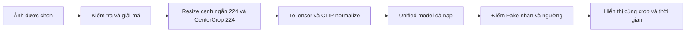

# Kế hoạch demo FatFormer XLA

Ngày lập: **14/11/2026**. Phạm vi: triển khai một demo nhỏ cho model đã chọn. Sau phản hồi của người dùng, yêu cầu gồm **hai cách chạy Windows và Colab GPU**, dùng chung ứng dụng **Gradio** và mở bằng trình duyệt. Người dùng đã cho phép bắt đầu triển khai. Source, hướng dẫn và bằng chứng thực thi được bàn giao tại [docs/demo](../demo/README.md); trạng thái nghiệm thu thực tế nằm trong [validation.md](../demo/validation.md).

## 1 Kết quả cần bàn giao

Người trình diễn khởi động bằng một lệnh, mở giao diện tiếng Việt, tải một ảnh lên và nhận kết quả từ đúng package hiện hành. Màn hình hiển thị ảnh đầu vào, crop 224×224 thực sự đưa vào model, nhãn dự đoán, điểm Fake sau calibration và thời gian xử lý. Có ảnh mẫu mang nhãn nguồn để chuẩn bị phần trình diễn, nhưng nhãn nguồn và dự đoán phải được phân biệt.

Demo có hai mức:

- **MVP bắt buộc:** phân tích một ảnh bằng model đã chọn, xử lý đầu vào lỗi, chạy ổn định trên môi trường đã kiểm chứng và có hướng dẫn khởi động.
- **Hai cách khởi động bắt buộc:** một lệnh cho Windows và một notebook cho Colab GPU. Dùng chung source inference/UI; mỗi môi trường có kết quả kiểm chứng riêng.
- **Bổ sung sau MVP:** so sánh cùng một ảnh ở clean và JPEG Q30 để minh họa đề tài robustness. Chỉ làm sau khi đường suy luận ảnh đơn đã được kiểm chứng.

Hoàn thành demo là hoàn thành giao diện và hợp đồng suy luận. Nó không thay G7.2 FAIL 6/8 hoặc G7.3 PENDING của nghiên cứu thành PASS.

## 2 Những gì đã xác nhận tại workspace

### 2.1 File người dùng vừa đưa về đã đúng

Đường dẫn được tìm thấy và băm lại trực tiếp:

```text
DATASET/checkpoints/phase7/demo/unified_fatformer_v2.pth
```

Kích thước: **1.972.728.367 byte**. SHA-256 thực tế khớp hoàn toàn [package reference Task 7.15](../../DATASET/logs/phase7/task_7.15/current/artifacts/package_reference.json):

```text
248690528f6e7ecadb06717fafbdb64ca5c101cb966ad3f06f8c00994c9245d0
```

Đã đọc payload bằng `torch.load(..., map_location="cpu", weights_only=True, mmap=True)` và xác nhận:

- Payload có `model` và `metadata`; `model` có 1.200 keys.
- Schema metadata: `unified_fatformer/v1`.
- Layout n=3, adapter ở block 7, 15, 23; `partial=false`.
- Source checkpoint SHA-256: `5cd49252ae94189734cee324f9543aa93f462028c879ac259cc16864b609bd3c`.
- Nhiệt độ **T=2,7832491397857666**.
- Ngưỡng **0,7918508648872375**.
- `router_enabled=false`.

**Giới hạn kiểm tra hiện tại:** đã xác minh bytes và metadata, chưa nạp canonical backbone và chưa forward model thật trong lượt lập kế hoạch. Các bước đó thuộc mốc M1 bên dưới.

File cũ cùng tên ở thư mục cha là file khác. Demo phải trỏ rõ vào thư mục `phase7/demo/`; khi thiếu file hoặc sai hash thì báo lỗi, không tìm một checkpoint khác để thay thế tự động.

### 2.2 Môi trường Python hiện tại

Đã kiểm tra trực tiếp:

- Windows; Python **3.14.0**, executable `C:\Python314\python.exe`.
- PyTorch **2.10.0+cpu**, torchvision **0.25.0+cpu**; hai thư viện import thành công.
- `torch.cuda.is_available()` trả **False**. Điều này mô tả môi trường PyTorch hiện tại, không khẳng định máy không có GPU vật lý.
- Có Pillow, NumPy, scikit-learn, PyYAML, regex và tqdm.
- Chưa có Gradio. Chưa có ftfy và pytorch_wavelets, nhưng source hiện có fallback tương ứng; không coi hai gói này là blocker trước khi thử đường inference thật.
- Chưa tìm thấy manifest dependency gốc để dùng trực tiếp cho demo.

Windows dùng CPU hiện tại để giảm thay đổi; Colab là đường GPU cần chuẩn bị và kiểm chứng riêng. Bộ Python/torch/CUDA của Colab phải được đọc ở runtime thực tế, không lấy cấu hình Windows hoặc run L4 lịch sử điền thay. UI, weights và calibration giữ chung hợp đồng.

### 2.3 Dữ liệu và code đã có thể dùng lại

- Loader: [load_unified_model](../../tools/infer_unified.py) dựng kiến trúc từ metadata và nạp canonical.
- Transform: `get_default_transform()` trong cùng file.
- Model output: [UnifiedFatFormerXLA](../../src/models/unified_fatformer.py) trả `prob_fake`, `label`, `w_deg`, `threshold`.
- Canonical loading: [canonical_loader.py](../../src/models/canonical_loader.py).
- Kiểm thử hiện có: [test_unified_packaging.py](../../tests/test_unified_packaging.py); các test dummy không thay forward model thật.
- Có 20 ảnh kiểm chứng gồm 10 Real và 10 Fake ở `DATASET/logs/phase7/task_7.15/current/raw/verification_images/`, với ID/nhãn/hash trong [verification_images.csv](../../DATASET/logs/phase7/task_7.15/current/analysis/verification_images.csv).
- Có ảnh minh họa khác trong `DATASET/image/`; chỉ gắn ground truth khi có nguồn xác nhận nhãn.

## 3 Chốt phương án triển khai

### Phương án chính

**Một ứng dụng Python/Gradio dùng chung, với hai profile Windows và Colab GPU.** Trên mỗi máy/runtime, model nạp một lần khi khởi động; mỗi yêu cầu dùng lại model đó. Xử lý tối đa một lượt inference đồng thời ở bản đầu. Người trình diễn chọn môi trường trước khi khởi động; không tạo hai frontend hoặc một nút trong trình duyệt có thể tự bật GPU Colab từ Windows.

Lý do chọn: tái sử dụng trực tiếp code PyTorch hiện hữu, ít thành phần vận hành và thuận tiện trình diễn ảnh. Gradio là dependency giao diện mới cần thêm ở giai đoạn triển khai; lượt lập kế hoạch này chưa cài đặt.

### Hai lựa chọn triển khai

1. **Windows CPU.** Khởi động bằng terminal, dùng CPU/FP32 và mở `http://127.0.0.1:7860`. Ưu điểm: môi trường đã biết, chủ động khi trình diễn, có thể dùng sau khi chuẩn bị offline. Hạn chế: tốc độ chưa được đo và cần đủ RAM. Độ phức tạp vận hành thấp sau khi môi trường được chuẩn bị. Hợp với ảnh đơn, demo trực tiếp tại máy.
2. **Colab GPU.** Mở notebook, chọn GPU, chuẩn bị source/package rồi chạy cùng ứng dụng trên CUDA/FP16 autocast. Ưu điểm: có thể xử lý nhanh hơn CPU, không cần cài GPU stack lên Windows. Hạn chế: phụ thuộc internet, GPU được cấp, VRAM và thời hạn phiên; cần quyền đọc model trên Drive. Có thêm công việc staging và kiểm chứng runtime. Hợp khi cần tốc độ hoặc máy Windows không đáp ứng trải nghiệm.

**Khuyến nghị vận hành:** hoàn thiện đường Windows trước để kiểm chứng phần dùng chung, sau đó nghiệm thu Colab GPU. Khi trình diễn, chọn Colab nếu có GPU/runtime ổn định; giữ Windows làm phương án chạy độc lập. Local CUDA chỉ là mở rộng nếu sau này có nhu cầu, chưa nằm trong hai cấu hình phải bàn giao.

Không xây frontend và API server riêng cho MVP. Phương án đó tăng số thành phần mà chưa giải quyết nhu cầu ảnh đơn hiện tại.

## 4 Phạm vi giao diện

### 4.1 Màn hình chính

Giao diện gồm:

- Tiêu đề “FatFormer XLA — Demo phát hiện ảnh tổng hợp”.
- Trạng thái model: sẵn sàng/đang nạp/lỗi, thiết bị và precision đang dùng.
- Nhãn môi trường **Windows CPU** hoặc **Colab GPU** lấy từ runtime thực tế; Colab chọn GPU nhưng không có CUDA thì dừng, không hiển thị nhãn GPU trong khi chạy CPU.
- Vùng chọn ảnh JPG/JPEG/PNG/WebP; hỗ trợ tải file từ máy.
- Nút **Phân tích** và **Xóa kết quả**.
- Ảnh gốc và preview crop 224×224.
- Nhãn **Dự đoán REAL** hoặc **Dự đoán FAKE**.
- Điểm Fake sau calibration, ngưỡng phân loại và thời gian xử lý.
- Khu vực ảnh mẫu, có nhãn nguồn hiển thị riêng nếu đã biết.
- Một dòng giải thích: “Kết quả là dự đoán của mô hình trên vùng crop được hiển thị.”

Model info chi tiết có thể thu gọn: hash rút gọn, source hash, T, threshold và router. Không đưa tất cả metadata kỹ thuật lên phần thao tác chính.

### 4.2 Ý nghĩa điểm số phải thể hiện đúng

- Gọi giá trị `prob_fake` là **điểm Fake sau calibration**; không diễn giải thành xác suất kết luận pháp lý hoặc độ chính xác của ảnh cụ thể.
- Nhãn lấy từ output `label` của unified model; không dùng ngưỡng 0,5 mặc định của component UI để phân loại lại.
- Không thêm slider sửa T/ngưỡng trong MVP.
- Preview cho biết model chỉ quan sát crop; không tạo ấn tượng đã phân tích mọi vùng của ảnh gốc.
- Không thêm nhãn “không chắc chắn” bằng một biên tự đặt. Nếu sau này cần vùng từ chối, phải định nghĩa và kiểm chứng riêng.

## 5 Hợp đồng suy luận



### 5.1 Khởi động

1. Resolve checkpoint từ đường dẫn đã cấu hình; dùng gốc repo thay vì phụ thuộc thư mục terminal hiện tại.
2. Kiểm SHA-256 một lần khi khởi động, trước khi load. Sai hash thì dừng và nêu rõ file đang dùng.
3. Dùng `load_unified_model`, `clip_path=""`, đọc calibration nhúng; không yêu cầu CLIP checkpoint rời.
4. Xác nhận layout, source hash, T/threshold và router từ metadata.
5. Đặt `eval()`, chọn device/precision theo cấu hình và ghi log khởi động.
6. Chỉ báo “sẵn sàng” sau khi nạp xong. Warm-up được ghi riêng; không tính vào latency ảnh của người dùng.

### 5.2 Nhận và xử lý ảnh

1. Kiểm file rỗng, định dạng, khả năng giải mã, kích thước byte/pixel. Giới hạn triển khai: **32 MiB/file, 25 triệu pixel**; tăng từ dự kiến 20 MiB do ảnh verification gốc lớn nhất 23.310.018 byte. Đây là giới hạn sản phẩm, không phải khả năng model đã đo.
2. Từ chối file lỗi, ảnh vượt giới hạn hoặc ảnh động không được hỗ trợ; không thay bằng ảnh xám/synthetic.
3. Chuyển sang RGB theo cùng quy tắc Pillow hiện có. Với alpha/EXIF, cần test và ghi rõ cách xử lý; không thêm bước xoay/composite riêng làm khác đầu vào canonical mà không đối chiếu.
4. Tái sử dụng transform resize short-side224 bicubic → center crop224 → tensor → CLIP normalize. Preview phải tương ứng chính xác với tensor dùng inference.
5. Chạy `torch.inference_mode()` với batch1.
6. Đọc dictionary model; không softmax lại `prob_fake` và không hiệu chuẩn lần thứ hai.
7. Trả kết quả kèm device/precision và timing thực tế.

### 5.3 Precision và đối chiếu

- CPU dùng FP32.
- CUDA nếu được chọn: backbone FP16 autocast, logits/softmax FP32, TF32 tắt, đối chiếu lại trước khi trình diễn.
- Benchmark nghiên cứu từng chạy L4/FP16/batch16. Không gán toàn bộ accuracy/latency đó cho CPU/FP32/batch1 của demo.
- Khi cùng backend/precision, UI và đường reference phải dùng cùng transform/model. Sai khác giữa CPU và kết quả GPU lịch sử cần được đo và ghi nhận, đặc biệt ở mẫu sát ngưỡng; không sửa threshold để che khác biệt.

### 5.4 Thời gian và bộ nhớ

Đo riêng thời gian nạp model, preprocess, inference và tổng xử lý backend. Không gộp thời gian chờ queue thành thời gian forward. CUDA cần synchronize trước/sau điểm đo. Tốc độ cập nhật trình duyệt chưa được đo end-to-end thì không gọi timing backend là latency end-to-end.

Đo cold start một lần; sau warm-up ghi ít nhất 20 lượt ảnh đơn để báo median/p95, cấu hình CPU/RAM/device/precision và bộ nhớ quan sát được. Đây là profile của demo trên máy chạy, không thay benchmark nghiên cứu. Chưa đặt SLA hoặc cam kết 44,98 ms/ảnh cho CPU.

## 6 Phần so sánh JPEG Q30 sau MVP

Thêm một chế độ **So sánh Clean / JPEG Q30** sau khi M3 đạt. Hai view phải xuất phát từ cùng một ảnh/crop và dùng chung model, T, threshold.

Protocol ưu tiên để đối chiếu nghiên cứu:

```text
RGB → resize/crop 224 → tách hai view
                       ├─ clean → normalize → model
                       └─ JPEG Q30 → normalize → model
```

Đối chiếu codec và thứ tự thực hiện với [StrictImageDataset/degrade](../../tools/phase7_corrected.py) của run current. Tránh import cả bộ evaluator nặng vào UI chỉ để dùng một thao tác JPEG; nếu cần, dùng đoạn PIL ngắn có đối chiếu bằng test. Không tự chọn default JPEG encoder khác rồi gọi là tái lập protocol.

Hiển thị hai crop, hai dự đoán, hai điểm Fake và thay đổi điểm. Ghi rõ đây là **nén trên crop**, không phải mô phỏng đầy đủ một mạng xã hội. Không đổi threshold theo view; không yêu cầu mọi ảnh phải giữ nhãn sau nén. Có thể trình diễn cả trường hợp thành công và trường hợp thất bại có nhãn nguồn.

Heatmap/Grad-CAM, grid16crop, video và định vị vùng giả không nằm trong bản đầu vì thêm forward/gradient và dễ khiến kết quả bị hiểu là localization đã được kiểm chứng.

## 7 Tệp dự kiến và giới hạn thay đổi

Tạo tối thiểu:

- **`demo.py`**: entry point, tải model một lần, callback phân tích và Gradio UI. Không tạo lớp service/factory riêng chỉ cho một nơi dùng.
- **`requirements-demo.txt`**: dependency cần thiết cho đường demo, phiên bản được chốt sau kiểm tra cài/import. Tránh freeze cả môi trường toàn cục hoặc cài lại bộ PyTorch CPU đang dùng được mà không có lý do.
- **`docs/demo/README.md`**: chuẩn bị môi trường, checkpoint/hash, cách chạy, ảnh mẫu, giới hạn và xử lý sự cố.
- **`notebooks/demo_fatformer_xla_colab.ipynb`**: notebook khởi động đường GPU, staging source/model và gọi cùng `demo.py`; không chép lại model hoặc callback inference vào notebook.
- **`tests/test_demo.py`**: kiểm thử các hành vi ranh giới có ý nghĩa; không lặp lại toàn bộ test loader hiện có.

Thêm manifest/log đo trong `logs/demo/` nếu chưa bị ignore thì bổ sung đúng phạm vi ignore cho output; không commit ảnh upload, weights hay dữ liệu cá nhân. Không có database ở MVP.

Chỉ chỉnh source inference chung nếu phát hiện lỗi thực sự cản đường demo, có test tái hiện và giải thích riêng. Không đụng code train, calibration, benchmark gốc hoặc hai báo cáo Word để hoàn thành demo.

## 8 Môi trường và cách chạy dự kiến

### 8.1 Chuẩn bị

Ưu tiên kiểm tra các import trong môi trường Python hiện tại rồi chỉ bổ sung Gradio và dependency thực sự thiếu. Khi cần môi trường tách riêng, dùng một venv dành cho demo; không nâng/hạ hàng loạt Python, torch hoặc torchvision trên máy. Nếu gặp vấn đề wheel tương thích Python3.14, ghi lỗi cụ thể rồi chọn môi trường được hỗ trợ; không đoán phiên bản cài đặt trước.

Chưa cài Gradio trong lượt lập kế hoạch. Phiên bản và kích thước dependency sẽ được xem xét trước bước cài ở giai đoạn triển khai theo quy tắc Lean Code.

### 8.2 Chạy trên Windows

CLI dưới đây là **thiết kế cho file `demo.py` sẽ tạo**, chưa phải lệnh đã có thể chạy ở repository:

```powershell
python demo.py --checkpoint DATASET/checkpoints/phase7/demo/unified_fatformer_v2.pth --device cpu
```

Host mặc định `127.0.0.1`, port mặc định7860, `share=False`; người dùng mở `http://127.0.0.1:7860`. Chỉ một model instance và tối đa một inference đồng thời, queue có giới hạn nhỏ để tránh nhiều yêu cầu làm cạn bộ nhớ. Tính năng queue được cung cấp sẵn bởi [Gradio](https://gradio.app/guides/queuing).

LAN/public link chỉ cấu hình nếu có nhu cầu riêng. Khi ấy phải xem lại host, truy cập và phạm vi file được phục vụ; không mặc định chia sẻ model, thư mục repo hoặc Drive ra ngoài.

### 8.3 Chạy trên Colab GPU

Notebook gồm ba cell chính, chia rõ để người dùng chạy lại từng bước:

1. **Chuẩn bị source và môi trường.** Xác nhận CUDA/GPU/VRAM, ghi Python/torch/torchvision. Đưa source bundle của đúng bản demo đã kiểm chứng vào `/content/fatformer_xla_demo`, kiểm manifest/hash, cài phần dependency thiếu. Ưu tiên giữ bộ torch CUDA có sẵn nếu tương thích. Bundle chứa source, `demo.py`, dependency manifest, tokenizer BPE và ảnh mẫu được phép dùng; không chứa weights 2GB hoặc toàn bộ dataset. Không chạy lại notebook benchmark/train để mở demo và không tự dùng GitHub HEAD khác source Windows.
2. **Đưa model vào ổ cục bộ runtime và kiểm chứng.** Mount Drive khi người dùng cho phép; đọc đúng file bên dưới, copy một lần từ Drive sang `/content/fatformer_xla_demo/DATASET/checkpoints/phase7/demo/unified_fatformer_v2.pth`. Băm bản đã copy và kiểm metadata/calibration. Chạy một ảnh smoke test trên CUDA trước khi mở UI. Không ghi đè hoặc đóng gói lại model trên Drive.
3. **Khởi động UI.** Gọi entry point dùng chung với device CUDA/FP16 autocast, batch1, TF32 tắt. Dùng cơ chế truy cập Gradio phù hợp Colab; khi dùng link chia sẻ tạm, bảo vệ bằng thông tin truy cập nhập lúc chạy và không ghi mật khẩu vào notebook đã lưu. Model chạy tại runtime Colab, trình duyệt chỉ là giao diện.

File model nguồn trên Drive:

```text
/content/drive/MyDrive/Fatformer/checkpoint/phase7/corrected_20261109_102954_3d28ad/unified_fatformer_v2.pth
```

Thiết kế CLI chung có thể nhận thêm `--device cuda` và tùy chọn chia sẻ cho profile Colab; cú pháp cuối cùng được ghi cùng notebook sau khi triển khai. Không dùng `--share` mặc định trên Windows và không hardcode thông tin truy cập vào lệnh.

Colab phải dừng với thông báo rõ khi chưa được cấp GPU, thiếu weights, sai hash hoặc batch1 không vừa VRAM. Không thay T/threshold, không chọn model khác và không âm thầm đổi sang CPU khi người dùng chọn profile GPU. Loại GPU/thời gian phiên không được giả định trước; kết quả đo phải gắn với runtime thực nhận.

Tắt/chạy lại phiên Colab có thể cần stage source/model lại và tạo link mới. Mount Drive chỉ dùng để lấy model; không cấu hình Gradio phục vụ thư mục Drive/checkpoint. Notebook đã lưu phải bỏ thông tin truy cập/link phiên cũ và tách output/log đo khỏi template.

### 8.4 Kiểm tra sau khi chuẩn bị xong

Windows: thử khởi động khi không có mạng; loader không được tải CLIP weights ngoài. Kiểm offline của inference và kiểm offline của UI là hai việc riêng; nếu Gradio/theme cố truy cập tài nguyên ngoài thì xử lý ở cấu hình UI. Colab: kiểm từ một runtime mới, lần chạy lại cell và kết nối trình duyệt tới phiên GPU. Dừng ứng dụng phải giải phóng tiến trình/model để có thể khởi động lại.

## 9 Các mốc thực hiện

### M0 Xác nhận đầu vào — đã làm một phần

- **Đã hoàn tất:** tìm đúng file mới, băm khớp package chuẩn, đọc metadata nhúng, xác nhận stack Python/PyTorch hiện tại và thiếu Gradio.
- **Đã xác nhận thêm:** người dùng yêu cầu có hai lựa chọn Windows và Colab GPU; cả hai là đầu ra phải chuẩn bị.
- **Còn kiểm tra:** tài nguyên thực tế và tốc độ Windows, runtime GPU được cấp khi chạy Colab; Q30 vẫn là phần sau MVP ảnh đơn.
- **Điều kiện qua mốc:** đúng package và hợp đồng hai môi trường được ghi rõ; không cần ép chọn duy nhất một môi trường trước khi triển khai phần chung.

### M1 Nạp model và forward thật trước giao diện

- Dùng loader canonical hiện hữu, CLIP path rỗng, không tải thêm weights.
- Thử một ảnh nguồn đã biết, xác nhận output hợp lệ/hữu hạn, đúng calibration và router tắt.
- Kiểm một tập nhỏ ảnh Real/Fake từ 20 ảnh verification, lưu kết quả FP32 thực tế.
- Đo cold load và bộ nhớ; không khởi tạo thêm một model cho mỗi ảnh.
- Thực hiện đường Windows CPU trước; sau đó chạy cùng ảnh smoke trên CUDA Colab với hợp đồng precision tương ứng.
- **Điều kiện qua mốc:** mỗi môi trường đã forward thật có log riêng; không missing/unexpected keys bị bỏ qua, không dummy result, không sửa threshold. Nếu chưa chạy Colab, giữ mục đó pending thay vì gọi hai môi trường đều đạt.
- **Ước lượng:** 0,5–1,5 giờ nếu import/loader không phát sinh lỗi; đây là dự toán, không phải thời gian đã đo.

### M2 Tạo giao diện ảnh đơn

- Viết một entry point Gradio, upload/preview/nút phân tích/kết quả.
- Hiển thị trạng thái tải model và lỗi thao tác bằng tiếng Việt.
- Trả nhãn từ model, điểm Fake và thời gian xử lý; hiển thị crop đúng.
- Không cache kết quả ảnh mẫu để thay inference thật trong phần trình diễn.
- **Điều kiện qua mốc:** ảnh do người dùng chọn chạy thật từ UI, một phiên model dùng lại được.
- **Ước lượng:** 1–2 giờ.

### M3 Kiểm thử chức năng và độ ổn định

- Thực hiện các kiểm tra ở mục10; xử lý lỗi phát hiện trong phạm vi demo.
- Đối chiếu UI với reference cùng backend/precision và profile ít nhất20 lượt.
- Kiểm upload liên tiếp, bấm lại, queue và khởi động lại.
- Kiểm lại các đường trên Windows và Colab GPU; so reference theo cùng backend của từng môi trường, báo khác biệt CPU/GPU riêng.
- **Điều kiện qua mốc:** không sai pipeline/nhãn do UI, không tải lại model liên tục, có số đo runtime thực tế của hai môi trường. Thiếu phiên GPU thì Colab chưa nghiệm thu.
- **Ước lượng:** 1–2 giờ cộng thời gian inference CPU thực tế.

### M4 Bổ sung Q30 — chỉ sau khi MVP ảnh đơn đạt

- Thêm clean/Q30 đúng thứ tự và codec đã kiểm chứng.
- Hiển thị hai view và kết quả riêng; log chế độ/quality/precision.
- **Điều kiện qua mốc:** clean view tương đương mode ảnh đơn; Q30 view khớp đường reference cùng protocol.
- **Ước lượng:** 0,5–1 giờ.

### M5 Bàn giao và tập trình diễn

- Chốt dependency đã cài/test, hướng dẫn một lệnh chạy và trường hợp lỗi phổ biến.
- Bàn giao notebook Colab cùng source bundle/manifest tương ứng bản Windows; chỉ rõ bước chọn GPU, mount Drive, lấy model, mở link và khởi động lại sau khi phiên kết thúc.
- Chuẩn bị bộ ảnh ví dụ với nguồn nhãn; ghi rõ ảnh dùng để minh họa, không dùng vài ảnh demo để tuyên bố accuracy mới.
- Chạy lại kịch bản trình diễn3–5 phút; kiểm sau restart và điều kiện offline mục tiêu.
- **Điều kiện qua mốc:** người dùng tự khởi động bằng cả lệnh Windows và notebook Colab; các phần chưa có run thực tế được đánh dấu rõ.
- **Ước lượng:** 0,5–1 giờ.

**Dự toán MVP ảnh đơn:** khoảng3–6,5 giờ kỹ thuật nếu môi trường không phát sinh lỗi, cộng thời gian xử lý model/kiểm thử. Q30 và các thay đổi môi trường lớn tính riêng. Chưa chốt lịch theo ngày hoặc SLA khi chưa chạy forward trên máy mục tiêu.

Phần notebook/staging/kiểm chứng Colab GPU dự kiến thêm **1–2 giờ kỹ thuật**, chưa tính chờ cấp GPU, tải/copy package và xử lý lỗi runtime. Tổng cho hai cách chạy dự kiến **4–8,5 giờ kỹ thuật** theo các giả định trên; không coi đây là lịch cam kết.

## 10 Kiểm thử và tiêu chí hoàn thành

### 10.1 Định danh và pipeline

- Đúng SHA package, layout, source hash, calibration và router.
- Không cần CLIP checkpoint rời; không fallback sang checkpoint ở thư mục cha.
- Transform UI và reference cho cùng tensor trên ảnh RGB chuẩn, ảnh dọc/ngang và ảnh nhỏ.
- Với cùng backend/precision, điểm Fake của UI và `model.predict` reference khớp trong tolerance xác định trước, ban đầu đề xuất `atol=1e-6`, `rtol=1e-5`; label giống nhau, threshold giữ nguyên. Nếu tolerance không đạt phải điều tra đường xử lý, không tự nới để cho qua.
- Nếu đối chiếu JSON của CLI hiện có, tính đến việc CLI làm tròn điểm bốn chữ số; không dùng JSON đã làm tròn làm reference full precision.

### 10.2 Đầu vào và UI

- Chưa chọn ảnh, file không phải ảnh, file bị cắt/hỏng, file quá lớn, ảnh RGBA/grayscale và ảnh dọc/ngang đều có hành vi được định nghĩa.
- Ảnh động/EXIF xử lý theo quy tắc đã thống nhất; không tự đổi geometry giữa preview và inference.
- Phân tích ảnh mới không để lại kết quả của ảnh trước khi có lỗi.
- Nút thao tác có nhãn rõ, trạng thái đang xử lý và thông báo lỗi đọc được; dùng bàn phím được cho các thao tác chính.
- Bấm liên tiếp không tạo nhiều model hoặc nhiều inference đồng thời ngoài giới hạn đã đặt.

### 10.3 Model thật và hiệu năng

- Thực hiện smoke test trên model thật, không chỉ test dummy.
- Chạy20 ảnh verification đã có nhãn nguồn, lưu dự đoán hiện tại. Có thể có dự đoán sai; đó là giới hạn model cần hiển thị trung thực, không phải tiêu chí ép mọi ảnh phải đúng.
- Đối chiếu CPU FP32 với GPU FP16 lịch sử chỉ là kiểm tra chuyển môi trường; không yêu cầu bit-exact hoặc tự gán accuracy benchmark lịch sử cho demo.
- Ghi cold start, p50/p95 backend, số lượt đo và RAM/VRAM quan sát được. Không nạp weights lại cho mỗi ảnh; không có tăng bộ nhớ không kiểm soát qua chuỗi chạy thử.
- Kiểm lần chạy thứ hai sau khi restart. Mọi lỗi hoặc phần chưa kiểm chứng được ghi cụ thể trong bàn giao.

### 10.4 Nghiệm thu riêng hai môi trường

- **Windows:** lệnh README chạy được trên máy mục tiêu, `127.0.0.1` truy cập được, CPU/FP32 được ghi đúng, nạp lại sau restart và kiểm offline theo phạm vi đã nêu.
- **Colab GPU:** notebook chạy trên một runtime mới, source/package khớp manifest/hash, CUDA thực sự được dùng, ảnh upload từ trình duyệt nhận được kết quả model thật và có log GPU/precision.
- **Tính nhất quán:** hai nơi dùng cùng package/source demo, preprocessing, T/threshold và router tắt. Không bắt buộc CPU/FP32 và CUDA/FP16 bit-exact; đối chiếu từng môi trường với reference cùng backend, ghi rõ chênh lệch giữa hai môi trường.
- Không lấy kiểm thử unit/Windows hoặc số đo L4 cũ thay bằng chứng đã chạy notebook demo mới trên Colab.

## 11 Kịch bản trình diễn đề xuất

1. **30 giây:** giới thiệu model và giới hạn crop; mở app đã nạp model.
2. **60 giây:** chọn một ảnh Real có nhãn nguồn, xem crop/điểm/nhãn và phân biệt nhãn nguồn với dự đoán.
3. **60 giây:** chọn một ảnh Fake có nhãn nguồn, giải thích cùng threshold cố định.
4. **60 giây nếu có Q30:** so sánh cùng ảnh clean/nén; nêu rõ kết quả thay đổi thực tế, kể cả khi model thất bại.
5. **30–60 giây:** thử ảnh tự chọn, kết luận demo là ứng dụng của package nghiên cứu; nhắc giới hạn ngoại miền và trạng thái nghiên cứu khi được hỏi.

Chuẩn bị tối thiểu vài ảnh mẫu đủ Real/Fake từ nguồn đã có; ưu tiên giữ cả một trường hợp model sai đã quan sát sau M1/M3 để phần thảo luận minh bạch. Không chọn lại threshold sau khi xem ảnh trình diễn.

## 12 Phần chưa chốt và thứ tự tiếp theo

Người dùng đã xác nhận cần cả **Windows và Colab GPU** và đã yêu cầu bắt đầu triển khai. Windows đã nạp model thật, kiểm chứng 20 ảnh clean/Q30 và chạy HTTP/upload với model sau restart. Giao diện chung, requirements, source bundle và notebook đã được tạo. Chi tiết số đo và giới hạn nghiệm thu tại [validation.md](../demo/validation.md).

Bước nghiệm thu còn lại là **chạy notebook trên Colab GPU mới** và kiểm giao diện trực quan bằng trình duyệt (công cụ UI của phiên Windows hiện tại không kết nối được). Không cần người dùng tải thêm model hay toàn bộ dataset cho Windows; Colab đọc chính package hiện có trên Drive. Chưa ghi M1/M3/M5 của Colab là hoàn tất khi chưa có log mới của runtime đó. App chưa được kiểm offline bằng cách tắt mạng hệ điều hành.

Theo yêu cầu bổ sung, demo đã có giải thích quyết định theo điểm/ngưỡng, tóm tắt thay đổi sau Q30 và tùy chọn bản đồ che 16 vùng trên crop gốc. Tính năng đo ảnh hưởng đến điểm Fake, chưa chứng minh vị trí giả mạo. Đã kiểm hai ảnh REAL/FAKE bằng model thật và upload HTTP trên CPU; xem [báo cáo bổ sung](../demo/validation.md). Tùy chọn mặc định tắt vì CPU mất thêm khoảng 30 giây/ảnh; giữ nguyên checkpoint, threshold và calibration.

Nguồn kế thừa chính:

- [Báo cáo đóng gói Task7.15](../bao_cao/C/bao_cao_task_7.15_unified_packaging.md).
- [Quyết định giữ incumbent](../bao_cao/sau_task_7_15/04_ket_luan_va_huong_tiep_theo.md).
- [Package reference](../../DATASET/logs/phase7/task_7.15/current/artifacts/package_reference.json) và [metadata chuẩn](../../DATASET/logs/phase7/task_7.15/current/artifacts/metadata.json).
- [Bằng chứng verification GPU trước đây](../../DATASET/logs/phase7/task_7.15/current/raw/real_image_verification.json); không gọi đây là forward local mới.
- [Loader và CLI hiện hành](../../tools/infer_unified.py), [model wrapper](../../src/models/unified_fatformer.py), [protocol corrected](../../tools/phase7_corrected.py).
- Gradio: [Blocks](https://gradio.app/docs/gradio/blocks), [queue và concurrency](https://gradio.app/guides/queuing), [hướng dẫn hiệu năng](https://gradio.app/guides/setting-up-a-demo-for-maximum-performance). Phiên bản cài đặt cụ thể sẽ được chốt khi triển khai.
