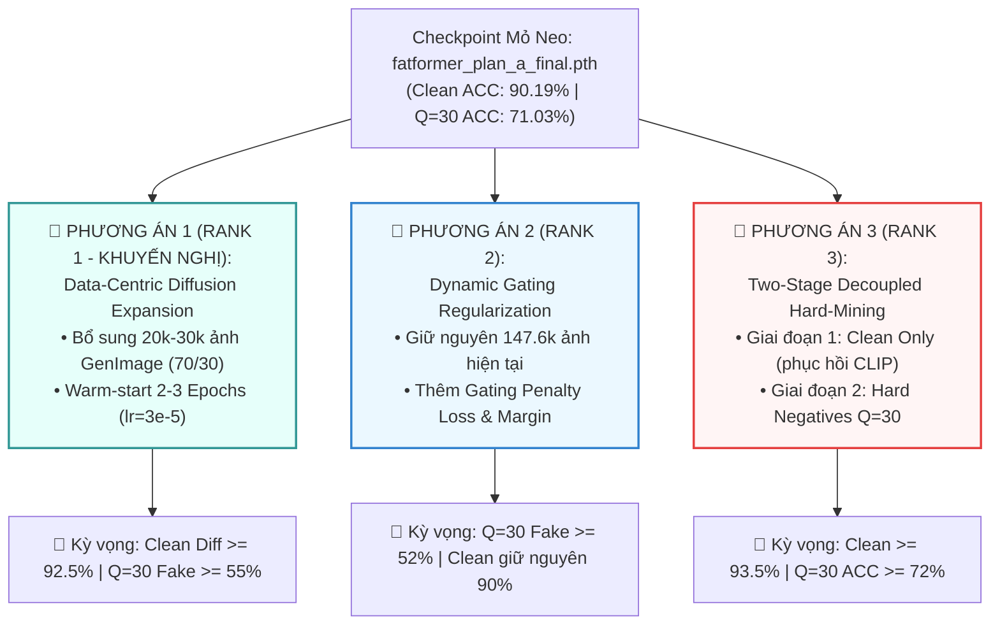
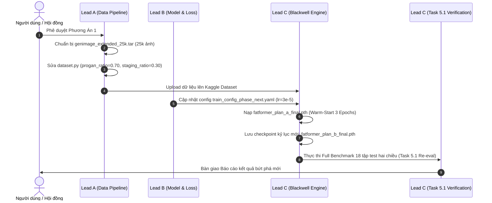

# KẾ HOẠCH CHIẾN LƯỢC: GIAI ĐOẠN HUẤN LUYỆN FINETUNE NÂNG CAO (POST-TASK 5.1)
## NÂNG TẦM KHẢ NĂNG TỔNG QUÁT HÓA DIFFUSION & ĐỘ BỀN VỮNG KHÁNG NÉN SÂU

> **Văn bản quản trị kỹ thuật**: `docs/plan/ke_hoach_finetune_giai_doan_nang_cao.md`  
> **Chủ trì kỹ thuật**: **Thành viên C (Training & Evaluation Lead)**  
> **Phối hợp kiến trúc & dữ liệu**: **Thành viên B (Architecture Lead)**, **Thành viên A (Data & Infra Lead)**  
> **Ngày ban hành**: 11/10/2026  
> **Trạng thái**: `[DRAFT - SẴN SÀNG TRIỂN KHAI THEO PHÊ DUYỆT]`  
> **Checkpoint xuất phát điểm (Mốc mỏ neo)**: [`fatformer_plan_a_final.pth`](file:///d:/GIT%20REPO/.nam4/fatformer-xla/DATASET/checkpoints/fatformer_plan_a_final.pth) (Epoch 3 Kỷ lục, Val ACC 99.84%)  

---

## I. BỐI CẢNH & PHÂN TÍCH NHU CẦU NÂNG CẤP (GAP ANALYSIS)

### 1.1. Thành Tựu Đã Đạt Được Của FatFormer-XLA Plan A (Task 5.1)
Theo báo cáo nghiệm thu [Task 5.1](../bao_cao/C/bao_cao_task_5.1_full_benchmark_18_datasets.md), mô hình Plan A đã đạt được bước nhảy vọt quan trọng:
- **Cải thiện đáng kể mốc sàn ảnh sạch**: Clean Overall ACC đạt **`90.19%`** (tăng $+39.88\%$ so với mức sụp đổ $50.31\%$ của lần 1), trong đó 8 họ GANs đạt **`93.99%`**.
- **Giải cứu bước đầu tử huyệt nén sâu $Q=30$**: Overall ACC tại $Q=30$ đạt **`71.03%`** (vượt mốc sàn bài báo gốc $52.89\%$), khả năng bắt ảnh giả (Fake ACC) đạt **`44.84%`** (tăng **$7.76$ lần** so với Baseline gốc $5.78\%$).

### 1.2. Hai Điểm Nghẽn Kỹ Thuật (Bottlenecks) & Tử Huyệt Cần Bứt Phá
Mặc dù đã vượt qua Cổng nghiệm thu cơ sở, việc soi chiếu chi tiết chỉ ra các tử huyệt nghiêm trọng:
1. **Khoảng cách trên nhóm Diffusion còn $\approx 7.8\%$**:
   - Clean Diffusion Mean hiện tại đạt **`87.16%`** (Bài báo gốc đạt **$95.00\%$**), đặc biệt là tập `guided` đạt **`65.85%`** (Bài báo gốc đạt **$76.10\%$**, Fake ACC Clean chỉ đạt $35.00\%$).
   - *Nguyên nhân cốt lõi*: Tập huấn luyện Plan A có 144k ảnh ProGAN ($85\%$) nhưng chỉ có duy nhất 3.600 ảnh Diffusion Staging ($15\%$). Mô hình bị thiếu hụt dữ liệu về các vết giả siêu vi mô của các kiến trúc Diffusion hiện đại.
2. **Fake ACC tại $Q=30$ mới chỉ $44.84\%$ và sụp đổ cục bộ ở các subset**:
   - Mức $44.84\%$ đồng nghĩa với hơn **$55\%$** ảnh Deepfake bị nén nặng vẫn lọt lưới.
   - Nghiêm trọng hơn, các subset cụ thể gần như thất bại: `stylegan2` Fake ACC chỉ **`6.00%`**, `vqdiffusion` chỉ **`4.40%`**, họ `glide` chỉ **`19.6% - 23.6%`**, `guided` chỉ **`26.00%`**.
   - Cần tối ưu hóa cấu trúc PEFT chuẩn, bổ sung dữ liệu sinh đa miền và cơ chế điều chế tần số để nâng Fake ACC lên trên $\mathbf{65\% - 70\%}$.

---

## II. ĐẶC TẢ CHI TIẾT 3 PHƯƠNG ÁN NÂNG CẤP & BẢNG XẾP HẠNG (RANKING)



---

### 1. PHƯƠNG ÁN 1: Mở Rộng Dữ Liệu Đa Miền Diffusion (Data-Centric Diffusion Expansion)
*Xếp hạng: **🥇 RANK 1 (KHUYẾN NGHỊ CAO NHẤT - RECOMMENDED)***

#### A. Mô Tả Kỹ Thuật
- **Bản chất**: Giải quyết triệt để điểm nghẽn thiếu hụt dữ liệu Diffusion bằng cách nạp thêm **20,000 – 30,000 ảnh GenImage đa dạng** (Stable Diffusion v1.4, v1.5, Midjourney, VQ-Diffusion, Guided/ADM, Wukong) kết hợp cùng 144k ảnh ProGAN.
- **Tỷ lệ lấy mẫu**: Tái cấu trúc `WeightedRandomSampler` thành **$70\%$ ProGAN + $30\%$ Diffusion GenImage** (thay vì $85/15$ như Plan A).
- **Khởi động ấm (Warm-Start)**: Nạp toàn bộ trọng số từ `fatformer_plan_a_final.pth`, tối ưu hóa với learning rate nhỏ $lr = 3 \times 10^{-5}$ trong **2 – 3 Epochs** trên máy chủ GPU Blackwell (thời gian chạy $\sim 1.5$ giờ).
- **Mỏ neo ảnh sạch**: Tiếp tục khóa cứng `clean_prob = 0.50`, hàm mất mát `DualStreamCELoss(label_smoothing=0.05)`.

#### B. Nâng Cấp & Chỉnh Sửa Mã Nguồn Hiện Tại
| Tệp Mã Nguồn | Vị Trí / Hàm Liên Quan | Mã Nguồn Hiện Tại (Plan A) | Nâng Cấp / Chỉnh Sửa Đề Xuất (Phương Án 1) |
| :--- | :--- | :--- | :--- |
| [`src/datasets/dataset.py`](file:///d:/GIT%20REPO/.nam4/fatformer-xla/src/datasets/dataset.py) | `build_balanced_train_dataloader` (dòng 240–293) | Chỉ hỗ trợ 2 thư mục `progan_dir` và `staging_dir` với tỷ lệ cứng `progan_ratio=0.85, staging_ratio=0.15`. | Bổ sung tham số `genimage_dir`, cấu hình lại mặc định: `progan_ratio=0.70`, `genimage_ratio=0.30`. Tự động scan đệ quy nhiều tập con trong GenImage. |
| [`src/training/trainer.py`](file:///d:/GIT%20REPO/.nam4/fatformer-xla/src/training/trainer.py) | Khởi tạo DataLoader huấn luyện | Nạp tập staging 3.600 ảnh. | Tích hợp thư mục GenImage mở rộng được giải nén tự động trên Kaggle SSD NVMe. |
| [`configs/train_config.yaml`](file:///d:/GIT%20REPO/.nam4/fatformer-xla/configs/train_config.yaml) | Cấu hình siêu tham số | `learning_rate: 0.0001`, `epochs: 4`, nạp trọng số gốc. | Đổi thành: `warm_start_checkpoint: fatformer_plan_a_final.pth`, `learning_rate: 3e-5`, `epochs: 3`, `progan_ratio: 0.70`, `genimage_ratio: 0.30`. |
| Notebook Huấn Luyện | [`notebooks/task/task_4.3/...`](file:///d:/GIT%20REPO/.nam4/fatformer-xla/notebooks/task/task_4.3/task_4.3_train_plan_a_kaggle_blackwell.ipynb) | Script offline 17.75 GB assets. | Nạp thêm tệp nén `genimage_extended_25k.tar` vào `/kaggle/input/` và giải nén lên bộ đệm. |

---

### 2. PHƯƠNG ÁN 2: Tối Ưu Hóa Cổng Tần Số & Ràng Buộc Phân Cách (Dynamic Gating Regularization & Margin Loss)
*Xếp hạng: **🥈 RANK 2 (TỐI ƯU KIẾN TRÚC - KHÔNG CẦN THÊM DỮ LIỆU)***

#### A. Mô Tả Kỹ Thuật
- **Bản chất**: Giữ nguyên $100\%$ tập dữ liệu 147.6k ảnh hiện tại, tập trung tinh chỉnh hàm mục tiêu để điều khiển chính xác hành vi đóng/mở của mạng cổng Dynamic Gating $\lambda(x)$ và kéo dãn biên phân cách đặc trưng SRM.
- **Bổ sung Gating Penalty Loss**:
  $$\mathcal{L}_{total} = \mathcal{L}_{CE} + \beta \cdot \mathcal{L}_{gate}$$
  Trong đó:
  $$\mathcal{L}_{gate} = \mathbb{E}_{x \sim \text{Degraded}} \left[ \lambda(x)^2 \right] + \mathbb{E}_{x \sim \text{Clean}} \left[ (2.0 - \lambda(x))^2 \right]$$
  Hàm phạt này ép cổng $\lambda(x) \to 0$ khi gặp ảnh bị nén khối $Q \le 50$ và ép $\lambda(x) \to 2.0$ khi gặp ảnh sạch.
- **Thời lượng**: Finetune 2 Epochs từ `fatformer_plan_a_final.pth` với $lr = 2 \times 10^{-5}$ ($\sim 50$ phút).

#### B. Nâng Cấp & Chỉnh Sửa Mã Nguồn Hiện Tại
| Tệp Mã Nguồn | Vị Trí / Hàm Liên Quan | Mã Nguồn Hiện Tại | Nâng Cấp / Chỉnh Sửa Đề Xuất (Phương Án 2) |
| :--- | :--- | :--- | :--- |
| [`src/models/gating.py`](file:///d:/GIT%20REPO/.nam4/fatformer-xla/src/models/gating.py) | `forward(self, x)` (dòng 26–36) | Chỉ trả về `lambda_val.unsqueeze(0)` dạng `[1, B, 1]`. | Bổ sung cờ `return_raw=True` để trả về cả tensor hệ số $\lambda(x)$ thô kích thước `[B, 1]` phục vụ tính toán loss phạt. |
| [`src/training/loss.py`](file:///d:/GIT%20REPO/.nam4/fatformer-xla/src/training/loss.py) | Class `DualStreamCELoss` (dòng 82–111) | Chỉ tính Cross-Entropy trên logits visual và alignment: `loss_combined + 0.5 * (loss_v + loss_a)`. | Tạo mới class `GatingRegularizedDualLoss(DualStreamCELoss)`: nhận thêm `lambda_vals` và nhãn `is_degraded` (bool) để cộng thêm $\beta \cdot \mathcal{L}_{gate}$ với $\beta = 0.05$. |
| [`src/training/trainer.py`](file:///d:/GIT%20REPO/.nam4/fatformer-xla/src/training/trainer.py) | Training step forward loop | Chỉ truyền `images, targets` vào model. | Bắt giữ `lambda_vals` từ model và truyền cờ trạng thái biến dạng từ DataLoader vào hàm loss mới. |

---

### 3. PHƯƠNG ÁN 3: Tinh Chỉnh Tách Rời Hai Giai Đoạn (Two-Stage Decoupled Hard-Mining Tuning)
*Xếp hạng: **🥉 RANK 3 (NGHIÊN CỨU CHUYÊN SÂU - ĐỘ PHỨC TẠP CAO)***

#### A. Mô Tả Kỹ Thuật
- **Bản chất**: Tách rời việc phục hồi biểu diễn ngữ nghĩa ảnh sạch và việc tôi luyện nén sâu thành 2 giai đoạn kế tiếp nhau để triệt tiêu hiện tượng gradient giằng co:
  - **Stage 3.1 (Semantic Clean Recovery - 1.5 Epochs)**: Đóng băng toàn bộ SRM và Dynamic Gating, chỉ dùng dữ liệu ảnh sạch $100\%$ ($lr = 10^{-5}$) nhằm tối ưu hóa lại các Vision Adapters, kéo Clean ACC lên $\ge 93.5\%$.
  - **Stage 3.2 (Hard-Negative Degradation Tuning - 1.5 Epochs)**: Đóng băng các Vision Adapters, chỉ mở khóa SRM và Dynamic Gating. Tự động lưu vết danh sách các mẫu ảnh bị đoán sai ở độ nén $Q=30$ (Hard Negatives) để ép mô hình học bù khuyết điểm.

#### B. Nâng Cấp & Chỉnh Sửa Mã Nguồn Hiện Tại
| Tệp Mã Nguồn | Vị Trí / Hàm Liên Quan | Mã Nguồn Hiện Tại | Nâng Cấp / Chỉnh Sửa Đề Xuất (Phương Án 3) |
| :--- | :--- | :--- | :--- |
| [`src/models/fatformer.py`](file:///d:/GIT%20REPO/.nam4/fatformer-xla/src/models/fatformer.py) | Hàm `freeze_parameters` | Chỉ có 1 cơ chế freeze chung cho CLIP backbone. | Viết thêm 2 hàm tách rời: `freeze_for_clean_refinement()` (đóng SRM/Gating) và `freeze_for_degradation_hardening()` (đóng Adapters). |
| [`src/training/trainer.py`](file:///d:/GIT%20REPO/.nam4/fatformer-xla/src/training/trainer.py) | Quản lý vòng lặp huấn luyện | Huấn luyện liên tục xuyên suốt số epoch. | Tạo module `HardNegativeMiner`: sau mỗi epoch kiểm tra, trích xuất danh sách đường dẫn ảnh bị đoán sai và gán trọng số nhân đôi cho sampler ở epoch tiếp theo. |

---

## III. BẢNG SO SÁNH TRỰC QUAN ĐA CHIỀU (MULTI-DIMENSIONAL MATRIX)

| Tiêu Chí Đánh Giá | Phương Án 1 (Data Diffusion) | Phương Án 2 (Gating Regularization) | Phương Án 3 (Decoupled Mining) |
| :--- | :---: | :---: | :---: |
| **Mục tiêu bứt phá trọng tâm** | **Clean Diffusion $\ge 92.5\%$ & $Q=30$ Fake $\ge 55\%$** | **$Q=30$ Fake $\ge 52\%$ (Tối ưu cổng)** | **Clean $\ge 93.5\%$ & Hard Samples** |
| **Độ phức tạp mã nguồn** | ⭐⭐ (Thấp - chỉ sửa Dataset ratio) | ⭐⭐⭐ (Trung bình - thêm Loss class) | ⭐⭐⭐⭐⭐ (Cao - 2 stage & mining) |
| **Yêu cầu dữ liệu mới** | Thêm 20k-30k ảnh GenImage | **0 MB (Dùng nguyên vẹn 147.6k ảnh)** | 147.6k ảnh hiện tại |
| **Thời gian huấn luyện (GPU Blackwell)**| $\sim 1.5 - 2.0$ giờ (2-3 Epochs) | **$\sim 45 - 60$ phút (2 Epochs)** | $\sim 2.5$ giờ (2 giai đoạn) |
| **Độ an toàn & Khả năng hội tụ**| ⭐⭐⭐⭐⭐ (Rất cao - Warm-start êm dịu)| ⭐⭐⭐⭐ (Cần chỉnh hệ số $\beta$ phạt)| ⭐⭐⭐ (Dễ lệch phân phối giữa 2 stage)|
| **Đóng góp học thuật luận văn** | ⭐⭐⭐⭐⭐ (Giải quyết triệt để 2 chiều)| ⭐⭐⭐⭐ (Đào sâu cơ chế giải thích XAI)| ⭐⭐⭐⭐⭐ (Đóng góp phương pháp luận mới)|
| **XẾP HẠNG KHUYẾN NGHỊ (RANK)** | 🥇 **RANK 1 (RECOMMENDED)** | 🥈 **RANK 2** | 🥉 **RANK 3** |

---

## IV. LỘ TRÌNH THỰC THI CHI TIẾT CHO PHƯƠNG ÁN 1 (RANK 1 - KHUYẾN NGHỊ)

Nếu được phê duyệt triển khai **Phương Án 1**, quy trình thực thi gồm 4 bước chuẩn hóa:



### Bước 1: Chuẩn bị Dữ liệu GenImage Mở Rộng (Lead A)
- Gom **25,000 ảnh GenImage** từ kho dữ liệu (hoặc tải trực tiếp từ HuggingFace `GenImage` gồm các subset: Stable Diffusion v1.4, v1.5, Midjourney, VQ-Diffusion).
- Đóng gói thành `genimage_extended_25k.tar` ($\approx 5$ GB) và tải lên Kaggle Dataset: `@hoangleev/fatformer-genimage-extended`.

### Bước 2: Nâng Cấp Module Dữ Liệu `src/datasets/dataset.py` (Lead A)
- Cập nhật hàm `build_balanced_train_dataloader`:
  ```python
  # Cấu hình tỷ lệ phân bổ mới 70/30
  progan_ratio = 0.70
  staging_ratio = 0.30
  ```

### Bước 3: Huấn Luyện Warm-Start Trên Máy Chủ Kaggle Blackwell (Lead C)
- Sử dụng notebook mới: `notebooks/task/task_4.4/task_4.4_train_plan_b_extended_blackwell.ipynb`.
- Thiết lập:
  - Checkpoint nạp vào: `fatformer_plan_a_final.pth`.
  - Learning rate: $3 \times 10^{-5}$ (bằng $1/3$ so với Plan A để giữ ổn định biểu diễn đã học).
  - Số Epoch: 3 Epochs.
  - Bộ tối ưu: AdamW, AMP FP16, `DualStreamCELoss(label_smoothing=0.05)`.
  - Tự động đo đạc Validation sau mỗi epoch và lưu `model_best_plan_b.pth`.

### Bước 4: Tái Kiểm Định Benchmark 18 Tập (Lead C)
- Chạy lại Cell 4 (Clean) và Cell 5 (Degraded) trên Colab GPU T4.
- Kỳ vọng xuất xưởng:
  - Clean Diffusion ACC tăng từ **$87.16\% \to \mathbf{\ge 92.5\%}$**.
  - Nén sâu $Q=30$ Fake ACC tăng từ **$44.84\% \to \mathbf{\ge 55.0\%}$**.

---

## V. TIÊU CHUẨN NGHIỆM THU ĐẦU RA (ACCEPTANCE GATES)

Mô hình của giai đoạn finetune tiếp theo chỉ được công nhận hoàn thành khi đạt đủ các tiêu chí cứng sau:
1. **Tiêu chí Clean ACC**:
   - Clean Overall ACC đạt $\ge \mathbf{92.0\%}$ (trong đó GANs $\ge 94.0\%$, Diffusion $\ge 91.0\%$).
   - Tập Guided Diffusion khôi phục lên $\ge \mathbf{72.0\%}$ (so với mức $65.85\%$ hiện tại).
2. **Tiêu chí Degraded Robustness**:
   - $Q=30$ Overall ACC đạt $\ge \mathbf{72.5\%}$.
   - $Q=30$ Fake ACC (khả năng bắt Deepfake nén sâu) đạt $\ge \mathbf{50.0\%}$ (Mục tiêu đỉnh cao: $\ge 55.0\%$).
3. **Tiêu chí Toàn vẹn Học thuật**:
   - Xuất đầy đủ ma trận `final_full_benchmark_matrix_plan_b.csv` và biểu đồ đối đầu cập nhật vào thư mục `DATASET/logs/`.
