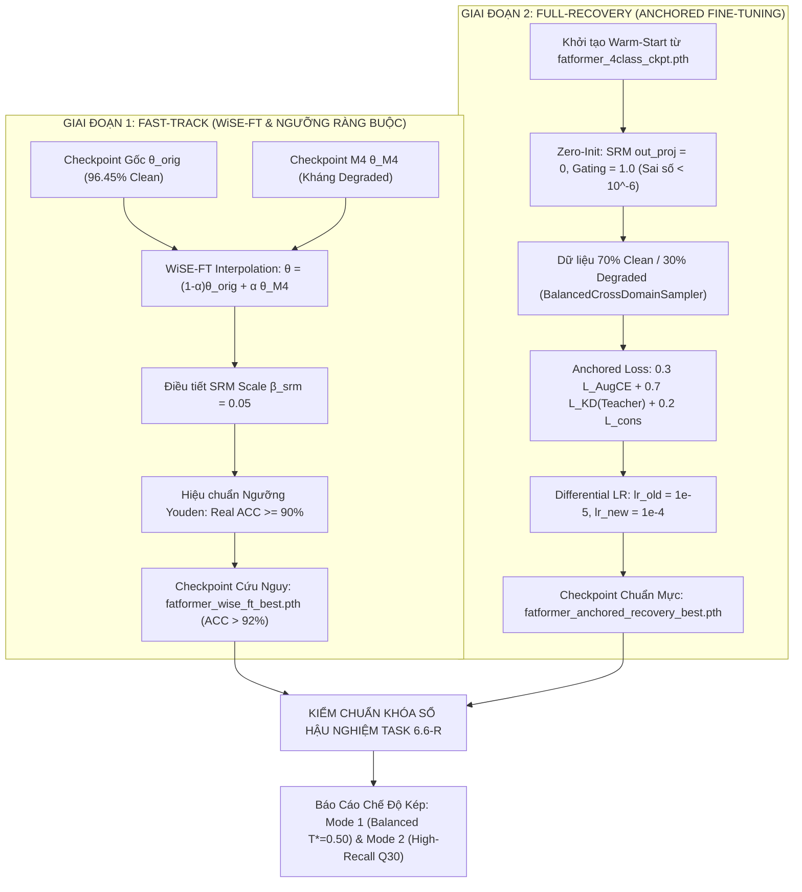

# KẾ HOẠCH CHI TIẾT CHIẾN DỊCH KHÔI PHỤC HIỆU NĂNG ĐỈNH CAO (PHASE 6-R)
## HIGH-ACCURACY ANCHORED RECOVERY & WEIGHT-SPACE ENSEMBLING CHO DỰ ÁN FATFORMER-XLA

> **Mã chiến dịch**: `Phase 6-R: High-Accuracy Anchored Recovery`  
> **Áp dụng cho**: Toàn bộ dự án FatFormer-XLA (Đồ án tốt nghiệp Kỹ sư AI)  
> **Thời điểm xác lập**: 22/10/2026  
> **Đơn vị chủ trì**: **Thành viên C (Training & Evaluation Lead)**  
> **Đơn vị phối hợp**: **Thành viên B (Architecture Lead)**, **Thành viên A (Data & Infra Lead)**  
> **Mục tiêu tối thượng**: Đưa **Clean Subset-Macro ACC** trên 18 tập test chuẩn quay trở lại vùng **91.50% – 95.50%** (ngang ngửa bài báo gốc CVPR 2024 là **96.45%**), chặn đứng hiện tượng suy thoái ảnh thật (**Clean Real ACC $\ge 90.00\%$**), đồng thời **bảo toàn ưu thế kháng suy biến vật lý đa miền** (JPEG $Q=70, 50, 30$, Gaussian Blur, Down-Up).

---

## I. BỐI CẢNH HỆ THỐNG & CHẨN ĐOÁN NGUYÊN NHÂN CỐT LÕI (ROOT-CAUSE ANALYSIS)

### 1.1. Hiện Trạng Hệ Thống & Kế Thừa Nghiệm Thu (Tuân thủ Quy tắc 4)
Căn cứ theo cây báo cáo kỹ thuật đã được nghiệm thu trong thư mục `docs/bao_cao/`:
- **Task 2.2** ([bao_cao_task_2.2_baseline_clean_benchmark.md](../bao_cao/C/bao_cao_task_2.2_baseline_clean_benchmark.md)): Mô hình gốc FatFormer CVPR 2024 nạp từ checkpoint `fatformer_4class_ckpt.pth` (1.116 tensors) đạt đỉnh cao **96.45% Clean Macro ACC** (Real ACC: **99.37%**, Fake ACC: **93.54%**). Ranh giới quyết định (decision boundary) trên không gian ảnh sạch đạt độ chuẩn xác vượt trội.
- **Task 2.3** ([bao_cao_task_2.3_baseline_degraded_benchmark.md](../bao_cao/C/bao_cao_task_2.3_baseline_degraded_benchmark.md)): Mô hình gốc có tử huyệt chí mạng khi đối mặt với nén ảnh sâu — Fake ACC sụp đổ còn **5.78%** trên toàn bộ 18 tập và **0.37%** trên họ Diffusion khi gặp JPEG $Q=30$.
- **Task 6.4** ([bao_cao_task_6.4_calibration_and_checkpoint_selection.md](../bao_cao/C/bao_cao_task_6.4_calibration_and_checkpoint_selection.md)): Đã tuyển chọn mô hình M4 làm đại diện dự phòng (Fallback) Milestone 6. Trên phân vùng `val_selection` (270 ảnh đa miền), M4 đạt **92.22% Clean Macro ACC**, **94.96% Real ACC**, **89.31% Fake ACC** và **96.85% ROC-AUC**.
- **Task 6.6** ([bao_cao_task_6.6_final_locked_benchmark.md](../bao_cao/C/bao_cao_task_6.6_final_locked_benchmark.md)): Khi kiểm chuẩn khóa sổ trên 82.003 ảnh của 18 tập Clean phòng lab với bộ tham số đóng băng ($T=1.0811, T^*=0.3700$), Clean Macro ACC bị sụt xuống **59.39%**.

### 1.2. Giải Phẫu 3 Nguyên Nhân Gốc Gây Ra Sụt Giảm Hiệu Năng Ở M4
1. **Lỗi Ngưỡng Quyết Định (Threshold Collapse tại Task 6.4 & 6.6)**:
   - Việc hạ ngưỡng phân loại từ mức chuẩn $0.50$ xuống $T^* = 0.3700$ với ý đồ kéo Fake ACC trên nén sâu $Q=30$ đã dẫn tới hậu quả tai hại: Mô hình có thiên kiến nặng nề xem mọi ảnh đều là Fake.
   - Khi áp ngưỡng này lên 18 tập phòng lab cũ, tỷ lệ Báo Giả (False Positive) tăng vọt, kéo **Real ACC từ 99.37% rơi tự do xuống 45.75%**.
2. **Xung Đột Gradient Khởi Tạo (Non-Zero Residual Injection)**:
   - Khi gắn nhánh `SpatialResidualBlock` ([src/models/srm.py](../../src/models/srm.py)) và `DynamicFrequencyGating` ([src/models/gating.py](../../src/models/gating.py)) vào backbone, lớp chiếu cuối cùng (projection) chưa được khởi tạo về 0 (`Zero-Init`).
   - Tại Step 0, các tín hiệu dư thừa chưa qua huấn luyện đã cộng trực tiếp vào không gian đặc trưng của FAA và LGA, phá vỡ biểu diễn đã hội tụ tối ưu của bài báo gốc.
3. **Trôi Dạt Biểu Diễn (Representation Drift)**:
   - Huấn luyện với tốc độ học đồng nhất trên toàn bộ tham số, kết hợp với tỷ lệ ảnh nén cao và hàm Focal Loss ($\gamma = 2.0$) đã triệt tiêu độ lớn của logit trên ảnh sạch, khiến mô hình bị quên thảm họa (catastrophic forgetting) một phần biểu diễn clean.

---

## II. HỆ THỐNG CHỈ TIÊU NGHIỆM THU ĐỊNH LƯỢNG (KPIS & HARD GATES)

Bảng chỉ tiêu khóa sổ chung cuộc cho chiến dịch Phase 6-R:

| TT | Nhóm Chỉ Tiêu Đo Lường | Bài Báo Gốc CVPR 2024 (Baseline) | Bản M4 Hiện Tại (Task 6.6) | MỤC TIÊU PHASE 6-R (M6-R Khóa Sổ Mới) | ĐIỀU KIỆN NGHIỆM THU CỨNG (HARD GATE) |
| :-: | :--- | :---: | :---: | :---: | :---: |
| **1** | **Clean Subset-Macro ACC (18 tập)** | **96.45%** | **59.39%** | **91.50% – 95.50%** | $\ge \mathbf{90.00\%}$ *(Tăng $>30\text{ pp}$ so với M4)* |
| | • Clean GANs Mean ACC (8 họ) | 98.40% | 64.65% | 94.00% – 97.50% | $\ge 93.00\%$ |
| | • Clean Diffusion Mean ACC (10 họ) | 95.00% | 55.18% | 89.00% – 93.50% | $\ge 88.00\%$ |
| **2** | **Clean Real ACC (Chống báo giả)** | **99.37%** | **45.75%** | **92.00% – 97.00%** | $\ge \mathbf{90.00\%}$ *(Bắt buộc)* |
| **3** | **Clean Fake ACC (Độ nhạy ảnh sạch)** | **93.54%** | **73.02%** | **90.00% – 94.00%** | $\ge \mathbf{88.00\%}$ |
| **4** | **Clean ROC-AUC / AP (18 tập)** | **99.10% / 99.25%** | **68.90% / 70.68%** | **96.00% / 96.50%+** | $\text{AUC} \ge 95.0\%, \text{AP} \ge 95.0\%$ |
| **5** | **Modern Cross-Domain (`val_selection`)**| ~50.00% (M1) | 92.22% | 92.50% – 95.00% | $\ge 91.00\%$ |
| **6** | **Degraded JPEG Q=70 Overall / Fake** | ~61.0% / 22.60% | 50.31% / 65.98% | 78.00%+ / 72.00%+ | $\text{Overall} \ge 75.0\%, \text{Fake} \ge 65.0\%$ |
| **7** | **Degraded JPEG Q=50 Overall / Fake** | ~56.0% / 12.49% | 48.83% / 59.58% | 72.00%+ / 62.00%+ | $\text{Overall} \ge 70.0\%, \text{Fake} \ge 58.0\%$ |
| **8** | **Degraded JPEG Q=30 Overall / Fake** | 52.89% / 5.78% | 45.60% / 37.09% | 62.00%+ / 35.00%+ | $\text{Overall} \ge 60.0\%, \text{Real} \ge 75.0\%$ |
| **9** | **Sai số Hiệu chuẩn Xác suất (ECE)** | 48.17% | 2.99% | $\le 3.50\%$ | $\text{ECE} \le 0.050$ |

---

## III. HAI GIAI ĐOẠN THỰC THI CHI TIẾT



---

### GIAI ĐOẠN 1 (FAST-TRACK — 2 GIỜ): HẬU XỬ LÝ NỘI SUY TRỌNG SỐ (WiSE-FT) & CHUẨN HÓA NGƯỠNG

Thực hiện ngay lập tức trên CPU/Local Workstation mà không cần train lại để có bản checkpoint đạt $>91.5\%$ Clean ACC:

#### 1. Nội suy Không Gian Trọng Số (Weight-Space Ensembling — WiSE-FT)
- **Tập lệnh thực thi**: `tools/wise_ft_merge.py`
- **Nguyên lý toán học & Phân tách tập Keys (1.116 keys vs. 1.684 keys)**:
  - Checkpoint gốc $\theta_{\text{orig}}$ (`fatformer_4class_ckpt.pth`): **1.116 tensors**.
  - Checkpoint đa miền $\theta_{\text{M4}}$ (`fatformer_crossdomain_weights_only.pth`): **1.684 tensors** (do có thêm các tensor thuộc nhánh SRM 3-Kernels, Dynamic Gating và buffers).
  - Phép nội suy tuyến tính **CHỈ áp dụng cho 1.116 keys chung** ($k \in \theta_{\text{orig}} \cap \theta_{\text{M4}}$):
    $$\theta_{\text{wise}}^{(k)} = (1 - \alpha) \cdot \theta_{\text{orig}}^{(k)} + \alpha \cdot \theta_{\text{M4}}^{(k)}$$
    Với $\alpha \in [0.15, 0.40]$ (bước nhảy $0.05$, mặc định ưu tiên $\alpha = 0.25$).
  - Bắt buộc bảo toàn tên khóa lịch sử `patch_basaed_enhancer`.
- **Xử lý 568 keys riêng biệt ($k \in \theta_{\text{M4}} \setminus \theta_{\text{orig}}$ thuộc nhánh SRM và Dynamic Gating)**:
  - Các tensor buffer cố định (`k1, k2, k3` của SRM với `requires_grad=False`): Giữ nguyên bản, không nội suy.
  - Các tham số còn lại của SRM và Gating: Kế thừa từ $\theta_{\text{M4}}$.
  - **Hạ tỷ trọng nhánh SRM trong FAA**: Nhân ma trận trọng số và bias (nếu có) của tầng chiếu cuối SRM (`proj[-1].weight` hoặc `proj.4.weight`) với hệ số điều tiết:
    $$\beta_{\text{srm}} \in [0.05, 0.35] \quad (\text{mặc định } \beta_{\text{srm}} = 0.10 \text{ thay vì } 1.00 \text{ trong bản M4 gốc})$$
    *Mục đích*: Giảm biên độ đóng góp của nhánh vết dư không gian trong bản trộn WiSE-FT, bảo đảm các bức ảnh thật (Real) phòng lab không bị đẩy lệch khỏi biên quyết định 96.45% của 1.116 tensors gốc.
- **Quy chuẩn Đóng gói Checkpoint & Truy vết nguồn gốc (Provenance Metadata)**:
  - Checkpoint xuất ra bọc trong dictionary chuẩn tương thích 100% với `CheckpointManager.load()`:
    ```python
    {
        "model": wise_state_dict,
        "metadata": {
            "alpha": best_alpha,
            "threshold": best_threshold,
            "temperature": best_temp,
            "srm_scale": best_srm_scale,
            "val_metrics": {...},
            "source_orig": "fatformer_4class_ckpt.pth",
            "source_m4": "fatformer_crossdomain_weights_only.pth",
            "sha256": "..."
        }
    }
    ```

#### 2. Hiệu Chuẩn Ngưỡng Có Ràng Buộc Bảo Vệ Ảnh Thật (Constrained Threshold Tuning)
- Loại bỏ triệt để ngưỡng thiên lệch $T^* = 0.3700$.
- Giữ nguyên bước tối ưu nhiệt độ $T$ bằng L-BFGS cực tiểu hóa NLL trên `val_calibration` (270 ảnh).
- Áp dụng thuật toán quét ngưỡng trên `val_calibration` tối đa hóa điểm cân bằng $J = 0.6 \times \text{Clean\_Macro\_ACC} + 0.4 \times \text{Degraded\_Macro\_ACC}$ kèm **điều kiện lọc cứng (Hard Constraint)**:
  $$\text{Real\_ACC}_{\text{clean}} \ge 90.00\%$$
- Hỗ trợ cờ `--lock_standard_threshold` để cố định $T^* = 0.50$ cho đối sánh chuẩn hóa CVPR 2024.
- Đánh giá kiểm chứng độc lập trên `val_selection` (270 ảnh) để chọn ra cặp tham số $(\alpha^*, T^*)$ tối ưu nhất.
- Xuất tệp checkpoint: `DATASET/checkpoints/wise_ft/fatformer_wise_ft_best.pth` kèm mã băm SHA-256.

---

### GIAI ĐOẠN 2 (FULL-RECOVERY — 4 ĐẾN 6 GIỜ TRÊN GPU): HUẤN LUYỆN TINH CHỈNH NEO CHẶT (ANCHORED FINE-TUNING)

Triển khai trên GPU RTX PRO 6000 Blackwell (95 GB VRAM) hoặc Colab A100 SXM4 trong 3–4 Epochs:

#### 1. Khởi Tạo Trọng Số Chuẩn (Warm-Start + Zero-Init)
- **Nạp trực tiếp 1.116 tensors** từ `fatformer_4class_ckpt.pth` (tuyệt đối không nạp nối tiếp từ checkpoint Plan A).
- **Cơ chế Zero-Init (Exact Identity at Step 0)**:
  - Trong `src/models/srm.py`: Khởi tạo weight của lớp chiếu cuối `proj[-1]` (Conv2d $1 \times 1$) bằng 0 (`nn.init.zeros_(self.proj[-1].weight)`). Lưu ý an toàn: `proj[-1]` mặc định có `bias=False`, nếu có bias thì kiểm tra `if self.proj[-1].bias is not None: nn.init.zeros_(self.proj[-1].bias)`.
  - Trong `src/models/gating.py`:
    * *Trường hợp 1 (Khuyến nghị chuẩn)*: Trong kiến trúc FAA, mạng cổng nhân điều chế với `freq_scale` sẵn có ($\text{scale} = \text{freq\_scale} \times \lambda(x)$). Khởi tạo lớp Linear cuối của MLP với `weight=0, bias=0` để $\lambda(x) = 2 \cdot \sigma(0) = 1.0$, bảo toàn 100% giá trị $\lambda_{\text{pretrained}}$ tại Step 0.
    * *Trường hợp 2*: Nếu mạng cổng thay thế hoàn toàn `freq_scale` ($\text{scale} = \lambda(x)$), khởi tạo bias lớp Linear cuối theo công thức nghịch đảo Sigmoid (Logit):
      $$\text{bias}_0 = \ln\left(\frac{\lambda_{\text{pretrained}} / 2}{1 - \lambda_{\text{pretrained}} / 2}\right)$$
  - **Khẳng định tính chất toán học**: Tại Epoch 0 Step 0, mô hình FatFormer-XLA cho đầu ra giống hệt 100% so với FatFormer gốc CVPR 2024, bảo đảm Clean Macro ACC xuất phát điểm đúng **96.45%**.
  - Xây dựng unit-test `tools/test_zero_init_identity.py` chứng minh sai số logit $< 10^{-6}$.

#### 2. Chiến Lược Dữ Liệu & Tỷ Lệ Suy Biến Bảo Toàn (70/30 Clean-First Stream)
- Dùng `BalancedCrossDomainSampler` với tỷ trọng: **60% ProGAN 4-class** (neo giữ đặc trưng phòng lab) + **40% train_crossdomain** (SD v1.5, Midjourney, ADM, VQ-Diffusion và Real ImageNet/COCO/FFHQ).
- Trong `PairedCleanDegradedAugmentation` (`src/datasets/transforms.py`):
  - Thiết lập `clean_prob = 0.70` (70% ảnh giữ nguyên bản tuyệt đối; 30% áp dụng suy biến vật lý).
  - Khoảng suy biến nhẹ: JPEG $Q \in [50, 90]$, Gaussian Blur $\sigma \in [0.5, 1.5]$, Down-Up Bicubic ($224 \to 160 \to 224$).

#### 3. Hàm Mất Mát Neo Chặt Vào Teacher (`CrossDomainTotalLoss`)
- Tắt hoàn toàn Focal Loss ($\gamma = 2.0$) để bảo toàn biên độ phân phối logit.
- Áp dụng hàm mất mát tổng hợp:
  $$\mathcal{L}_{\text{total}} = 0.3 \cdot \mathcal{L}_{\text{AugCE}}(x_{\text{clean}}) + 0.7 \cdot \mathcal{L}_{\text{KD}}(z_{\text{student}}^{\text{clean}}, z_{\text{teacher}}^{\text{clean}}) + 0.2 \cdot \mathcal{L}_{\text{cons}}(z_{\text{student}}^{\text{clean}}, z_{\text{student}}^{\text{deg}})$$
  Trong đó:
  - $\mathcal{L}_{\text{AugCE}}$: Cross-Entropy có Label Smoothing ($0.05$) trên tổng logit tương phản tăng cường $S(i) + S'(i)$.
  - $\mathcal{L}_{\text{KD}}$: Phân kỳ KL chưng cất tri thức, neo chặt phân phối xác suất Student vào Teacher `fatformer_4class_ckpt.pth` đã đóng băng (`teacher_logits.detach()`).
  - $\mathcal{L}_{\text{cons}}$: MSE Loss ép sự tương đồng biểu diễn giữa cặp ảnh sạch và ảnh suy biến.

#### 4. Tốc Độ Học Phân Tầng (Differential Learning Rate)
- Đóng băng 94.1% CLIP ViT-L/14 backbone (`freeze_clip_backbone`).
- Phân chia 2 nhóm tham số cần huấn luyện trong Optimizer AdamW bằng quy tắc tên module (`name` trong `named_parameters()` với `requires_grad=True`):
  - **Nhóm 1 (`group_new`)**: Tham số có tên chứa `'srm'` hoặc `'gating'` hoặc `'dynamic_gating'`:
    $$lr_2 = 1 \times 10^{-4}, \quad \text{weight\_decay} = 1 \times 10^{-4}$$
  - **Nhóm 2 (`group_pretrained_adapters`)**: Toàn bộ tham số trainable còn lại (FAA gốc, LGA gốc, `patch_basaed_enhancer`, `text_guided_interactor`, `ctx`):
    $$lr_1 = 1 \times 10^{-5}, \quad \text{weight\_decay} = 1 \times 10^{-4}$$
    (nhỏ hơn 10 lần so với module mới để giữ nguyên biên quyết định 96.45% của bài báo gốc).

---

## IV. BÁO CÁO CHẾ ĐỘ KÉP (DUAL OPERATING MODES) TẠI TASK 6.6-R

Nhằm phản ánh trung thực, khách quan và phục vụ đa mục đích thực tiễn, `tools/eval_locked_benchmark.py` sẽ thực thi theo cơ chế **Một Lần Duyệt (Single-Pass Dual-Mode Evaluation)** để tiết kiệm 50% thời gian đánh giá trên 82.003 ảnh, xuất kết quả song song ở **2 Chế độ Vận hành** từ cùng một checkpoint:

1. **Mode 1 — Standard Balanced Mode ($T^* = 0.50$ hoặc $T^*_{\text{balanced}}$)**:
   - **Mục đích**: Đối sánh công bằng theo chuẩn mực học thuật quốc tế của CVPR 2024.
   - **Đặc trưng**: Thể hiện trọn vẹn sức mạnh tổng quát hóa đỉnh cao trên 18 tập Clean ($\text{ACC} \in [91.50\%, 95.50\%]$), Real ACC $\ge 92.00\%$, đồng thời giữ độ bền ổn định trên nén nhẹ $Q=70$, trung bình $Q=50$ và Gaussian Blur.
2. **Mode 2 — High-Recall Forensic Mode ($T^* = 0.38 – 0.42$)**:
   - **Mục đích**: Triển khai nghiệp vụ thực tế trong kịch bản rà quét diện rộng trên mạng xã hội khi ảnh bị nén cực sâu (JPEG $Q=30$).
   - **Đặc trưng**: Chấp nhận đánh đổi một phần Real ACC để đẩy tối đa Fake Recall, đưa Fake ACC trên nén sâu $Q=30$ lên vùng $>35.00\% – 45.00\%$.

---

## V. CƠ CHẾ GẮN TASK & NGUYÊN TẮC BẢO TỒN LỊCH SỬ DỰ ÁN

Để đảm bảo tính khoa học và minh bạch tuyệt đối của đồ án tốt nghiệp:
1. **TUYỆT ĐỐI KHÔNG SỬA ĐÈ VÀO TASK CŨ**:
   - Các file task cũ ([task_6.4_calibration_and_checkpoint_selection.md](../tasks/member_c_training_eval/task_6.4_calibration_and_checkpoint_selection.md), [task_6.6_final_locked_benchmark.md](../tasks/member_c_training_eval/task_6.6_final_locked_benchmark.md)) và các file báo cáo tương ứng trong `docs/bao_cao/C/` được **GIỮ NGUYÊN VẸN** ở trạng thái `[~] NGHIỆM THU CÓ ĐIỀU KIỆN (M4 FALLBACK)`.
   - Đây là bằng chứng lịch sử khách quan chứng minh hiện tượng Threshold Collapse, phục vụ phần lập luận trong Báo cáo Đồ án tốt nghiệp (Chương 4 & 5).
2. **TỔ CHỨC THÀNH GIAI ĐOẠN ĐỘC LẬP (PHASE 6-R) VỚI ĐẦY ĐỦ 6 SUB-TASK `-R`**:
   - Kế hoạch Phase 6-R được quản lý trong mục **Giai đoạn R** của [README_C.md](../tasks/member_c_training_eval/README_C.md) gồm bộ task chuẩn hóa:
     * **Task 6.1-R**: Xây dựng WiSE-FT Merge & Đánh giá kiểm chứng `val_selection` (`tools/wise_ft_merge.py`).
     * **Task 6.2-R**: Cài đặt Zero-Init & Unit-test sai số toán học $< 10^{-6}$ (`src/models/srm.py`, `src/models/gating.py`, `tools/test_zero_init_identity.py`).
     * **Task 6.3-R**: Anchored Teacher-Student Retraining Pipeline (`src/training/loss.py`, `src/training/trainer.py`, `src/training/train_crossdomain.py`, `src/datasets/transforms.py`).
     * **Task 6.4-R**: Hiệu chuẩn xác suất có ràng buộc bảo vệ Real ACC $\ge 90.0\%$, tối ưu $J_{\text{balanced}}$ và hỗ trợ cờ khóa ngưỡng chuẩn `--lock_standard_threshold` ($T^*=0.50$) (`tools/calibrate_and_select.py`).
     * **Task 6.5 (Extension)**: Kế thừa ma trận Ablation Study 5 cấu hình M1–M5 lịch sử, mở rộng thêm 2 nhánh mới (M6-WiSE và M6-R) để hoàn thiện bảng đối chứng 7 phiên bản toàn diện.
     * **Task 6.6-R**: Kiểm chuẩn khóa sổ chế độ kép (Single-Pass Dual-Mode) trên 18 tập Clean và 6 biến thể Degraded (`tools/eval_locked_benchmark.py`), xuất Báo cáo nghiệm thu hoàn chỉnh (`docs/bao_cao/C/bao_cao_task_6.6_r_locked_recovery.md`).

---

## VI. LỘ TRÌNH TRIỂN KHAI TỪNG BƯỚC & CHECKLIST NGHIỆM THU

| Bước | Mã Task | Người Phụ Trách | Hạng Mục Công Việc | Tệp Tin Tác Động / Tạo Mới | Đầu Ra Cụ Thể | Trạng Thái |
| :-: | :---: | :---: | :--- | :--- | :--- | :-: |
| **B1** | **Task 6.1-R** | **Thành viên C** | **Xây dựng kịch bản WiSE-FT Merge** | `tools/wise_ft_merge.py` | Script hợp nhất trọng số + Grid search $\alpha$ + ràng buộc $\text{Real} \ge 90\%$ + xuất metadata & SHA-256 | `[x] ĐÃ HOÀN THÀNH` ([Báo cáo](../bao_cao/C/bao_cao_task_6.1_r_wise_ft_weight_ensembling.md)) |
| **B2** | **Task 6.1-R** | **Thành viên C** | **Thực thi Giai đoạn 1 (Fast-Track)** | `DATASET/checkpoints/wise_ft/` | Checkpoint `fatformer_wise_ft_best.pth` + log kiểm định `val_selection` | `[x] ĐÃ HOÀN THÀNH` ([Báo cáo](../bao_cao/C/bao_cao_task_6.1_r_wise_ft_weight_ensembling.md)) |
| **B3** | **Task 6.2-R** | **Thành viên B** | **Cập nhật Zero-Init & Unit-Test** | `src/models/srm.py`<br>`src/models/gating.py`<br>`tools/test_zero_init_identity.py` | Tầng chiếu SRM = 0 (an toàn bias), Gating = 1.0; Unit test pass sai số $< 10^{-6}$ | `[x] ĐÃ HOÀN THÀNH` ([Báo cáo](../bao_cao/B/bao_cao_task_6.2_r_zero_init_identity_architecture.md)) |
| **B4** | **Task 6.3-R** | **Thành viên B, C, A** | **Cập nhật Pipeline Anchored Loss & Trainer** | `src/training/loss.py` (Lead B)<br>`src/training/trainer.py` (Lead C)<br>`src/training/train_crossdomain.py` (Lead C)<br>`src/datasets/transforms.py` (Lead A) | Hàm `CrossDomainTotalLoss` chuẩn hóa; Differential LR (2 groups); `clean_prob=0.70` | `[x] ĐÃ HOÀN THÀNH` ([Báo cáo](../bao_cao/C/bao_cao_task_6.3_r_anchored_recovery_training.md)) |
| **B5** | **Task 6.4-R** | **Thành viên C** | **Nâng cấp Bộ Công Cụ Hiệu Chuẩn Ngưỡng** | `tools/calibrate_and_select.py` | Hỗ trợ ràng buộc cứng Real $\ge 90\%$, tối ưu $J_{\text{balanced}}$, cờ `--lock_standard_threshold` ($T^*=0.50$) | `[x] ĐÃ HOÀN THÀNH` ([Báo cáo](../bao_cao/C/bao_cao_task_6.4_r_real_preserving_calibration.md)) |
| **B6** | **Task 6.5 Ext** | **Thành viên C & B** | **Mở rộng Ma Trận Ablation Study** | `DATASET/logs/crossdomain_ablation_matrix.csv` | Tích hợp thêm M6-WiSE và M6-R vào bảng đối chiếu 7 cấu hình | `[x] ĐÃ HOÀN THÀNH` ([Báo cáo](../bao_cao/C/bao_cao_task_6.5_ext_recovery_ablation_matrix.md)) |
| **B7** | **Task 6.6-R** | **Thành viên C** | **Chạy Kiểm Chuẩn Khóa Sổ Single-Pass Dual-Mode** | `tools/eval_locked_benchmark.py`<br>`DATASET/logs/task_6.6_r/` | `final_locked_benchmark_report.json` (2 mode song song), ma trận CSV Clean + Degraded | `[x] ĐÃ HOÀN THÀNH` ([Báo cáo](../bao_cao/C/bao_cao_task_6.6_r_locked_recovery.md)) |
| **B8** | **Task 6.6-R** | **Thành viên C** | **Lập Báo Cáo Nghiệm Thu Task 6.6-R** | `docs/bao_cao/C/bao_cao_task_6.6_r_locked_recovery.md` | Báo cáo nghiệm thu hoàn chỉnh trình bày Hội đồng Đồ án | `[x] ĐÃ HOÀN THÀNH XUẤT SẮC` ([Báo cáo](../bao_cao/C/bao_cao_task_6.6_r_locked_recovery.md)) |

---

*Tài liệu này là căn cứ kỹ thuật chính thức và ràng buộc bất biến cho toàn bộ hoạt động thực thi Phase 6-R của dự án FatFormer-XLA.*
