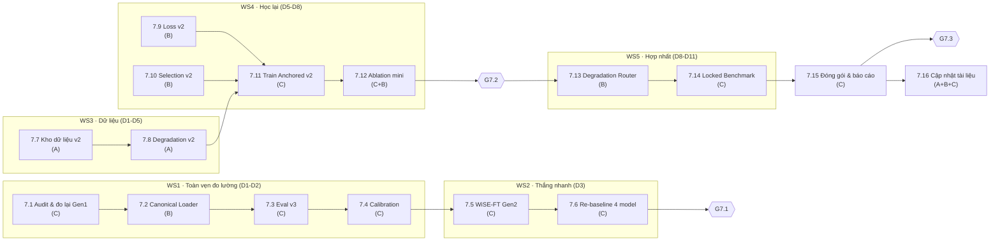

# KẾ HOẠCH PHASE 7 — TÁI LẬP ĐO LƯỜNG & HỢP NHẤT MÔ HÌNH FATFORMER-XLA

> **Phiên bản**: `v3.0` — viết lại toàn bộ từ v2.0 sau khi kiểm chứng cấu trúc checkpoint bằng PyTorch (không dựa trên suy đoán).
> **Ngày ban hành**: 27/10/2026
> **Người chủ trì**: Thành viên C (Training & Evaluation Lead)
> **Đồng chủ trì**: Thành viên B (Architecture & Loss), Thành viên A (Data & Infrastructure)
> **Trạng thái**: `[ ] SẴN SÀNG TRIỂN KHAI` — chờ chốt ngân sách GPU ở §V.4
> **Bản cũ**: [`docs/plan/archive/ke_hoach_phase_7_dieu_chinh_toan_dien_v2.0_2026-10-27.md`](archive/ke_hoach_phase_7_dieu_chinh_toan_dien_v2.0_2026-10-27.md) (chỉ để truy vết, **không dùng để triển khai**)
> **Nguồn số liệu gốc**: [`bao_cao_kiem_dinh_communityforensics_eval.md`](../bao_cao/overall/bao_cao_kiem_dinh_communityforensics_eval.md), [`tong_hop_checkpoints_va_lich_su_thuc_nghiem.md`](tong_hop_checkpoints_va_lich_su_thuc_nghiem.md)

---

## 0. TÓM TẮT ĐIỀU HÀNH

Phase 7 gồm **16 task / 4 cổng chặn (G7.0 → G7.3) / 13 ngày làm việc**, chia 6 nhánh công việc chạy song song cho 3 thành viên.

Thứ tự bắt buộc: **(1) sửa cho đúng thước đo → (2) thắng nhanh bằng WiSE-FT Gen 2 + hiệu chuẩn → (3) huấn luyện lại có dữ liệu đa bộ sinh và hàm phạt bảo vệ ảnh thật → (4) đóng gói một checkpoint tự định tuyến.**

### 0.1 Vì sao phải viết lại v2.0 (đối chiếu từng điểm sai)

| Nội dung trong v2.0 | Sự thật kiểm chứng được (27/10/2026) | Kết luận v3.0 |
| :--- | :--- | :--- |
| "Canonical Loader (strict=True) sẽ **cứu** được `fatformer_wise_ft_best.pth`" | Checkpoint chứa **10 khối adapter** `{2,5,7,8,11,14,15,17,20,23}`. Hàm dựng mô hình chỉ sinh được vị trí `(i+1)·24/n − 1` ⇒ chỉ biểu diễn được `n=3` `{7,15,23}` hoặc `n=8` `{2,5,8,11,14,17,20,23}`. **Không có `n` nào tạo ra tập 10 khối.** | Không "cứu" được. Phải **cách ly** checkpoint cũ và **tái tạo Gen 2** từ cặp cùng cấu trúc (Baseline + Anchored). |
| "Lỗi 146 unexpected keys là do `strict=False`" | 146 keys chỉ là `srm.*`/`gating.*` top-level đã chết (`CLIPModel.srm = None`). Nguyên nhân sụp đổ thật là **chọn sai tập khối adapter**: eval cũ chọn `n=3`, nạp 3/10 khối và bỏ 5 khối M4 thuần. | Đổi chẩn đoán: lỗi **ánh xạ cấu trúc**, không phải lỗi khoá thừa. |
| "Sửa `num_vit_adapter=8` là xong" | Tại 3 khối `7,15,23`, bản WiSE-FT cũ chỉ có **66 tensor/khối** (bằng Baseline) trong khi M4/Anchored có **94 tensor/khối** ⇒ **nhánh SRM + Gating bên trong 3 adapter đó đã bị mất khi trộn**. Kể cả nạp `n=8` cũng chỉ là "M4 + 1 khối 23 khuyết SRM". | Bản cũ **không thể tái tạo trung thực**. Chỉ dùng để **đo lại và đối chiếu**, không dùng làm sản phẩm. |
| "WiSE-FT Gen 2 chỉ cần trộn `α` và `β_srm` là đạt Real 88–92%, Fake 68–76%" | Chưa có bất kỳ phép đo nào cho cấu hình Gen 2. Con số trong v2.0 là **dự báo**, không phải kết quả. | Hạ xuống thành **giả thuyết có cổng kiểm chứng G7.1**, kèm ngưỡng "must/stretch". |
| "Chạy P2 trong 1 phiên GPU 4–5 giờ là xong" | 3.600 ảnh hiện tại (3.060/540), chỉ 3 giá trị `generator` (`real`, `stable_diffusion`, `midjourney`). Muốn có 12–16k ảnh phải **stream + lọc + kiểm toán hash** (Task 7.7 mất ~14 h công). | Tách P2 thành **2 task dữ liệu + 2 task huấn luyện**, có cổng dữ liệu riêng. |
| "`eval_communityforensics.py` bản mới đã sửa xong lỗi nạp" | Bản mới **vẫn** `load_state_dict(..., strict=False)`, **vẫn** có fallback `len(indices) > 8 → 3` (chọn đúng tập tệ nhất), và ngưỡng thích ứng dùng **trung bình `w_deg` của cả tập đang đánh giá**. | Cần 4 bản vá ở Task 7.2–7.4 (chi tiết §I.4). |
| "JPEG Q=30 sau Resize 224 là bản vá vật lý" | Tập CFE hiện tại **đã là 224×224** (báo cáo §VIII) ⇒ Resize/CenterCrop là no-op, kết quả không đổi. | Giữ thay đổi nhưng **ghi rõ là phòng thủ cho ảnh độ phân giải gốc**, không được coi là nguyên nhân cải thiện. |

### 0.2 Ba câu chốt

1. **Số liệu WiSE-FT đang lưu hành (CFE 52.05% / Fake 4.10%, và cả in-dist 96.58%) không dùng được** cho tới khi đo lại ở Task 7.1 & 7.6. Anchored và Baseline thì hợp lệ.
2. **Nút thắt thật của OOD không phải kiến trúc, mà là (a) ngưỡng/hiệu chuẩn, (b) vùng dữ liệu huấn luyện quá hẹp, (c) tín hiệu tần số bị bỏ phí.** Kiến trúc tự định tuyến chỉ có nghĩa sau khi 3 điểm trên được xử lý.
3. **Mọi con số phải kèm điều kiện vận hành** `TPR@FPR` và một tập hiệu chuẩn tách rời. Bỏ "overall accuracy" làm chỉ số chính.

---

## I. BẰNG CHỨNG XUẤT PHÁT

### I.1. Kiểm kê cấu trúc 4 checkpoint (đo trực tiếp bằng `torch.load`)

| Checkpoint | Dung lượng | Số tensor | Khối adapter | Biểu diễn được? | SRM/Gating trong adapter | Alias `image_encoder` ↔ `clip_model.visual` | Kết luận |
| :--- | ---: | ---: | :--- | :--- | :---: | :---: | :--- |
| `fatformer_4class_ckpt.pth` (Baseline) | 1,97 GB | 1.116 | `{7,15,23}` | ✅ `n=3` | ❌ không có (66 tensor/khối) | 395/395 khớp | **Hợp lệ** |
| `fatformer_crossdomain_weights_only.pth` (M4) | 7,5 GB | 1.684 | `{2,5,8,11,14,17,20,23}` | ✅ `n=8` | ✅ 94 tensor/khối | 672/672 khớp | Hợp lệ (fallback cũ) |
| `fatformer_wise_ft_best.pth` (Gen 1) | 4,69 GB | 1.816 | `{2,5,7,8,11,14,15,17,20,23}` | ❌ **không `n` nào** | ⚠️ 66/94 tại `7,15,23` (đã mất) | 738/738 khớp | **Cách ly** |
| `fatformer_anchored_recovery_best.pth` (M6-R) | 1,97 GB | 1.200 | `{7,15,23}` | ✅ `n=3` | ✅ 94 tensor/khối | 437/437 khớp | **Hợp lệ** |

> Kiểm tra alias: 100% key `image_encoder.*` bằng đúng tensor `clip_model.visual.*` trong cả 4 file ⇒ **không có** hiện tượng ghi đè chéo do alias. Nguyên nhân sụp đổ nằm ở ánh xạ khối, không ở alias.

### I.2. Ràng buộc vị trí adapter (bắt buộc ghi vào Chương 3 của báo cáo)

```python
# src/models/clip/model.py
num_vit_adapter = getattr(args, "num_vit_adapter", 3)
n_spilt = layers // num_vit_adapter           # layers = 24
add_adapter[(i + 1) * n_spilt - 1] = True     # i = 0..n-1
```

Hệ quả: `n=3 → {7,15,23}`, `n=8 → {2,5,8,11,14,17,20,23}`, `n=6 → {3,7,11,15,19,23}`, `n=12 → {1,3,5,...,23}`, `n=24 → {0..23}`.
**Đây là ràng buộc cứng của kiến trúc**: mọi checkpoint trộn khác số khối sẽ tạo ra file không nạp được đầy đủ. Quy tắc từ nay: **chỉ trộn hai checkpoint có cùng `num_vit_adapter`.**

### I.3. Sáu phát hiện định hình kế hoạch

| Mã | Phát hiện | Hệ quả cho Phase 7 |
| :--- | :--- | :--- |
| **F1** | WiSE-FT Gen 1 không biểu diễn được bằng kiến trúc hiện tại (10 khối). | Phải tái tạo Gen 2; số liệu cũ bị đánh dấu `invalid_layout`. |
| **F2** | Tại `7,15,23`, Gen 1 mất nhánh SRM/Gating (66 vs 94 tensor/khối). | Không thể "phục hồi" Gen 1; chỉ dùng để so sánh "nếu nạp `n=8`". |
| **F3** | Anchored hợp lệ và **thực sự** báo oan: Real 48,1% (clean) tại `T*=0.40`, AUC Q30 = 50,07. | Vấn đề của Anchored là ngưỡng + shortcut, xử lý được bằng Task 7.4 + 7.9. |
| **F4** | Dữ liệu huấn luyện: 3.600 ảnh, 3.060/540, `generator ∈ {real, stable_diffusion, midjourney}`, `source = diffusion_staging` duy nhất. CFE có 4.803 bộ sinh. | Khoảng trống phủ dữ liệu là nguyên nhân gốc số 1 của OOD ⇒ Task 7.7 bắt buộc. |
| **F5** | Tín hiệu pháp y bị bỏ phí: `CLIPModel.srm = None`, `gating = None`; SRM chỉ tiêm trong adapter với hệ số `0.1`. | Task 7.9 + 7.13 phải định tuyến lại vai trò nhánh tần số. |
| **F6** | Tiêu chí chọn checkpoint chỉ dựa composite 540 ảnh sạch, không có nhóm OOD/suy biến. | Task 7.10 đổi sang worst-group + ràng buộc Real. |

### I.4. Sáu khuyết tật của bộ công cụ vừa cập nhật (cần bản vá)

| Mã | File | Khuyết tật | Rủi ro | Bản vá |
| :--- | :--- | :--- | :--- | :--- |
| E1 | `eval_communityforensics.py` | `model.load_state_dict(filtered_sd, strict=False)`, chỉ lọc theo shape, không assert missing | Nạp thiếu mà vẫn in "✓" | `strict=True` + hard assert `0/0`; thiếu thì **raise** |
| E2 | `eval_communityforensics.py` | `if len(indices) > 8: return 3` | Chọn đúng tập khối tệ nhất cho Gen 1 | Trả về **tập khối tường minh** (`adapter_block_indices`) hoặc raise `IncompatibleAdapterLayout` |
| E3 | `eval_communityforensics.py` | `adaptive_thresh = 0.50·(1−mean_w) + 0.42·mean_w` (mean trên cả tập đang chấm) | Ngưỡng phụ thuộc thành phần lô ⇒ không triển khai được, rò rỉ thông tin tập test | Ngưỡng **cố định**, fit trên tập hiệu chuẩn riêng |
| E4 | `eval_communityforensics.py` | Hệ số router (`12.0`, `1.18`, clamp `[0.10,0.90]`, `0.50/0.42`) đặt tay, chưa fit/chưa kiểm chứng | "Unified" chỉ là trộn heuristic | Fit logistic trên calibration split, lưu `router_params.json` |
| E5 | `eval_communityforensics.py` | Nhiệt độ `1.0811 / 1.2763` hard-code; chỉ có `TPR@FPR=5%`; AP có edge-case chia 0; không có CI | Số liệu không tái lập, thiếu chuẩn học thuật | Task 7.4 (calibration) + 7.3 (metric contract) |
| E6 | `wise_ft_merge.py` | `sweep_threshold_constrained()` **không được gọi**; không có bước verify sau trộn; `is_fixed_buffer` khớp chuỗi con `"k1"/"k2"/"k3"` (dễ dương tính giả); grid chỉ quét `α`, không quét `β_srm`; vẫn copy `srm.*`/`gating.*` top-level nếu target có | Trộn ra file không ai kiểm chứng; ngưỡng "khuyến nghị" vô căn cứ | Thêm `--verify` (dựng model + assert 0/0), lọc khoá chết, quét lưới `α×β`, gọi calibration |

### I.5. Điều chưa biết — phải đo, không được suy đoán

| Câu hỏi | Cách trả lời | Task |
| :--- | :--- | :--- |
| Nạp Gen 1 với `n=8` thì hiệu năng OOD là bao nhiêu? Có thật sự "sụp" hay chỉ là artefact của `n=3`? | Đo 2 cấu hình (`n=3`, `n=8`) trên CFE clean, 2.000 ảnh, T4, ~6 phút | 7.1 |
| Gen 2 (Baseline + Anchored, cùng `n=3`) có Pareto-dominance được cả hai bố mẹ? | Quét `α×β_srm` (12 điểm), chấm tại `Real ≥ 90%` và `Real ≥ 95%` | 7.5 |
| Thêm 12–16k ảnh có tăng AUC Q30 từ ~50 lên ≥ 60? | Huấn luyện có/không có dữ liệu mới, cùng seed | 7.11–7.12 |
| Router tự động có thắng ngưỡng cố định đã hiệu chuẩn? | So sánh trên tập held-out, bootstrap CI | 7.13–7.14 |

---

## II. MỤC TIÊU & CỔNG NGHIỆM THU

### II.1. Bốn trụ mục tiêu

1. **Trung thực đo lường**: mọi con số tái lập được, có tập hiệu chuẩn tách rời, có `TPR@FPR` và CI.
2. **Thắng nhanh trên không gian trọng số**: Gen 2 + hiệu chuẩn cho điểm vận hành tốt hơn cả hai bố mẹ mà không cần GPU huấn luyện.
3. **Nâng năng lực thật**: mở rộng vùng dữ liệu + hàm phạt bảo vệ ảnh thật + consistency đặc trưng, cải thiện **AUC** (không chỉ dịch ngưỡng).
4. **Một checkpoint duy nhất**: tự định tuyến theo suy biến, một `forward()`, không cần cờ chế độ.

### II.2. Khế ước đo lường v3 (áp dụng cho mọi báo cáo từ nay)

| Quy định | Nội dung |
| :--- | :--- |
| Chỉ số chính | `ROC-AUC`, `AP`, `TPR@FPR=1%`, `TPR@FPR=5%`, `TPR@FPR=10%` |
| Chỉ số phụ | `Real ACC`, `Fake ACC` **tại ngưỡng cố định** `T*` fit trên calibration split |
| Phân tầng | 5 subset × 4 nhóm generator × 2 điều kiện (clean, Q30) |
| Tập hiệu chuẩn | `val_calibration` (in-dist) + 400 ảnh CFE **tách khỏi** 2.000 ảnh báo cáo (hoặc cross-validation 5-fold nếu không đủ dữ liệu) |
| Bắt buộc | Không dùng chung tập để fit `T`, `T*`, router **và** báo cáo |
| Bắt buộc | Bootstrap 1.000 lần → CI 95% cho AUC và TPR |
| Nghiêm cấm | Báo cáo "overall accuracy" đơn lẻ; báo cáo số của checkpoint `invalid_layout` |
| Phiên bản | `report_schema: v3` + `git_commit` + `sha256` checkpoint trong JSON |

### II.3. Cổng chặn

#### 🚧 G7.0 — Cổng toàn vẹn đo lường (cuối Ngày 2, chặn toàn bộ Phase)
- [ ] 4/4 checkpoint được phân loại tự động: **nạp 0 missing / 0 unexpected** hoặc **bị từ chối kèm lỗi có tên** (`IncompatibleAdapterLayout`).
- [ ] `fatformer_wise_ft_best.pth` bị đánh dấu `status: invalid_layout` trong mọi báo cáo; có bảng đo `n=3` vs `n=8` để chứng minh.
- [ ] `report_schema v3` có đủ `AUC/AP/TPR@FPR 1-5-10/CI`, không còn ngưỡng phụ thuộc batch.
- [ ] `pytest tests/test_canonical_loader.py -q` xanh; `tools/audit_checkpoint_compat.py` chạy trên 4 file.

#### 🚧 G7.1 — Cổng thắng nhanh (Ngày 3, không tốn GPU train)
Chấm tại **điểm vận hành FPR = 10%** trên CFE clean (2.000 ảnh):

| Chỉ số | Must | Stretch |
| :--- | :---: | :---: |
| Fake ACC @ Real = 90% (Gen 2 hoặc ensemble) | ≥ 55% | ≥ 70% |
| AUC clean | ≥ 80% | ≥ 85% |
| AUC Q30 | ≥ 55% | ≥ 62% |
| Không tệ hơn Baseline ở bất kỳ subset nào > 5 pp | ✅ | ✅ |

#### 🚧 G7.2 — Cổng năng lực thật (Ngày 8, sau huấn luyện lại)

| Chỉ số | Must | Stretch |
| :--- | :---: | :---: |
| CFE clean: Fake @ Real = 90% | ≥ 65% | ≥ 78% |
| CFE clean: AUC | ≥ 78% | ≥ 85% |
| CFE Q30: AUC | ≥ 60% | ≥ 65% |
| CFE Q30: Fake @ Real = 90% | ≥ 40% | ≥ 55% |
| 18 tập in-dist: Macro ACC | ≥ 90% | ≥ 94% |
| 18 tập in-dist: Real ACC | ≥ 90% (**cứng**) | ≥ 95% |
| Worst-subset Fake ACC (CFE) | ≥ 45% | ≥ 55% |
| ECE | ≤ 0,08 | ≤ 0,05 |

#### 🚧 G7.3 — Cổng hợp nhất (Ngày 11)
- [ ] **Một** file `.pth` + `router_params.json`; một `forward(x) → P(fake), ŷ`; không cờ điều kiện.
- [ ] Trong **1,5 pp** so với kết quả tốt nhất theo từng điều kiện (clean và Q30) ⇒ không hy sinh chế độ nào.
- [ ] Độ trễ thêm < 5 ms/ảnh trên T4; không cần metadata ngoài ảnh.

> **Điều khoản kết quả âm (bắt buộc tôn trọng):** nếu G7.2 trượt, Phase 7 vẫn được coi là **hoàn thành hợp lệ** khi bàn giao: (a) checkpoint Pareto tốt nhất, (b) ma trận ablation chỉ rõ đòn bẩy nào thất bại, (c) mục "Hạn chế" viết rõ trong báo cáo. Không được nâng số.

---

## III. KIẾN TRÚC CÔNG VIỆC



| Nhánh | Mục tiêu | Chủ trì | Cổng ra |
| :--- | :--- | :---: | :--- |
| WS1 | Không còn con số nào nạp sai cấu trúc | C (+B) | G7.0 |
| WS2 | Điểm vận hành tốt hơn cả 2 bố mẹ, 0 GPU train | C | G7.1 |
| WS3 | Vùng dữ liệu phủ 5 họ 2024–2025, cô lập test | A | — (nạp vào WS4) |
| WS4 | Tăng AUC thật, không quên in-dist | B + C | G7.2 |
| WS5 | Một checkpoint, tự định tuyến | B + C | G7.3 |
| WS6 | Tài liệu khớp số liệu, luận văn có mục Hạn chế | Cả 3 | — |

---

## IV. PHÂN CÔNG & ĐẶC TẢ CHI TIẾT

### IV.1. Bảng master

| ID | Tên task | Chủ trì | Hỗ trợ | Ước lượng | Môi trường | Phụ thuộc | Cổng |
| :--- | :--- | :---: | :---: | ---: | :--- | :--- | :---: |
| 7.1 | Audit cấu trúc & đo lại Gen 1 (`n=3` vs `n=8`) | C | B | 4 h | Local CPU + T4 10′ | — | G7.0 |
| 7.2 | `canonical_loader` + adapter-index tường minh + test | B | C | 8 h | Local CPU | 7.1 | G7.0 |
| 7.3 | Eval v3: metric contract, bỏ `strict=False`, bỏ ngưỡng batch | C | B | 6 h | Local + T4 | 7.2 | G7.0 |
| 7.4 | Calibration & threshold có ràng buộc FPR + ECE | C | — | 4 h | Local CPU | 7.3 | G7.0 |
| 7.5 | WiSE-FT Gen 2 + lưới `α×β` + verify | C | B | 5 h | Local CPU | 7.4 | G7.1 |
| 7.6 | Re-baseline 4 cấu hình trên CFE (v3) | C | — | 3 h | T4 45′ | 7.5 | G7.1 |
| 7.7 | Kho dữ liệu v2 (CFE-Small phân tầng + real đa nguồn) | A | C | 14 h | Drive/Colab CPU | 7.1 | — |
| 7.8 | Degradation pipeline v2 (Q∈[30,85], đa suy biến) | A | B | 5 h | Local CPU | 7.7 | — |
| 7.9 | Loss v2: `RealGuard` + `FeatureConsistency` | B | C | 7 h | Local CPU | 7.4 | — |
| 7.10 | Selection v2: worst-group + ràng buộc Real | B | C | 4 h | Local CPU | 7.9 | — |
| 7.11 | Huấn luyện Anchored Recovery v2 | C | A+B | 5 h + GPU | T4/L4/A100 | 7.7–7.10 | G7.2 |
| 7.12 | Ablation mini 4 cấu hình (cùng seed) | C | B | 4 h + GPU | T4 | 7.11 | G7.2 |
| 7.13 | `DegradationRouter` + fusion fit trên calibration | B | C | 8 h | Local CPU | 7.4 | — |
| 7.14 | Locked Benchmark Phase 7 (in-dist + CFE + 6 biến thể) | C | A | 5 h | T4/A100 | 7.12, 7.13 | G7.3 |
| 7.15 | Đóng gói `UnifiedFatFormerXLA` + báo cáo nghiệm thu | C | B | 4 h | Local | 7.14 | G7.3 |
| 7.16 | Cập nhật tài liệu dự án & Chương 5/Hạn chế | Cả 3 | — | 6 h | Local | 7.14 | G7.3 |

**Tổng**: ~92 giờ công + ~14–18 giờ GPU. Chia đều ≈ 12 h/người/tuần trong 2,5 tuần.

### IV.2. Đặc tả chi tiết

> 📁 **Đặc tả đầy đủ từng task** (input/output/ràng buộc/DoD/rủi ro) nằm trong các thư mục `phase_7/` của từng thành viên:
>
> - **A — Data & Infra**: [`7.7`](../tasks/member_a_data_infra/phase_7/task_7.7_kho_du_lieu_v2.md) · [`7.8`](../tasks/member_a_data_infra/phase_7/task_7.8_degradation_pipeline_v2.md) · [chỉ mục](../tasks/member_a_data_infra/phase_7/README.md)
> - **B — Architecture & Loss**: [`7.2`](../tasks/member_b_architecture_loss/phase_7/task_7.2_canonical_loader.md) · [`7.9`](../tasks/member_b_architecture_loss/phase_7/task_7.9_loss_v2_realguard.md) · [`7.10`](../tasks/member_b_architecture_loss/phase_7/task_7.10_selection_metric_v2.md) · [`7.13`](../tasks/member_b_architecture_loss/phase_7/task_7.13_degradation_router.md) · [chỉ mục](../tasks/member_b_architecture_loss/phase_7/README.md)
> - **C — Training & Eval**: [`7.1`](../tasks/member_c_training_eval/phase_7/task_7.1_audit_checkpoint_gen1.md) · [`7.3`](../tasks/member_c_training_eval/phase_7/task_7.3_eval_v3_measurement_contract.md) · [`7.4`](../tasks/member_c_training_eval/phase_7/task_7.4_calibration_threshold_fpr.md) · [`7.5`](../tasks/member_c_training_eval/phase_7/task_7.5_wise_ft_gen2.md) · [`7.6`](../tasks/member_c_training_eval/phase_7/task_7.6_rebaseline_cfe_v3.md) · [`7.11`](../tasks/member_c_training_eval/phase_7/task_7.11_train_anchored_v2.md) · [`7.12`](../tasks/member_c_training_eval/phase_7/task_7.12_ablation_mini_v2.md) · [`7.14`](../tasks/member_c_training_eval/phase_7/task_7.14_locked_benchmark_phase7.md) · [`7.15`](../tasks/member_c_training_eval/phase_7/task_7.15_unified_packaging.md) · [`7.16`](../tasks/member_c_training_eval/phase_7/task_7.16_cap_nhat_tai_lieu_du_an.md) · [chỉ mục](../tasks/member_c_training_eval/phase_7/README.md)
>
> Phần dưới đây là **bản tóm tắt điều hành**; khi có khác biệt, **file task là nguồn sự thật**.

#### 🔹 Task 7.1 — Audit cấu trúc & đo lại Gen 1 `[C, hỗ trợ B, 4 h, G7.0]`

**Mục tiêu**: biến mọi giả thuyết ở §I thành số liệu, đặc biệt là "Gen 1 có thật sự sụp hay chỉ do chọn `n=3`".

**Đầu vào**: 4 file `.pth`; `DATASET/test_communityforensics` (2.000 ảnh, 224×224); `ViT-L-14.pt`.

**Các bước**
1. Viết `tools/audit_checkpoint_compat.py` → xuất `logs/phase7/checkpoint_structure_audit.json` gồm: `n_keys`, `adapter_blocks`, `expressible_n` (danh sách `n ∈ {3,4,6,8,12,24}` phủ được), `blocks_dropped`, `has_srm_per_block` (đếm tensor/khối), `alias_equality`, `dead_keys`.
2. Chạy trên 4 checkpoint. Kỳ vọng: Baseline/M4/Anchored pass; Gen 1 báo `expressible_n=[3,8]` nhưng `blocks_dropped={7,15}` với `n=8` và `{2,5,8,11,14,17,20}` với `n=3`.
3. Trên T4: chấm Gen 1 hai lần (`n=3`, `n=8`) trên CFE **clean 2.000 ảnh** (chỉ clean để tiết kiệm), cùng nhiệt độ `T=1.0`, ngưỡng 0.5. Xuất `logs/phase7/wise_ft_legacy_reinterpretation.json`.
4. Viết 1 trang kết luận: nếu `n=8` cho Fake ACC cao hơn hẳn `n=3` ⇒ xác nhận chẩn đoán "artefact loader"; nếu không ⇒ chẩn đoán chuyển sang "trộn khác basin".

**Đầu ra**: 2 file JSON + `docs/bao_cao/C/bao_cao_task_7.1_checkpoint_audit.md`.
**DoD**: JSON có đủ trường; kết luận nêu rõ Gen 1 bị `invalid_layout`; không có số nào của Gen 1 được dùng làm kết quả chính thức.

---

#### 🔹 Task 7.2 — Canonical Loader + adapter index tường minh `[B, hỗ trợ C, 8 h, G7.0]`

**Mục tiêu**: loại bỏ vĩnh viễn khả năng "nạp thiếu mà im lặng".

**Các bước**
1. `src/models/clip/model.py`: thêm tham số `adapter_block_indices: Optional[List[int]]` cho `VisionTransformer`/nhánh visual. Nếu có, dùng trực tiếp; nếu không, giữ quy tắc `(i+1)*n−1`. Thêm `assert` không trùng/không vượt `layers`.
2. `src/models/canonical_loader.py`:
   - `extract_state_dict(ckpt) -> dict` (hỗ trợ `model`/`state_dict`/`model_state`, strip `module.`).
   - `infer_adapter_blocks(sd) -> set[int]`.
   - `resolve_layout(blocks, layers=24) -> {n, indices, dropped}`: chọn `n` **phủ nhiều khối nhất**; nếu `dropped ≠ ∅` → trả cờ `partial=True` (không im lặng).
   - `canonicalize(sd, model_sd) -> (clean_sd, report)`: bỏ `image_encoder.*` (giữ `clip_model.visual.*` làm nguồn chuẩn), bỏ `srm.*`/`gating.*` top-level, đối chiếu shape, tính `missing/unexpected`.
   - `load_canonical(ckpt_path, model_args, strict=True)`: dựng model → nạp → **assert 0/0** → trả `(model, report)`.
3. `tools/audit_checkpoint_compat.py` gọi lại loader này để đảm bảo cùng một logic.
4. Test `tests/test_canonical_loader.py`: (a) Baseline/Anchored nạp 0/0; (b) M4 nạp `n=8` 0/0; (c) Gen 1 raise hoặc trả `partial=True` + `dropped`; (d) state_dict giả có key lạ → `unexpected>0` và raise; (e) shape lệch → raise.

**Đầu ra**: `src/models/canonical_loader.py`, sửa `src/models/clip/model.py`, test, `tools/audit_checkpoint_compat.py`.
**DoD**: `pytest -q tests/test_canonical_loader.py` xanh; 3/4 checkpoint `0/0`, Gen 1 bị từ chối/đánh dấu; không còn `strict=False` nào trong `tools/` (grep sạch).
**Rủi ro**: đổi constructor ảnh hưởng `train_crossdomain.py` → chạy `tools/test_src_load.py` + smoke 1 batch trước khi merge.

---

#### 🔹 Task 7.3 — Evaluation v3 `[C, hỗ trợ B, 6 h, G7.0]`

**Các bước**
1. Thay toàn bộ phần nạp bằng `load_canonical` (E1, E2).
2. Bỏ `adaptive_thresh`; nhận `--threshold` hoặc đọc `calibration.json` (E3).
3. `compute_unified_router_predictions` → **không dùng `mean_w` của tập**; dùng `router_params.json` (E4).
4. Metric: thêm `tpr@fpr1`, giữ `tpr@fpr5`, thêm `tpr@fpr10`, `ece`, `n_real/n_fake`, bootstrap CI (E5).
5. Xuất JSON `report_schema: v3` + `git_commit` + `sha256` từng checkpoint + `layout.status`.
6. Thêm `--degrade_order {post_resize, pre_resize}`; mặc định `post_resize` (khớp dữ liệu 224 hiện tại) và ghi rõ trong header báo cáo.
7. Giữ nguyên phần Markdown report nhưng thêm cột "FPR=10%" và dòng "Trạng thái nạp".

**DoD**: chạy `--test_dummy` pass; chạy thật trên Baseline cho ra JSON đúng schema; không còn cảnh báo "Filtered out-of-graph" khi nạp 3 checkpoint hợp lệ.

---

#### 🔹 Task 7.4 — Calibration & Threshold có ràng buộc `[C, 4 h, G7.0]`

**Các bước**
1. Nâng `tools/calibrate_and_select.py`: fit nhiệt độ `T` bằng L-BFGS tối thiểu NLL trên `val_calibration`; fit `T*` theo ràng buộc `FPR ≤ 5%` (và 10%).
2. Tính `ECE` (10 bin) trước/sau hiệu chuẩn.
3. Xuất `logs/phase7/calibration/<model>.json`: `{T, T*, fpr_target, real_acc, fake_acc, ece, n_calib}`.
4. Quy tắc: nếu thiếu tập OOD để hiệu chuẩn, dùng **cross-validation 5-fold trên 2.000 ảnh CFE** và báo cáo cả 5 fold (không được fit trên fold đang chấm).

**DoD**: mỗi model có `calibration.json`; báo cáo nêu rõ nguồn fit; `T*` không phụ thuộc thành phần lô.

---

#### 🔹 Task 7.5 — WiSE-FT Gen 2 `[C, hỗ trợ B, 5 h, G7.1]`

**Các bước**
1. Vá `tools/wise_ft_merge.py`: (a) bỏ `srm.*`/`gating.*` top-level khỏi output; (b) `is_fixed_buffer` chuyển sang khớp **chính xác** `srm_block.k1|k2|k3`; (c) thêm `--verify` (dựng model qua `load_canonical`, in `missing/unexpected`, `sys.exit(1)` nếu ≠ 0); (d) grid `α ∈ {0.35,0.45,0.55,0.65}` × `β_srm ∈ {0.25,0.35,0.50}`; (e) metadata ghi `alpha, beta, sha256, layout`.
2. Chạy 12 ứng viên trên CPU (~1 phút/ứng viên).
3. Chấm 12 ứng viên trên CFE clean + Q30 (T4, ~25 phút tổng) với `T`/`T*` từ Task 7.4.
4. Chọn theo luật: tối đa `Fake@Real=90%`, hoà thì ưu tiên AUC Q30.
5. Ghi `DATASET/checkpoints/phase7/fatformer_wise_ft_v2_best.pth` + `_metadata.json`.

**DoD**: 12 dòng kết quả trong `logs/phase7/wise_ft_v2_sweep.csv`; checkpoint best verify `0/0`; **không** dùng lại tên file cũ để tránh nhầm lẫn.

---

#### 🔹 Task 7.6 — Re-baseline 4 cấu hình `[C, 3 h, G7.1]`

**Các bước**: chấm Baseline / Anchored / Gen 2 best / Ensemble (logit trung bình sau hiệu chuẩn) trên CFE clean + Q30, harness v3. Xuất `logs/phase7/cfe_v3_baseline_matrix.{json,md}`. So sánh với bảng 26/10 và **ghi rõ chênh lệch do đâu** (loader, ngưỡng, metric).

**DoD**: bảng 4×2×6 chỉ số; kết luận G7.1 pass/fail có số.

---

#### 🔹 Task 7.7 — Kho dữ liệu v2 `[A, hỗ trợ C, 14 h]`

**Mục tiêu**: 12.000–16.000 ảnh, phủ 5 họ kiến trúc 2024–2025 + ảnh thật đa nguồn, **cô lập 100%** với 2.000 ảnh test CFE và 18 tập Task 5.1.

**Các bước**
1. Stream `CommunityForensics/CommunityForensics-Small` (Parquet) qua `datasets`, lọc theo trường generator; chọn **tối đa 1.200 ảnh/họ** cho 5 họ: `commercial`, `latent_diffusion`, `pixel_diffusion`, `modern_gans`, `autoregressive`.
2. **Generator-disjoint**: loại mọi generator đã xuất hiện trong tập test CFE (đọc danh sách generator từ manifest test) và trong 18 tập Task 5.1.
3. Ảnh thật: 3.000–4.000 ảnh từ COCO / FFHQ / RAISE / LAION / ImageNet (đa nguồn, đa lịch sử nén), ưu tiên ảnh đã qua JPEG thật.
4. Replay in-dist: giữ 3.600 ảnh `diffusion_staging` (20–25% tổng).
5. Chia: `train` 85% / `val_calib` 7,5% / `val_select` 7,5%, cân bằng real/fake và **cân bằng theo họ**.
6. Kiểm toán: `tools/verify_data_isolation.py` (SHA-256 + pHash ≤ 8) trên 3 cặp (v2-test CFE, v2-18 tập, v2-chính nó); xuất `logs/phase7/data_isolation_report.json` với 0 vi phạm.
7. Đóng gói `.tar` lên Drive + ghi `DATASET/manifests/data_manifest_v2.json` (có `sha256`, `phash`, `generator`, `family`, `split`).

**DoD**: manifest v2 ≥ 12.000 mẫu; isolation report 0 near-duplicate; báo cáo dung lượng & thời gian stream; `README_A` cập nhật.
**Kill**: nếu stream vượt 4 h hoặc > 60 GB → hạ xuống 8.000 ảnh (600/họ) và ghi rõ trong báo cáo.

---

#### 🔹 Task 7.8 — Degradation pipeline v2 `[A, hỗ trợ B, 5 h]`

**Các bước**
1. Mở rộng `PairedCleanDegradedAugmentation`: `Q ∈ [30,85]` với **≥ 35% khối lượng rơi vào [30,45]**; thêm WebP (q 30–70), double-JPEG (q1 70–90 → q2 30–50), blur `σ ∈ [0.5,2.0]`, down-up `0.5–0.75`.
2. Cho phép **ghép 2 suy biến** với xác suất 25% (ví dụ JPEG + down-up) để mô phỏng mạng xã hội.
3. Tham số hoá bằng `configs/degradation_v2.yaml`; `clean_prob` mặc định 0.60 (thay 0.70).
4. Test phân phối: sample 10.000 lần, kiểm tra histogram Q và tỷ lệ nhóm nặng; lưu `logs/phase7/degradation_profile.png`.

**DoD**: test pass; hình histogram; không làm chậm DataLoader > 15% (đo `time per batch` trước/sau).

---

#### 🔹 Task 7.9 — Loss v2 `[B, hỗ trợ C, 7 h]`

**Công thức đề xuất** (giữ nguyên tinh thần v2.0 nhưng viết đúng ký hiệu):

$$\mathcal{L} = 0.3\,\mathcal{L}_{CE}(x_{clean}) + 0.3\,\mathcal{L}_{CE}(x_{deg}) + 0.7\,\mathcal{L}_{KD} + 0.3\,\mathcal{L}_{Feat} + 0.5\,\mathcal{L}_{Guard}$$

- **`RealGuardLoss`**: chỉ áp dụng cho mẫu **Real**:
  $$\mathcal{L}_{Guard} = \frac{1}{|B_{real}|}\sum_{i\in B_{real}} \Big[\mathrm{ReLU}\big(z^{fake}_{s}(x^{deg}_i) - z^{fake}_{t}(x^{clean}_i)\big)\Big]^2$$
  (dùng `ReLU` để **chỉ phạt khi student vượt teacher**, không kéo logit xuống vô hạn).
- **`FeatureConsistencyLoss`**: `(1 − cos(f_s(x_deg), sg[f_s(x_clean)]))` + `KL(p_clean ‖ p_deg)` trên vector trước classifier (`aug_image_features`).
- Giữ `CrossDomainDistillationLoss` hiện có (selective teacher-correct) và `PairedConsistencyLoss`.

**Các bước**
1. Thêm 2 module vào `src/training/loss.py`, mặc định `weight=0` để **backward-compatible**.
2. Nối vào `CrossDomainTotalLoss.forward` với `logits_clean/logits_deg/teacher_logits/features`.
3. `train_crossdomain.py`: lấy `features` bằng `model(x, return_features=True)` (thêm cờ, không đổi forward mặc định).
4. Test: (a) weight=0 ⇒ loss trùng bản cũ (allclose); (b) mẫu Real có `z_s < z_t` ⇒ guard = 0; (c) `z_s > z_t` ⇒ guard > 0 và gradient âm lên `z_s^{fake}`.

**DoD**: 3 test xanh; smoke 1 batch trên T4 không NaN; config `configs/train_phase7_anchored_v2.yaml`.

---

#### 🔹 Task 7.10 — Selection metric v2 `[B, hỗ trợ C, 4 h]`

**Các bước**
1. Định nghĩa `worst_group_score = min over g ∈ {clean, q30} × {real, fake} (balanced_acc_g)`.
2. `Trainer.validate()` trả thêm 4 chỉ số nhóm (dùng transform Q30 in-memory).
3. Điều kiện lưu `best.pth`: `score = worst_group` **và** `real_acc_clean ≥ 90%`; nếu không thoả, lưu `best_effort` riêng.
4. Log mỗi epoch: `{clean_r, clean_f, q30_r, q30_f, worst, composite}`.

**DoD**: log CSV đủ 6 cột; test với mảng giả; không làm chậm validation > 2× (dùng 300 ảnh con).

---

#### 🔹 Task 7.11 — Huấn luyện Anchored Recovery v2 `[C, 5 h + GPU, G7.2]`

**Cấu hình**
| Tham số | Giá trị |
| :--- | :--- |
| Warm start | Baseline + Zero-Init (SRM proj = 0, λ ≡ 1.0) |
| `num_vit_adapter` | 3 (`{7,15,23}`) |
| LR | adapter cũ `1e-5`, SRM/Gating `1e-4`, backbone frozen |
| Batch / AMP | 32 / FP16, grad-accum 2 |
| Epoch | 4–6 (early stop theo `worst_group`) |
| Dữ liệu | manifest v2, `clean_prob=0.60`, degradation v2 |
| Loss | Task 7.9 (`0.3/0.3/0.7/0.3/0.5`) |

**Các bước**: benchmark 100 step để chốt thời gian/epoch → train → lưu `DATASET/checkpoints/phase7/fatformer_anchored_v2_best.pth` + `_best_effort.pth` + `train_history.csv` + đường hội tụ `m7_convergence.png`.
**DoD**: 4 chỉ số nhóm mỗi epoch; checkpoint chọn theo worst-group; thời gian thực tế ghi lại.

---

#### 🔹 Task 7.12 — Ablation mini `[C+B, 4 h + GPU, G7.2]`

4 cấu hình, cùng seed 42, cùng manifest: (1) `+data`, (2) `+data+guard`, (3) `+data+featcons`, (4) full. Nếu ngân sách GPU < 8 h: chạy 3 epoch thay vì 6 và ghi rõ.
**DoD**: bảng 4×8 chỉ số + kết luận đòn bẩy nào đóng góp nhiều nhất.

---

#### 🔹 Task 7.13 — `DegradationRouter` + fusion `[B, hỗ trợ C, 8 h]`

**Các bước**
1. `src/models/degradation_router.py`: trích 3 tín hiệu **không tham chiếu** trên `x` (224): blockiness `B(x)` (DCT 8×8), phương sai Laplacian `V_Lap(x)`, và `λ̄(x)` lấy từ gating đã học.
2. Fit **logistic regression 3 biến** trên `val_calib` để ra `w_deg(x) ∈ [0,1]` — **không đặt tay hằng số**.
3. `UnifiedFatFormerXLA`: `P(fake|x) = (1−w)·p_clean(x) + w·p_forensic(x)` với `p_*` là xác suất **đã hiệu chuẩn**; ngưỡng là hàm của `w` fit trên calibration (bảng 2–3 mức), không dùng mean của batch.
4. Lưu `router_params.json` (hệ số + ngưỡng + `n_calib`) vào metadata checkpoint.
5. Ablation: (a) ngưỡng cố định toàn cục, (b) router, (c) oracle theo điều kiện (cận trên).

**DoD**: 3 dòng ablation + CI; router beat ngưỡng cố định ≥ 1 pp ở ít nhất 3/5 subset, nếu không → **báo cáo trung thực là không thắng** và giữ ngưỡng cố định.

---

#### 🔹 Task 7.14 — Locked Benchmark Phase 7 `[C, hỗ trợ A, 5 h, G7.3]`

Chấm một lượt: 18 tập in-dist (82.003 ảnh) + CFE clean/Q30 + 6 biến thể suy biến; xuất `logs/phase7/final_phase7_report.{json,md}` + hình ROC + bảng per-generator + CI.
**DoD**: đủ 3 cổng G7.2/G7.3; JSON có `report_schema v3`; không còn số nào của Gen 1.

---

#### 🔹 Task 7.15 — Đóng gói & nghiệm thu `[C, hỗ trợ B, 4 h, G7.3]`

`src/models/unified_fatformer.py` (wrapper) + `tools/infer_unified.py` (CLI: ảnh → xác suất + nhãn + `w_deg`) + `docs/bao_cao/C/bao_cao_task_7.15_unified_packaging.md`.
**DoD**: chạy được trên 20 ảnh mẫu; độ trễ trung bình ghi lại; một file `.pth` duy nhất.

---

#### 🔹 Task 7.16 — Cập nhật tài liệu dự án `[Cả 3, 6 h]`

Theo đúng danh mục §VIII. **DoD**: mọi file trong §VIII đã cập nhật (hiện 11/11), không còn mâu thuẫn số liệu (kiểm bằng cách grep các số cũ: `52.05`, `4.10`, `96.58`).

---

## V. LỊCH TRIỂN KHAI

### V.1. Lịch 13 ngày làm việc

| Ngày | Thành viên A | Thành viên B | Thành viên C |
| :--- | :--- | :--- | :--- |
| D1 (27/10) | 7.7 stream + lọc | 7.1 audit (hỗ trợ) | 7.1 audit + 7.3 khung |
| D2 (28/10) | 7.7 isolation | 7.2 canonical loader | 7.3 eval v3 → **G7.0** |
| D3 (29/10) | 7.7 manifest v2 | 7.2 test + smoke | 7.4 calibration, 7.5 Gen 2 |
| D4 (30/10) | 7.8 degradation v2 | 7.9 loss v2 | 7.6 re-baseline → **G7.1** |
| D5 (31/10) | 7.8 test phân phối | 7.9 test | 7.10 selection v2 |
| D6 (03/11) | hỗ trợ 7.11 (data) | 7.10 tích hợp trainer | 7.11 train v2 (GPU) |
| D7 (04/11) | kiểm toán lần 2 | 7.13 router (khung) | 7.11 đánh giá + 7.12 |
| D8 (05/11) | hỗ trợ 7.12 | 7.13 fit calibration | **G7.2** + 7.13 tích hợp |
| D9 (06/11) | rà dữ liệu lần cuối | 7.13 ablation | 7.14 locked benchmark |
| D10 (07/11) | 7.16 (phần A) | 7.16 (phần B) | 7.14 hoàn tất → **G7.3** |
| D11 (10/11) | 7.16 | 7.16 | 7.15 đóng gói |
| D12 (11/11) | 7.16 | review chéo | 7.16 + review chéo |
| D13 (12/11) | buffer | buffer | Họp nghiệm thu Phase 7 |

### V.2. Nhịp họp
- **Standup 15′** mỗi ngày, ghi 1 dòng vào `docs/plan/ke_hoach_phase_7_dieu_chinh_toan_dien.md` (mục §V.3).
- **Gate review 60′** tại G7.0 (D2), G7.1 (D4), G7.2 (D8), G7.3 (D10); biên bản lưu `docs/milestones/milestone_phase7_*.md`.

### V.3. Bảng theo dõi tiến độ (cập nhật tại standup)

| Task | Chủ trì | Trạng thái | Ghi chú |
| :--- | :---: | :---: | :--- |
| 7.1 | C | `[ ]` | |
| 7.2 | B | `[ ]` | |
| 7.3 | C | `[ ]` | |
| 7.4 | C | `[ ]` | |
| 7.5 | C | `[ ]` | |
| 7.6 | C | `[ ]` | |
| 7.7 | A | `[ ]` | |
| 7.8 | A | `[ ]` | |
| 7.9 | B | `[ ]` | |
| 7.10 | B | `[ ]` | |
| 7.11 | C | `[ ]` | |
| 7.12 | C+B | `[ ]` | |
| 7.13 | B | `[ ]` | |
| 7.14 | C | `[ ]` | |
| 7.15 | C | `[ ]` | |
| 7.16 | Cả 3 | `[ ]` | |

### V.4. Ngân sách tài nguyên (cần chốt trước D1)

| Hạng mục | Ước lượng | Ghi chú |
| :--- | ---: | :--- |
| GPU T4/L4 cho eval | 2,5 h | ~12 lượt chấm 2.000 ảnh |
| GPU cho train 7.11 | 3–5 h | T4 batch 32; A100 ~1–1,5 h |
| GPU cho ablation 7.12 | 3–6 h | 3 epoch × 3 cấu hình phụ |
| Đĩa | 40–60 GB | manifest v2 + 3 checkpoint (~2 GB/file) |
| Băng thông | ~30–60 GB | CFE-Small stream, có cache |

> **Chốt trước khi bắt đầu**: nếu tổng GPU < 8 h, cắt 7.12 xuống 2 cấu hình và giảm 7.11 còn 4 epoch; ghi rõ trong báo cáo.

---

## VI. RỦI RO & KILL CRITERIA

| Rủi ro | Khả năng | Tác động | Giảm thiểu | Kill criteria |
| :--- | :---: | :---: | :--- | :--- |
| Stream CFE-Small quá chậm/tốn dung lượng | Cao | Trễ D4 | Lọc theo generator ngay khi stream; cache `.tar`; giới hạn 1.200/họ | > 4 h hoặc > 60 GB ⇒ hạ còn 8.000 ảnh |
| Rò rỉ dữ liệu test vào train | Trung bình | **Phá giá trị học thuật** | `verify_data_isolation.py` (SHA-256 + pHash) + generator-disjoint | 1 vi phạm ⇒ chặn 7.11 |
| Backbone đóng băng ⇒ trần năng lực thấp | Cao | G7.2 trượt | Chuẩn bị đòn bẩy dự phòng: mở khoá `resblocks.20-23` LR `1e-6`, hoặc LoRA `r=8` | Nếu sau 6 epoch `worst_group` không tăng ≥ 2 pp ⇒ bật đòn bẩy, ghi rõ |
| Threshold overfit trên 2.000 ảnh | Cao | Số liệu ảo | Calibration/held-out tách rời + bootstrap CI | Fit và báo cáo trên cùng tập ⇒ huỷ kết quả |
| Router sụp về 1 nhánh | Trung bình | G7.3 trượt | Ablation 3 mức; kiểm tra `w_deg` histogram trên clean vs Q30 | `w_deg` gần như hằng ⇒ bỏ router, dùng ngưỡng cố định |
| GPU Colab hết hạn giữa phiên | Trung bình | Mất tiến độ | Checkpoint mỗi epoch lên Drive + `--resume` | — |
| Tài liệu trôi khỏi số liệu | Cao | Phản biện bắt lỗi | Task 7.16 + grep số cũ trước khi nộp | Còn số cũ ⇒ chưa nghiệm thu |

---

## VII. DANH MỤC ARTIFACT

| Loại | Đường dẫn | Ghi chú |
| :--- | :--- | :--- |
| Checkpoint | `DATASET/checkpoints/phase7/fatformer_anchored_v2_best.pth` | kèm `_best_effort.pth` |
| Checkpoint | `DATASET/checkpoints/phase7/fatformer_wise_ft_v2_best.pth` | Gen 2 |
| Checkpoint | `DATASET/checkpoints/phase7/unified_fatformer_v2.pth` | G7.3 |
| Manifest | `DATASET/manifests/data_manifest_v2.json` | SHA-256 + pHash |
| Log | `logs/phase7/checkpoint_structure_audit.json` | 7.1 |
| Log | `logs/phase7/wise_ft_legacy_reinterpretation.json` | 7.1 |
| Log | `logs/phase7/cfe_v3_baseline_matrix.{json,md}` | 7.6 |
| Log | `logs/phase7/calibration/<model>.json` | 7.4 |
| Log | `logs/phase7/final_phase7_report.{json,md}` | 7.14 |
| Code | `src/models/canonical_loader.py`, `src/models/degradation_router.py`, `src/models/unified_fatformer.py` | |
| Code | `tools/audit_checkpoint_compat.py`, `tools/infer_unified.py` | |
| Test | `tests/test_canonical_loader.py`, `tests/test_loss_v2.py`, `tests/test_router.py` | |

---

## VIII. CẬP NHẬT TÀI LIỆU DỰ ÁN (bắt buộc, thuộc Task 7.16)

| File | Nội dung cập nhật |
| :--- | :--- |
| `docs/plan/ke_hoach.md` | Thêm mục **Tuần 7–8: Phase 7** (bảng 16 task + cổng); cập nhật bảng Gate 4 → Gate Phase 7; thêm 2 dòng rủi ro mới |
| `docs/plan/ke_hoach_cac_cot_moc_va_diem_dung.md` | Thêm **ĐIỂM DỪNG 6: PHASE 7** với G7.0–G7.3; sửa "Điểm dừng chung cuộc" để không tuyên bố vượt gate khi chưa đo lại Gen 1 |
| `docs/plan/tong_hop_checkpoints_va_lich_su_thuc_nghiem.md` | Thêm **§5.4 Đính chính Gen 1** (10 khối, không biểu diễn được, số liệu `invalid_layout`); thêm **§7 Thế hệ 6: Gen 2 (dự kiến)**; đánh dấu các số WiSE-FT cần đo lại |
| `docs/bao_cao/overall/bao_cao_kiem_dinh_communityforensics_eval.md` | Thêm **Phần IX: Đính chính kỹ thuật 27/10/2026** (E1–E6, F1–F2, phạm vi hiệu lực của Bảng A/B, cảnh báo không trích dẫn 52.05%/4.10%) |
| `docs/plan/ke_hoach_test_communityforensics_eval.md` | Thêm **Phụ lục A: Khế ước đo lường v3** (metric, split, CI, cấm overall-acc) |
| `docs/tasks/member_a_data_infra/README_A.md` | Thêm dòng Phase 7: 7.7, 7.8 |
| `docs/tasks/member_b_architecture_loss/README_B.md` | Thêm dòng Phase 7: 7.2, 7.9, 7.10, 7.13 |
| `docs/tasks/member_c_training_eval/README_C.md` | Thêm dòng Phase 7: 7.1, 7.3–7.6, 7.11, 7.12, 7.14, 7.15 |
| `docs/bao_cao/overall/README.md` | Thêm mục lục trỏ tới kế hoạch Phase 7 + báo cáo đính chính |
| `docs/bao_cao/overall/tong_quan_du_an.md` | Bổ sung **ràng buộc vị trí adapter** vào mục ENGINEERING RULES |
| `docs/bao_cao/C/bao_cao_task_6.6_r_locked_recovery.md` | Thêm banner **thu hẹp phạm vi hiệu lực** (chỉ còn cột Anchored; cột WiSE-FT = `invalid_layout`; câu "PASS 100%" không còn đúng) |

> **Trạng thái cập nhật (27/10/2026)**: 11/11 file trên đã được sửa trong cùng đợt này. Task 7.16 chỉ còn phải **cập nhật lại số liệu** sau khi có kết quả Task 7.1/7.5/7.6/7.14.

---

## IX. DEFINITION OF DONE — PHASE 7

Phase 7 chỉ được đánh dấu hoàn thành khi **tất cả** điều sau đúng:

1. **Toàn vẹn**: `pytest` xanh; 4/4 checkpoint có kết luận nạp rõ ràng; không còn `strict=False` trong `tools/`; Gen 1 bị cách ly kèm bằng chứng.
2. **Tái lập**: chạy lại `tools/eval_communityforensics.py` từ commit đã ghi trong JSON cho ra cùng số (sai khác < 0,1 pp).
3. **Chuẩn học thuật**: mọi bảng có `TPR@FPR`, AUC/AP, CI 95%, tập hiệu chuẩn tách rời.
4. **Năng lực**: G7.2 đạt tối thiểu mức **Must**, hoặc có tài liệu kết quả âm hợp lệ theo §II.3.
5. **Hợp nhất**: G7.3 đạt; một checkpoint + một `forward()`.
6. **Tài liệu**: 11 file ở §VIII đã cập nhật; không còn số cũ `52.05 / 4.10 / 96.58` xuất hiện như kết quả hiện hành (chỉ được phép xuất hiện kèm nhãn `invalid_layout` và gạch bỏ).
7. **Bàn giao**: `docs/bao_cao/C/bao_cao_task_7.14_locked_benchmark.md` + slide 5 phút tóm tắt Phase 7.

---

## PHỤ LỤC A — Bảng quyết định nhanh cho từng thành viên

**A (Data)**: D1–D5 chỉ làm 7.7 và 7.8. Không nhận việc khác. Xong 7.7 phải báo ngay cho C để chốt lịch train.
**B (Architecture/Loss)**: D1–D2 ưu tiên 7.2 (chặn mọi thứ). D3–D5 làm 7.9/7.10. D6–D10 làm 7.13. Không tự đổi công thức loss khi chưa có kết quả 7.12.
**C (Lead)**: giữ nhịp 4 cổng; không chấp nhận báo cáo thiếu `TPR@FPR`; mọi số liệu Gen 1 phải gắn nhãn `invalid_layout`.
