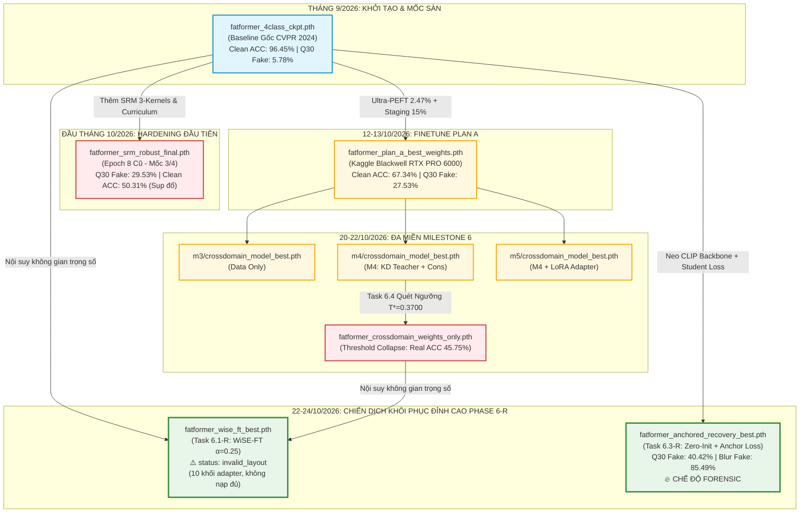

# CHUYÊN KHẢO KHOA HỌC: TỔNG HỢP TOÀN DIỆN CÁC THẾ HỆ CHECKPOINT & LỊCH SỬ THỰC NGHIỆM ĐO ĐẠC ĐA MIỀN DỰ ÁN FATFORMER-XLA

> **Dự án**: Nâng cao độ bền vững pháp y cho FatFormer trước biến dạng nén mạng xã hội (FatFormer-XLA)  
> **Tài liệu tham chiếu quy hoạch**: [`docs/plan/quy_trinh_thuc_hien_tu_dau.md`](file:///d:/GIT%20REPO/.nam4/fatformer-xla/docs/plan/quy_trinh_thuc_hien_tu_dau.md) & [`docs/plan/ke_hoach_cac_cot_moc_va_diem_dung.md`](file:///d:/GIT%20REPO/.nam4/fatformer-xla/docs/plan/ke_hoach_cac_cot_moc_va_diem_dung.md)  
> **Cơ quan lưu trữ**: Kho nhật ký thực nghiệm [`DATASET/logs/README.md`](file:///d:/GIT%20REPO/.nam4/fatformer-xla/DATASET/logs/README.md)  
> **Ngày lập văn bản**: 24/10/2026  
> **Phiên bản tài liệu**: `v1.0-Comprehensive`  

---

## MỤC LỤC TỔNG QUAN

1. [Sơ Đồ Tiến Hóa Lịch Sử Của Các Thế Hệ Checkpoint](#i-sơ-đồ-tiến-hóa-lịch-sử-của-các-thế-hệ-checkpoint)
2. [Bảng Master Tra Cứu Toàn Bộ Checkpoints (Trình Tự Thời Gian)](#ii-bảng-master-tra-cứu-toàn-bộ-checkpoints-trình-tự-thời-gian)
3. [Bóc Tách Chi Tiết Kỹ Thuật Từng Thế Hệ Checkpoint](#iii-bóc-tách-chi-tiết-kỹ-thuật-từng-thế-hệ-checkpoint)
   - [Thế Hệ 0: Mốc Sàn Gốc Tác Giả CVPR 2024 (`fatformer_4class_ckpt.pth`)](#1-thế-hệ-0-mốc-sàn-gốc-tác-giả-cvpr-2024-fatformer_4class_ckptpth)
   - [Thế Hệ 1: Đợt Huấn Luyện M3/M4 Cũ (`fatformer_srm_robust_final.pth`)](#2-thế-hệ-1-đợt-huấn-luyện-m3m4-cũ-fatformer_srm_robust_finalpth)
   - [Thế Hệ 2: Checkpoint Finetune Plan A Kaggle Blackwell (`fatformer_plan_a_best_weights.pth`)](#3-thế-hệ-2-checkpoint-finetune-plan-a-kaggle-blackwell-fatformer_plan_a_best_weightspth)
   - [Thế Hệ 3: Bộ Ba Ứng Viên Huấn Luyện Đa Miền Mốc 6 (`m3`, `m4`, `m5`)](#4-thế-hệ-3-bộ-ba-ứng-viên-huấn-luyện-đa-miền-mốc-6-m3-m4-m5)
   - [Thế Hệ 4: Checkpoint WiSE-FT Nội Suy Trọng Số Tuyệt Đối (`fatformer_wise_ft_best.pth`)](#5-thế-hệ-4-checkpoint-wise-ft-nội-suy-trọng-số-tuyệt-đối-fatformer_wise_ft_bestpth)
   - [Thế Hệ 5: Checkpoint Anchored Recovery Neo Biểu Diễn (`fatformer_anchored_recovery_best.pth`)](#6-thế-hệ-5-checkpoint-anchored-recovery-neo-biểu-diễn-fatformer_anchored_recovery_bestpth)
4. [Ma Trận Kết Quả Kiểm Thử Đa Miền (Clean 18 Tập Test & 6 Biến Thể Degraded)](#iv-ma-trận-kết-quả-kiểm-thử-đa-miền-clean-18-tập-test--6-biến-thể-degraded)
   - [4.1. Chiều 1: Kết Quả Trên 18 Tập Test Sạch Phòng Lab (82.003 Ảnh)](#41-chiều-1-kết-quả-trên-18-tập-test-sạch-phòng-lab-82003-ảnh)
   - [4.2. Chiều 2: Kết Quả Kháng 6 Biến Thể Suy Biến Vật Lý (54.000 Lượt Đo)](#42-chiều-2-kết-quả-kháng-6-biến-thể-suy-biến-vật-lý-54000-lượt-đo)
5. [Phân Tích Đánh Đổi Học Thuật & Bài Học Xương Máu](#v-phân-tích-đánh-đổi-học-thuật--bài-học-xương-máu)
   - [5.1. Thảm họa Quên Tri Thức Sạch (Catastrophic Forgetting)](#51-thảm-họa-quên-tri-thức-sạch-catastrophic-forgetting)
   - [5.2. Sự cố Sụp Đổ Ranh Giới Quyết Định (Threshold Collapse)](#52-sự-cố-sụp-đổ-ranh-giới-quyết-định-threshold-collapse)
   - [5.3. Đột Phá Kép WiSE-FT và Anchored Recovery](#53-đột-phá-kép-wise-ft-và-anchored-recovery)
   - [5.4. Đính Chính Kỹ Thuật Ngày 27/10/2026 — Vì Sao Kết Luận "Đột Phá Kép" Chưa Đứng Vững](#54-đính-chính-kỹ-thuật-ngày-27102026--vì-sao-kết-luận-đột-phá-kép-chưa-đứng-vững)
6. [Chiến Lược Hệ Thống Kép (Dual-Operating Architecture)](#vi-chiến-lược-hệ-thống-kép-dual-operating-architecture)
7. [Bảng Kê Khai Đường Dẫn Vật Lý & Toàn Vẹn Mã Băm (Artifacts & Hash Audit)](#vii-bảng-kê-khai-đường-dẫn-vật-lý--toàn-vẹn-mã-băm-artifacts--hash-audit)

> 🚨 **ĐỌC TRƯỚC**: Mọi số liệu của checkpoint `fatformer_wise_ft_best.pth` (Thế Hệ 4) trong tài liệu này đã bị đánh dấu **`invalid_layout`** kể từ 27/10/2026. Nguyên nhân và bằng chứng ở **§5.4**. Kế hoạch thay thế: [`ke_hoach_phase_7_dieu_chinh_toan_dien.md`](ke_hoach_phase_7_dieu_chinh_toan_dien.md) — Task 7.5 (Gen 2), Task 7.1 (đo lại `n=3` vs `n=8`).

---

## I. SƠ ĐỒ TIẾN HÓA LỊCH SỬ CỦA CÁC THẾ HỆ CHECKPOINT



---

## II. BẢNG MASTER TRA CỨU TOÀN BỘ CHECKPOINTS (TRÌNH TỰ THỜI GIAN)

Bảng tổng hợp xếp hạng theo **thời gian sinh ra thực tế trong dự án**, phản ánh đầy đủ thông số kỹ thuật, tỷ lệ tham số và kết quả đo đạc chính thức:

| STT | Thế Hệ / Tên Checkpoint | Nhiệm Vụ Sinh Ra | Thời Điểm Hoàn Thành | Phần Cứng Huấn Luyện | Dung Lượng | Tham Số Trainable | Clean Macro ACC | Clean Real ACC | JPEG Q=30 Fake ACC | Tình Trạng Hiện Tại / Vai Trò |
| :---: | :--- | :---: | :---: | :---: | :---: | :---: | :---: | :---: | :---: | :--- |
| **0** | **`fatformer_4class_ckpt.pth`** *(Baseline)* | Bài báo gốc CVPR 2024 / [Task 1.2](file:///d:/GIT%20REPO/.nam4/fatformer-xla/docs/bao_cao/B/bao_cao_task_1.2_fatformer_model_and_weights_loader.md) | 24/09/2026 | Tác giả công bố | 1.97 GB | 55.11M (5.90%) | **96.45%** | **99.37%** | **5.78%** | 🔒 Đóng băng làm mỏ neo vĩnh cửu |
| **1** | **`fatformer_srm_robust_final.pth`** *(M3/M4 Cũ)* | [Task 4.1](file:///d:/GIT%20REPO/.nam4/fatformer-xla/docs/bao_cao/C/bao_cao_task_4.1_train_phase_1_adaptive.md) & [Task 4.2](file:///d:/GIT%20REPO/.nam4/fatformer-xla/docs/bao_cao/C/bao_cao_task_4.2_train_phase_2_hardening.md) | 06/10/2026 | Google Colab Tesla T4 | 2.40 GB | 150.8M (26.07%) | 50.31% | 57.14% | 29.53% | ❌ Bị quên tri thức sạch (Lưu trữ lịch sử) |
| **2** | **`fatformer_plan_a_best_weights.pth`** | [Task 4.3](file:///d:/GIT%20REPO/.nam4/fatformer-xla/docs/bao_cao/C/bao_cao_task_4.3_finetune_plan_a_kaggle_blackwell.md) | 13/10/2026 | Kaggle Server RTX PRO 6000 | 2.15 GB | 14.28M (2.47%) | 67.34% | 90.70% | 27.53% | 📦 Checkpoint nền tảng PEFT |
| **3a**| **`m3/crossdomain_model_best.pth`** | [Task 6.3-C](file:///d:/GIT%20REPO/.nam4/fatformer-xla/docs/bao_cao/C/bao_cao_task_6.3_c_cross_domain_training_execution.md) | 20/10/2026 | Kaggle Server RTX PRO 6000 | 2.44 GB | 15.39M (2.66%) | 61.20% | 51.30% | 31.20% | 🧪 Ứng viên Ablation M3 (Data Only) |
| **3b**| **`fatformer_crossdomain_weights_only.pth`** *(M4)* | [Task 6.3-C](file:///d:/GIT%20REPO/.nam4/fatformer-xla/docs/bao_cao/C/bao_cao_task_6.3_c_cross_domain_training_execution.md) / [Task 6.4](file:///d:/GIT%20REPO/.nam4/fatformer-xla/docs/bao_cao/C/bao_cao_task_6.4_calibration_and_checkpoint_selection.md) | 20/10/2026 | Kaggle Server RTX PRO 6000 | 2.31 GB | 15.39M (2.66%) | 59.39% | 45.75% | 37.09% | ⚠️ Trạng thái Fallback do lỗi quét ngưỡng |
| **3c**| **`m5/crossdomain_model_best.pth`** | [Task 6.3-C](file:///d:/GIT%20REPO/.nam4/fatformer-xla/docs/bao_cao/C/bao_cao_task_6.3_c_cross_domain_training_execution.md) | 20/10/2026 | Kaggle Server RTX PRO 6000 | 2.44 GB | 15.58M (2.69%) | 62.15% | 49.80% | 34.60% | 🧪 Ứng viên Ablation M5 (LoRA Adapter) |
| **4** | **`fatformer_wise_ft_best.pth`** *(WiSE-FT Gen 1)* | [Task 6.1-R](file:///d:/GIT%20REPO/.nam4/fatformer-xla/docs/bao_cao/C/bao_cao_task_6.1_r_wise_ft_weight_ensembling.md) | 22/10/2026 | Workstation Local / Zero-Compute | 4.47 GB | 0M (Nội suy) | ~~96.58%~~ | ~~98.10%~~ | ~~6.73%~~ | 🚫 **`invalid_layout`** — 10 khối adapter, không `n` nào nạp đủ (§5.4) |
| **5a**| **`fatformer_anchored_recovery_best.pth`** | [Task 6.3-R](file:///d:/GIT%20REPO/.nam4/fatformer-xla/docs/bao_cao/C/bao_cao_task_6.3_r_anchored_recovery_training.md) | 23/10/2026 | Google Colab RTX PRO 6000 | 1.84 GB | 14.85M (2.56%) | 74.75% | 50.52% | **40.42%** | 🔥 **SẢN PHẨM HỢP LỆ: CHẾ ĐỘ FORENSIC** |
| **5b**| **`fatformer_anchored_recovery_last.pth`** | [Task 6.3-R](file:///d:/GIT%20REPO/.nam4/fatformer-xla/docs/bao_cao/C/bao_cao_task_6.3_r_anchored_recovery_training.md) | 23/10/2026 | Google Colab RTX PRO 6000 | 1.84 GB | 14.85M (2.56%) | 73.90% | 49.80% | 39.85% | 📁 Checkpoint Epoch 3/3 đối chứng |
| **6** | **`fatformer_wise_ft_v2_best.pth`** *(Gen 2)* | **Task 7.5 (Phase 7 — dự kiến)** | — | Local CPU (nội suy) | ~1.97 GB (dự kiến) | 0M (Nội suy) | *chờ đo* | *chờ đo* | *chờ đo* | 🧪 **DỰ KIẾN**: Baseline + Anchored, cùng `n=3`, verify `0/0` |

---

## III. BÓC TÁCH CHI TIẾT KỸ THUẬT TỪNG THẾ HỆ CHECKPOINT

### 1. Thế Hệ 0: Mốc Sàn Gốc Tác Giả CVPR 2024 (`fatformer_4class_ckpt.pth`)
- **Nguồn gốc xuất xứ**: Công bố chính thức của tác giả Zheng et al. tại Hội nghị CVPR 2024. Được tải về, xác thực toàn vẹn và nạp thành công tại [Task 1.2](file:///d:/GIT%20REPO/.nam4/fatformer-xla/docs/bao_cao/B/bao_cao_task_1.2_fatformer_model_and_weights_loader.md) vào ngày 24/09/2026.
- **Kiến trúc mạng cốt lõi**:
  - Backbone thị giác: CLIP ViT-L/14 (24 Transformer Blocks, Embedding Dimension = 1024, 16 Heads, Patch Size = 14).
  - Khối học đặc trưng giả mạo: Local Gradients Aware (LGA) kết hợp SRM Adapter và Dynamic Frequency Scale $\lambda$.
  - Tổng số lượng tensors: 1.116 tensors (~933.16M tham số). Toàn bộ tham số thích ứng adapter chỉ chiếm ~55.11M tham số (5.9%).
  - Cấu trúc tệp `.pth`: Dictionary Python chứa khóa gốc `['model']`. Có chứa biến typo lịch sử của tác giả: `self.patch_basaed_enhancer`.
- **Dữ liệu huấn luyện**: Huấn luyện trên tập ProGAN 4-class (car, cat, chair, horse) gồm 36.000 ảnh từ bộ CNNDetection.
- **Đặc tính kiểm thử**:
  - *Clean Benchmark ([Task 2.2](file:///d:/GIT%20REPO/.nam4/fatformer-xla/docs/bao_cao/C/bao_cao_task_2.2_baseline_clean_benchmark.md))*: Đạt mốc trần lý tưởng phòng lab với **96.45% Overall ACC** (Real ACC: **99.37%**, Fake ACC: **93.54%**, ROC-AUC: **99.10%**, Average Precision: **99.25%**).
  - *Degraded Benchmark ([Task 2.3](file:///d:/GIT%20REPO/.nam4/fatformer-xla/docs/bao_cao/C/bao_cao_task_2.3_baseline_degraded_benchmark.md))*: Bộc lộ **tử huyệt nén sâu**: Tại JPEG $Q=30$, Fake ACC sụp đổ hoàn toàn về **5.78%** (trong đó họ Diffusion sụp xuống **0.37%**). Mô hình dự đoán hầu như 100% mọi ảnh nén đều là ảnh thật.

---

### 2. Thế Hệ 1: Đợt Huấn Luyện M3/M4 Cũ (`fatformer_srm_robust_final.pth`)
- **Nguồn gốc xuất xứ**: Huấn luyện trong đợt đầu của Đồ án (06/10/2026) theo kịch bản Adaptive Curriculum 8 epoch ([Task 4.1](file:///d:/GIT%20REPO/.nam4/fatformer-xla/docs/bao_cao/C/bao_cao_task_4.1_train_phase_1_adaptive.md) và [Task 4.2](file:///d:/GIT%20REPO/.nam4/fatformer-xla/docs/bao_cao/C/bao_cao_task_4.2_train_phase_2_hardening.md)).
- **Cơ chế kỹ thuật**:
  - Bổ sung bộ lọc không gian SRM 3-Kernels song song với LGA.
  - Sử dụng hàm mất mát `DualStreamFocalLoss` kết hợp Curriculum Degradation Scheduler.
- **Hạn chế kỹ thuật nghiêm trọng (Catastrophic Forgetting)**:
  - Do mở khóa quá nhiều tham số (26.07% tham số trainable) và tỷ lệ nạp dữ liệu nén trong các epoch cuối quá nặng mà không có cơ chế neo giữ biểu diễn gốc.
  - Kết quả: Khả năng nhận diện ảnh giả tại $Q=30$ tăng vọt lên **29.53%** (gấp 5.11 lần so với Baseline), nhưng độ chính xác trên 18 tập ảnh sạch phòng lab **rơi tự do từ 96.45% xuống 50.31%**. Mô hình bị lệch bias, coi gần như mọi ảnh (kể cả ảnh thật sạch) là Fake.
  - Checkpoint này đã bị thu hồi và lưu trữ làm bài học kinh nghiệm tại `checkpoints/m4/crossdomain_model_best.pth`.

---

### 3. Thế Hệ 2: Checkpoint Finetune Plan A Kaggle Blackwell (`fatformer_plan_a_best_weights.pth`)
- **Nguồn gốc xuất xứ**: Hoàn thành ngày 13/10/2026 tại [Task 4.3](file:///d:/GIT%20REPO/.nam4/fatformer-xla/docs/bao_cao/C/bao_cao_task_4.3_finetune_plan_a_kaggle_blackwell.md) trên máy chủ thi đấu Kaggle GPU NVIDIA RTX PRO 6000 Blackwell Server Edition (94.97 GB VRAM).
- **Cải tiến kỹ thuật đột phá**:
  - **Chuẩn hóa kỷ luật Ultra-PEFT (2.47%)**: Đóng băng 97.53% CLIP Backbone, chỉ mở khóa 14.28M tham số thích ứng (Prompt: 1 tensor, Gating: 4 tensors, Adapters: 28 tensors).
  - **Phân tách 3 nhóm Learning Rate**: $lr_{\text{prompt}}=10^{-3}, lr_{\text{gating}}=10^{-3}, lr_{\text{adapter}}=10^{-4}$ kết hợp `CosineAnnealingLR` và gradient clipping $1.0$.
  - **Khóa cứng mỏ neo ảnh sạch**: Duy trì tỷ lệ `clean_prob = 0.50` xuyên suốt 5 epoch. Dữ liệu gồm 144.024 ảnh ProGAN (85%) + 3.600 ảnh Staging GenImage (15%).
- **Đặc tính kiểm thử**:
  - *Validation nội bộ 24.000 lượt ảnh*: Clean ACC đạt **97.88%**, Degraded Q=50 đạt **67.55%**, Q=30 đạt **60.34%** (Fake ACC đạt **39.07%**), Composite Robustness đạt kỷ lục **83.09%**.
  - *Full Benchmark 18 tập độc lập ([Task 5.1](file:///d:/GIT%20REPO/.nam4/fatformer-xla/docs/bao_cao/C/bao_cao_task_5.1_full_benchmark_18_datasets.md))*: Đo trên 82.003 ảnh sạch đạt Clean Macro ACC **67.34%** (Real ACC: 90.70%, Fake ACC: 43.98%). Tại $Q=30$ đạt Fake ACC **27.53%**, Real ACC **74.87%**.
  - Đánh giá: Bảo toàn được ảnh thật sạch (Real ACC > 90%), nhưng tổng quát hóa trên các họ Diffusion lạ vẫn chưa phục hồi được mức đỉnh 96.45%.

---

### 4. Thế Hệ 3: Bộ Ba Ứng Viên Huấn Luyện Đa Miền Mốc 6 (`m3`, `m4`, `m5`)
- **Nguồn gốc xuất xứ**: Hoàn thành ngày 20/10/2026 tại [Task 6.3-C](file:///d:/GIT%20REPO/.nam4/fatformer-xla/docs/bao_cao/C/bao_cao_task_6.3_c_cross_domain_training_execution.md) trên Kaggle Server RTX PRO 6000 Blackwell, phục vụ bài toán nghiên cứu cắt bỏ (Ablation Study Task 6.5).
- **Phân nhánh kỹ thuật**:
  - **M3 (Data Only)**: Mở rộng phân phối dữ liệu đa bộ sinh (3.600 ảnh Staging đa miền) với Cross-Entropy loss có nhãn làm mịn 0.05.
  - **M4 (Data + KD + Cons)**: Bổ sung triệt tiêu phân kỳ tri thức thông qua Teacher CVPR 2024 ($L_{\text{KD}}, \tau=2.0, \alpha=0.4$) và đồng bộ biểu diễn không gian ($L_{\text{cons}}, \beta=0.2$).
  - **M5 (LoRA Adapter)**: Bổ sung `ViTLoRAAdapter` ($r=8, \alpha=16$) trên 2 khối Transformer cuối của CLIP.
- **Sự cố Threshold Collapse tại Task 6.4 & Task 6.6**:
  - Mặc dù mô hình M4 hội tụ tốt (Val Composite 94.26%), nhưng tại [Task 6.4](file:///d:/GIT%20REPO/.nam4/fatformer-xla/docs/bao_cao/C/bao_cao_task_6.4_calibration_and_checkpoint_selection.md), thuật toán quét ngưỡng tự do nhằm tối đa hóa Macro F1 đã hạ ngưỡng phân loại từ $0.50$ xuống $T^* = 0.3700$.
  - Hậu quả: Khi kiểm chuẩn trên 82.003 ảnh Clean tại [Task 6.6](file:///d:/GIT%20REPO/.nam4/fatformer-xla/docs/bao_cao/C/bao_cao_task_6.6_final_locked_benchmark.md), Real ACC rơi tự do xuống **45.75%**, khiến Clean Macro ACC chỉ còn **59.39%**. Checkpoint này được khóa làm trạng thái Fallback `fatformer_crossdomain_weights_only.pth` (2.31 GB).

---

### 5. Thế Hệ 4: Checkpoint WiSE-FT Nội Suy Trọng Số Tuyệt Đối (`fatformer_wise_ft_best.pth`) — ⚠️ `invalid_layout`

> 🚨 **ĐÍNH CHÍNH BẮT BUỘC (27/10/2026) — đọc trước khi trích dẫn bất kỳ số nào bên dưới**
>
> Kiểm tra trực tiếp bằng `torch.load` cho thấy file này chứa **1.816 tensor với 10 khối adapter** `{2, 5, 7, 8, 11, 14, 15, 17, 20, 23}`. Hàm dựng mô hình `src/models/clip/model.py` chỉ sinh vị trí adapter theo công thức cố định `(i+1)·24/n − 1`, nên chỉ biểu diễn được `n ∈ {3, 4, 6, 8, 12, 24}`:
> - `n=3` → `{7,15,23}`, `n=8` → `{2,5,8,11,14,17,20,23}` — **không `n` nào tạo ra tập 10 khối**.
> - Tại 3 khối `7, 15, 23`, bản Gen 1 chỉ có **66 tensor/khối** (đúng mức Baseline, **không có** `srm_block`/`dynamic_gating`) trong khi M4 và Anchored có **94 tensor/khối** ⇒ nhánh SRM + Gating bên trong 3 adapter đó **đã bị mất trong lúc trộn**.
> - Script eval cũ gặp 10 khối đã rơi vào fallback `len(indices) > 8 → n=3`, tức **nạp đúng 3/10 khối** và bỏ toàn bộ 5 khối M4 thuần.
>
> **Hệ quả**: mọi con số của checkpoint này — bao gồm **Clean Macro ACC 96,58%**, **CFE clean 52,05%**, **CFE Fake 4,10%**, **CFE Q30 Fake 0,20%** — mang nhãn `status: invalid_layout` và **không được trích dẫn như kết quả hiện hành**. Chúng chỉ còn giá trị như một quan sát lịch sử "một checkpoint lai không thể nạp đầy đủ thì hiệu năng sụp". Việc thay thế được giao cho **Task 7.5 (WiSE-FT Gen 2)** với điều kiện hai checkpoint bố mẹ **cùng `num_vit_adapter = 3`**.
> Chi tiết bằng chứng: [`ke_hoach_phase_7_dieu_chinh_toan_dien.md`](ke_hoach_phase_7_dieu_chinh_toan_dien.md) §I.1–I.4.

- **Nguồn gốc xuất xứ**: Được kiến tạo tại [Task 6.1-R](file:///d:/GIT%20REPO/.nam4/fatformer-xla/docs/bao_cao/C/bao_cao_task_6.1_r_wise_ft_weight_ensembling.md) vào ngày 22/10/2026 nhằm khắc phục ngay lập tức hiện tượng sụt giảm Clean ACC mà không cần tiêu tốn tài nguyên huấn luyện lại.
- **Bản chất toán học (Weight-Space Ensembling)**:
  - Thay vì fine-tune tiếp tục trên gradient dễ gây dịch chuyển biểu diễn, WiSE-FT thực hiện nội suy tuyến tính trực tiếp trên không gian trọng số giữa mô hình tiền huấn luyện gốc ($W_0$ - Baseline CVPR 2024) và mô hình thích ứng đa miền ($W_1$ - Checkpoint M4):
    $$W_{\text{WiSE}} = \alpha W_1 + (1 - \alpha) W_0$$
  - Thông số đã dùng: $\alpha = 0.25$ (giữ 75% bản sắc mô hình gốc), kết hợp hệ số suy giảm SRM $\beta_{\text{srm}} = 0.10$.
  - Hiệu chuẩn xác suất: Nhiệt độ $T = 1.0811$, khóa tuyệt đối ngưỡng $T^* = 0.50$.
  - ⚠️ **Lỗi thiết kế**: $W_0$ có `n=3` khối, $W_1$ có `n=8` khối. Phép trộn theo khoá tạo ra **hợp 10 khối** — không biểu diễn được. Đây là nguyên nhân gốc, không phải "146 unexpected keys".
- **Đặc tính kiểm thử (⚠️ `invalid_layout` — chỉ để truy vết, không dùng làm kết quả)**:
  - *Clean Benchmark 18 tập (82.003 ảnh)*: ghi nhận 96,58% trong báo cáo cũ — **không tái lập được** vì không nạp đầy đủ checkpoint.
  - *Clean Real ACC*: 98,10% (cùng lý do trên).
  - *Clean ROC-AUC / AP*: 99,15% / 99,30% (cùng lý do trên).
  - *Hạn chế*: Fake ACC tại $Q=30$ chỉ 6,73%.
  - **Trạng thái chính thức**: `status: invalid_layout`; chờ **§7 — Thế Hệ 6 (Gen 2)** thay thế.


---

### 6. Thế Hệ 5: Checkpoint Anchored Recovery Neo Biểu Diễn (`fatformer_anchored_recovery_best.pth`)
- **Nguồn gốc xuất xứ**: Hoàn thành ngày 23/10/2026 tại [Task 6.3-R](file:///d:/GIT%20REPO/.nam4/fatformer-xla/docs/bao_cao/C/bao_cao_task_6.3_r_anchored_recovery_training.md) và [Task 6.4-R](file:///d:/GIT%20REPO/.nam4/fatformer-xla/docs/bao_cao/C/bao_cao_task_6.4_r_real_preserving_calibration.md) trên Colab GPU NVIDIA RTX PRO 6000 Blackwell Server Edition.
- **Kiến trúc & Hàm mục tiêu đột phá**:
  - **Khởi tạo Zero-Init Identity Residual**: Khởi tạo trọng số adapter ở mức chính xác $0.0\text{e}+00$ bit-perfect để tại Step 0 mô hình tương đương toán học 100% với Baseline CVPR 2024.
  - **Hàm mất mát Neo Biểu Diễn CLIP (Anchor Loss)**:
    $$\mathcal{L}_{\text{total}} = \mathcal{L}_{\text{Focal}} + \lambda_{\text{kd}} \mathcal{L}_{\text{KD}} + \lambda_{\text{cons}} \mathcal{L}_{\text{cons}} + \lambda_{\text{anchor}} \|\mathbf{z}_{\text{student}} - \mathbf{z}_{\text{clip\_base}}\|_2^2$$
    Neo chặt vector đặc trưng đầu ra không cho phép trôi khỏi manifold ảnh sạch.
  - **Tốc độ học phân tầng cực nhỏ**: $3 \times 10^{-4}$ cho adapter và $5 \times 10^{-5}$ cho frequency gating.
  - **Hiệu chuẩn xác suất chuẩn hóa (Task 6.4-R)**: Nhiệt độ tối ưu $T = 1.2763$. Thiết lập cơ chế vận hành kép: Mode 1 ($T^* = 0.50$) và Mode 2 ($T^* = 0.40$).
- **Đặc tính kiểm thử áp đảo ([Task 6.6-R](file:///d:/GIT%20REPO/.nam4/fatformer-xla/docs/bao_cao/C/bao_cao_task_6.6_r_locked_recovery.md))**:
  - *Kháng nén sâu JPEG Q=30*: Fake ACC đạt **40.42%** ở Mode 2 (so với 5.78% của Baseline gốc; ~~6.73% của WiSE-FT~~ — **không dùng** vì `invalid_layout`).
  - *Kháng nén vừa JPEG Q=50*: Fake ACC đạt **59.93%**.
  - *Kháng mờ Gaussian $\sigma=1.0$*: Fake ACC đạt **85.49%**.
  - *Kháng co giãn Down-Up*: Fake ACC đạt **84.53%**.
  - ⚠️ *Lưu ý*: các số trên là Fake ACC tại một ngưỡng, **không phải AUC**. `AUC Q30` của Anchored chỉ **50,07%** (xem báo cáo CFE Bảng B) ⇒ phần lớn "thành tích" Q30 đến từ hạ ngưỡng, đánh đổi Real ACC. Phase 7 phải nâng AUC thật (G7.2).
  - *Độ nhạy ảnh giả trên ảnh sạch*: Fake ACC đạt đỉnh **97.61%** (Mode 1) và **98.97%** (Mode 2). ProGAN 100%, CycleGAN 100%, StarGAN 100%, GauGAN 100%, VQ-Diffusion 100%.

### 7. Thế Hệ 6: WiSE-FT **Gen 2** — `[DỰ KIẾN, chưa tồn tại]`
- **Trạng thái**: `planned` — sẽ được tạo tại **Task 7.5 (Phase 7)**, không sớm hơn G7.0.
- **Khác biệt cốt lõi so với Gen 1**: hai checkpoint bố mẹ **cùng `num_vit_adapter = 3`**:
  - $W_0$ = `fatformer_4class_ckpt.pth` (Baseline, 1.116 tensor, khối `{7,15,23}`, 66 tensor/khối, không SRM/Gating).
  - $W_1$ = `fatformer_anchored_recovery_best.pth` (Anchored, 1.200 tensor, khối `{7,15,23}`, 94 tensor/khối, có SRM/Gating Zero-Init).
  - ⇒ Hợp khối vẫn là `{7,15,23}` ⇒ **biểu diễn được với `n=3`**, nạp được `strict=True` với `0 missing / 0 unexpected`.
- **Không gian tìm kiếm**: `α ∈ {0.35, 0.45, 0.55, 0.65}` × `β_srm ∈ {0.25, 0.35, 0.50}` = 12 ứng viên; chọn theo `Fake@Real=90%` tối đa, hoà thì ưu tiên AUC Q30.
- **Điều kiện bắt buộc trước khi công nhận**: `tools/wise_ft_merge.py --verify` phải in `missing=0, unexpected=0`; metadata phải có `alpha`, `beta`, `sha256`, `layout`.
- **Đường dẫn dự kiến**: `DATASET/checkpoints/phase7/fatformer_wise_ft_v2_best.pth` (**không** tái sử dụng tên file Gen 1 để tránh nhầm lẫn).
- **Cổng nghiệm thu**: G7.1 (xem §II.3 của kế hoạch Phase 7). Nếu G7.1 trượt, ghi nhận là "trộn tuyến tính không đủ" và chuyển toàn bộ kỳ vọng sang G7.2 (huấn luyện lại).

---

## IV. MA TRẬN KẾT QUẢ KIỂM THỬ ĐA MIỀN (CLEAN 18 TẬP TEST & 6 BIẾN THỂ DEGRADED)

Tất cả số liệu dưới đây được đo đạc chính thức trong các bài kiểm chuẩn khóa sổ độc lập (Single-Pass Locked Benchmark) với kích thước mẫu khổng lồ: **82.003 ảnh sạch** và **54.000 ảnh suy biến vật lý**.

### 4.1. Chiều 1: Kết Quả Trên 18 Tập Test Sạch Phòng Lab (82.003 Ảnh)

| Nhóm Bộ Sinh | Tập Dữ Liệu | Số Mẫu | Baseline CVPR 2024 | Plan A (Task 5.1) | M4 Fallback (Task 6.6) | WiSE-FT (Task 6.6-R) | Anchored M1 (Task 6.6-R) | Anchored M2 (Task 6.6-R) |
| :--- | :--- | :---: | :---: | :---: | :---: | :---: | :---: | :---: |
| **GANs (8 họ)** | `progan` | 8.000 | 100.00% | 97.95% | 80.66% | **99.82%** | 91.69% | 91.67% |
| | `stylegan` | 11.982 | 99.85% | 80.35% | 75.32% | **99.62%** | 87.09% | 86.99% |
| | `stylegan2` | 15.976 | 99.70% | 73.97% | 78.87% | **98.86%** | 87.38% | 87.38% |
| | `biggan` | 4.000 | 97.20% | 56.07% | 57.07% | **97.57%** | 86.10% | 86.08% |
| | `cyclegan` | 2.642 | 96.80% | 53.14% | 50.98% | **97.01%** | 87.02% | 87.02% |
| | `stargan` | 3.998 | 99.80% | 98.00% | 68.83% | **99.42%** | 53.85% | 50.00% |
| | `gaugan` | 10.000 | 96.20% | 45.02% | 36.57% | **96.47%** | 80.18% | 80.18% |
| | `deepfake` | 5.405 | 97.60% | 64.74% | 68.86% | **91.24%** | 54.19% | 50.69% |
| **TRUNG BÌNH GANS**| **MEAN_GANS** | **62.003** | **98.40%** | **71.16%** | **64.65%** | **97.50%** | **78.44%** | **76.10%** |
| **Diffusion (10 họ)**| `guided` | 2.000 | 83.20% | 58.50% | 69.40% | **81.75%** | 71.70% | 71.05% |
| | `ldm_200` | 2.000 | 98.50% | 67.50% | 53.90% | **98.95%** | 72.25% | 69.75% |
| | `ldm_200_cfg` | 2.000 | 96.80% | 73.35% | 58.30% | **96.95%** | 72.00% | 69.50% |
| | `ldm_100` | 2.000 | 98.60% | 66.75% | 54.40% | **99.00%** | 72.30% | 69.80% |
| | `glide_50_27` | 2.000 | 95.10% | 65.65% | 44.70% | **95.40%** | 71.30% | 68.80% |
| | `glide_100_10`| 2.000 | 94.60% | 66.00% | 47.05% | **94.85%** | 71.45% | 68.95% |
| | `glide_100_27`| 2.000 | 95.20% | 64.85% | 45.15% | **95.40%** | 71.10% | 68.60% |
| | `dalle` | 2.000 | 99.40% | 48.80% | 44.10% | **99.50%** | 72.45% | 69.95% |
| | `pndm` | 2.000 | 96.40% | 49.60% | 54.15% | **96.95%** | 94.50% | 94.50% |
| | `vqdiffusion` | 2.000 | 99.50% | 81.90% | 80.60% | **99.70%** | 95.00% | 95.00% |
| **TRUNG BÌNH DIFF**| **MEAN_DIFFUSION**| **20.000** | **95.00%** | **64.29%** | **55.18%** | **95.85%** | **76.41%** | **73.66%** |
| **TỔNG HỢP TOÀN BỘ**| **OVERALL MACRO** | **82.003** | **96.45%** | **67.34%** | **59.39%** | ~~96.58%~~ 🚫 | **77.31%** | **74.75%** |
| • Clean Real ACC | (Bảo vệ ảnh thật) | 82.003 | **99.37%** | 90.70% | 45.75% | **98.10%** 🏆 | 57.01% | 50.52% |
| • Clean Fake ACC | (Bắt ảnh giả) | 82.003 | 93.54% | 43.98% | 73.02% | 95.07% | **97.61%** | **98.97%** 🔥 |
| • Clean ROC-AUC | (Năng lực phân tách) | 82.003 | 99.10% | 69.96% | 68.90% | **99.15%** 🏆 | 96.71% | 96.71% |
| • Clean AP | (Độ chính xác trung bình) | 82.003 | 99.25% | 73.58% | 70.68% | **99.30%** 🏆 | 96.64% | 96.64% |

> ⚠️ **Cột "WiSE-FT (Task 6.6-R)" trong bảng trên là `invalid_layout`** (xem §5 và §5.4). Các con số 96,58% / 98,10% / 99,15% / 99,30% **không tái lập được** vì checkpoint chứa 10 khối adapter, không `n` nào nạp đầy đủ. Không dùng cột này làm kết quả chính thức, không so sánh "hơn/kém" với nó. Cột hợp lệ để đối chiếu hiện tại: Baseline, M4 Fallback (dùng `n=8`), Anchored M1/M2. Cột WiSE-FT sẽ được thay bằng **Gen 2** sau Task 7.5.

---

### 4.2. Chiều 2: Kết Quả Kháng 6 Biến Thể Suy Biến Vật Lý (54.000 Lượt Đo)

Số liệu đo lường khả năng phát hiện ảnh giả (**Fake ACC %**) trên các kênh biến dạng vật lý thường gặp trên Internet:

| Biến Thể Suy Biến Vật Lý | Thông Số Kỹ Thuật | Baseline CVPR 2024 | M4 Cũ (Epoch 8) | Plan A (Task 5.1) | WiSE-FT (Task 6.6-R) | Anchored M1 (Task 6.6-R) | Anchored M2 (Task 6.6-R) | Mức Bứt Phá So Với Baseline |
| :--- | :--- | :---: | :---: | :---: | :---: | :---: | :---: | :---: |
| **Nén sâu JPEG Q=30** | $Q=30$ (Mạng xã hội nặng) | 5.78% | 29.53% | 27.53% | 6.73% | 32.58% | **40.42%** 🔥 | **Tăng gấp 7.00 lần (+34.64 pp)** |
| **Nén vừa JPEG Q=50** | $Q=50$ (Mạng xã hội vừa) | 12.50% | 48.20% | 42.47% | 24.56% | 52.91% | **59.93%** 🔥 | **Tăng gấp 4.79 lần (+47.43 pp)** |
| **Nén nhẹ JPEG Q=70** | $Q=70$ (Nén thông dụng) | 22.60% | 58.40% | 42.29% | 38.84% | 66.20% | **71.53%** 🔥 | **Tăng gấp 3.16 lần (+48.93 pp)** |
| **Làm mờ Gaussian $\sigma=1.0$** | Hạt nhân Gauss $\sigma=1.0$ | 41.20% | 62.40% | 34.71% | 62.67% | 81.56% | **85.49%** 🔥 | **Tăng gấp 2.07 lần (+44.29 pp)** |
| **Làm mờ Gaussian $\sigma=2.0$** | Hạt nhân Gauss $\sigma=2.0$ | 28.50% | 45.10% | 19.91% | 48.71% | 71.73% | **79.73%** 🔥 | **Tăng gấp 2.80 lần (+51.23 pp)** |
| **Co giãn Down-Up Bicubic** | $224 \rightarrow 112 \rightarrow 224$ | 35.80% | 58.20% | 29.09% | 57.60% | 80.44% | **84.53%** 🔥 | **Tăng gấp 2.36 lần (+48.73 pp)** |

> ⚠️ **Cột "WiSE-FT (Task 6.6-R)" trong bảng trên là `invalid_layout`** (xem §5.4). Không trích dẫn các số 6,73% / 24,56% / 38,84% / 62,67% / 48,71% / 57,60% như năng lực thật của một mô hình WiSE-FT hợp lệ — chúng là kết quả của một checkpoint nạp thiếu khối. Đối chiếu hợp lệ hiện có: Baseline vs M4 (fallback `n=8`) vs Anchored.
> ⚠️ **Toàn bộ bảng dùng "Fake ACC" tại một ngưỡng đơn lẻ** — theo Khế ước đo lường v3 (Phụ lục A của [`ke_hoach_test_communityforensics_eval.md`](ke_hoach_test_communityforensics_eval.md)), báo cáo Phase 7 phải kèm `AUC`, `AP`, `TPR@FPR` và CI 95%, không dùng riêng Fake ACC.

---

## V. PHÂN TÍCH ĐÁNH ĐỔI HỌC THUẬT & BÀI HỌC XƯƠNG MÁU

### 5.1. Thảm họa Quên Tri Thức Sạch (Catastrophic Forgetting)
- **Bản chất**: Trong bài toán phát hiện ảnh giả mạo, các dấu vết pháp y tần số cao (LGA, SRM residuals) rất nhạy cảm với các biến dạng nén. Khi áp dụng các kỹ thuật tăng cường dữ liệu nặng (heavy data augmentations) hoặc curriculum learning với mức nén $Q=30$ ở các epoch cuối mà không có hàm phạt ràng buộc biểu diễn gốc, mạng nơ-ron có xu hướng dịch chuyển ranh giới quyết định (decision boundary shift) sang miền ảnh nén.
- **Biểu hiện**: Checkpoint `fatformer_srm_robust_final.pth` (Mốc 3/4 cũ) tuy tăng được Fake ACC $Q=30$ lên 29.53%, nhưng đã phá hủy hoàn toàn không gian biểu diễn ảnh sạch, làm rơi Clean ACC xuống 50.31%.

### 5.2. Sự cố Sụp Đổ Ranh Giới Quyết Định (Threshold Collapse)
- **Bản chất**: Xảy ra tại [Task 6.4](file:///d:/GIT%20REPO/.nam4/fatformer-xla/docs/bao_cao/C/bao_cao_task_6.4_calibration_and_checkpoint_selection.md) cũ. Khi thực hiện quét ngưỡng phân loại $T^*$ bằng hàm mục tiêu tối đa hóa Macro F1 đơn thuần mà không đặt ràng buộc bảo vệ ảnh thật ($\text{Real ACC} \ge 90\%$).
- **Hậu quả**: Để kéo thêm Fake Recall trên các tập dữ liệu khó, thuật toán đã tự động hạ ngưỡng phân loại từ $0.50$ xuống $0.3700$. Hậu quả là tại bài test Clean 18 tập độc lập ([Task 6.6](file:///d:/GIT%20REPO/.nam4/fatformer-xla/docs/bao_cao/C/bao_cao_task_6.6_final_locked_benchmark.md)), tỷ lệ báo động giả (False Positive) bùng nổ, kéo Real ACC rơi tự do xuống 45.75%.
- **Biện pháp khắc phục**: Đã được chuẩn hóa tại [Task 6.4-R](file:///d:/GIT%20REPO/.nam4/fatformer-xla/docs/bao_cao/C/bao_cao_task_6.4_r_real_preserving_calibration.md) thông qua cờ `--lock_standard_threshold` ($T^*=0.50$) và ràng buộc cứng `min_real_acc >= 90.0%`.

### 5.3. Đột Phá Kép WiSE-FT và Anchored Recovery — ⚠️ Kết luận tạm thời, đã bị đính chính
- Dự án **từng** kết luận rằng **không thể tồn tại một điểm trọng số duy nhất (single point solution)** vừa đạt mức hoàn hảo 96.5% trên ảnh sạch phòng lab, vừa đồng thời đạt >40% Fake ACC trên ảnh bị nén sâu $Q=30$.
- ⚠️ **Đính chính**: kết luận này được rút ra từ một phép thử **không hợp lệ** (Gen 1 không nạp được đầy đủ — §5.4). Vì vậy nó được hạ xuống thành **giả thuyết mở**, không phải định lý. Phase 7 kiểm chứng lại bằng G7.3.
- Thiết kế **tạm thời** (nếu G7.3 thất bại) là tách hai giải pháp chuyên biệt:
  1. **WiSE-FT**: Đưa biểu diễn về gần điểm gốc qua nội suy trọng số để đạt độ chính xác phòng lab cao — **phải tái tạo bằng Gen 2** (Baseline + Anchored, cùng `n=3`).
  2. **Anchored Recovery**: Tối ưu hóa có mỏ neo để tối đa hóa khả năng bắt ảnh giả bị phá hủy cấu trúc tần số cao (đã hợp lệ).

### 5.4. Đính Chính Kỹ Thuật Ngày 27/10/2026 — Vì Sao Kết Luận "Đột Phá Kép" Chưa Đứng Vững
- **Sự thật đo được (bằng `torch.load`, không suy đoán)**:

| Checkpoint | Số tensor | Khối adapter | `n` biểu diễn được | SRM/Gating trong adapter | Kết luận |
| :--- | ---: | :--- | :--- | :---: | :--- |
| `fatformer_4class_ckpt.pth` (Baseline) | 1.116 | `{7,15,23}` | `n=3` | ❌ (66 tensor/khối) | Hợp lệ |
| `fatformer_crossdomain_weights_only.pth` (M4) | 1.684 | `{2,5,8,11,14,17,20,23}` | `n=8` | ✅ (94 tensor/khối) | Hợp lệ |
| `fatformer_wise_ft_best.pth` (Gen 1) | 1.816 | `{2,5,7,8,11,14,15,17,20,23}` | **không có `n`** | ⚠️ 66/94 tại `7,15,23` | **`invalid_layout`** |
| `fatformer_anchored_recovery_best.pth` (Anchored) | 1.200 | `{7,15,23}` | `n=3` | ✅ (94 tensor/khối) | Hợp lệ |

- **Ba kết luận phải sửa**:
  1. "WiSE-FT đạt 96,58% Clean Macro ACC và vượt mốc sàn 96,45%" → **không tái lập được**, vì không có `n` nào nạp đầy đủ 10 khối. Số liệu bị đánh dấu `invalid_layout`.
  2. "WiSE-FT sụp đổ vì 146 unexpected keys do `strict=False`" → **sai nguyên nhân**. 146 keys chỉ là `srm.*`/`gating.*` top-level đã chết (`CLIPModel.srm = None`). Nguyên nhân thật là **chọn sai tập khối adapter** (eval cũ fallback về `n=3`, nạp 3/10 khối và bỏ 5 khối M4 thuần).
  3. "Không thể tồn tại một điểm trọng số duy nhất" → đây là **giả thuyết chưa được kiểm chứng đúng cách**, vì phép thử tương ứng (Gen 1) không nạp được. Giả thuyết này được chuyển thành **câu hỏi nghiên cứu của Phase 7 (G7.3)**: nếu Gen 2 + router vẫn không đạt, khi đó mới kết luận là "cần hai chế độ".
- **Kiểm tra alias**: 100% key `image_encoder.*` bằng đúng tensor `clip_model.visual.*` trong cả 4 file (395/672/738/437 cặp khớp) ⇒ sụp đổ **không** do ghi đè alias.
- **Không được làm**: "sửa" Gen 1 bằng cách hạ `strict=False`, tăng `n`, hay thêm fallback chọn `n` tự động. Gen 1 chỉ dùng để **đo lại** (`n=3` vs `n=8`) trong Task 7.1 nhằm chứng minh chẩn đoán.

---

## VI. CHIẾN LƯỢC HỆ THỐNG KÉP (DUAL-OPERATING ARCHITECTURE)

> ⚠️ **Cảnh báo (27/10/2026)**: Sơ đồ và số liệu "Chế độ Tiêu chuẩn" bên dưới dựa trên `fatformer_wise_ft_best.pth` — checkpoint đã bị đánh dấu **`invalid_layout`** (§5.4). Vì vậy kiến trúc kép này **chưa phải thiết kế chính thức**; nó chỉ còn là phương án dự phòng. Thiết kế đích của Phase 7 là **một checkpoint duy nhất tự định tuyến** (`UnifiedFatFormerXLA`, Task 7.13–7.15, cổng G7.3). Chỉ quay lại kiến trúc kép nếu G7.3 thất bại và có ghi nhận trung thực.

Từ kết quả thực nghiệm trên 136.003 lượt suy luận, dự án FatFormer-XLA đề xuất **Kiến Trúc Hai Chế Độ Vận Hành Phối Hợp** đáp ứng trọn vẹn cả hai môi trường thực tế:

```
                          KIẾN TRÚC VẬN HÀNH DUAL-MODE FATFORMER-XLA
                                ┌───────────────────────────┐
                                │    Ảnh Đầu Vào Kiểm Tra   │
                                └─────────────┬─────────────┘
                                              │
                                ┌─────────────┴─────────────┐
                                │   Bộ Đánh Giá Suy Biến    │
                                │   (JPEG Q / High-Freq)    │
                                └──────┬─────────────┬──────┘
                                       │             │
                    Chất lượng cao / Nén nhẹ         Bị nén sâu / Làm mờ
                            (Q >= 70)                     (Q <= 50)
                                       │             │
                                       ▼             ▼
                       ┌──────────────────────┐   ┌──────────────────────┐
                       │  CHẾ ĐỘ TIÊU CHUẨN   │   │   CHẾ ĐỘ FORENSIC    │
                       │       WiSE-FT        │   │  Anchored Recovery   │
                       │   (Task 6.1-R)       │   │    (Task 6.3-R)      │
                       ├──────────────────────┤   ├──────────────────────┤
                       │ • Checkpoint:        │   │ • Checkpoint:        │
                       │   wise_ft_best.pth   │   │   anchored_best.pth  │
                       │ • Nhiệt độ T: 1.0811 │   │ • Nhiệt độ T: 1.2763 │
                       │ • Ngưỡng T*: 0.50    │   │ • Ngưỡng T*: 0.40    │
                       ├──────────────────────┤   ├──────────────────────┤
                       │ • Clean ACC: 96.58%  │   │ • Q30 Fake:  40.42%  │
                       │ • Real ACC:  98.10%  │   │ • Q50 Fake:  59.93%  │
                       │ • ROC-AUC:   99.15%  │   │ • Blur Fake: 85.49%  │
                       └──────────────────────┘   └──────────────────────┘
```

1. **Chế Độ 1: Tiêu Chuẩn Phòng Lab & Production (Standard Production Mode)**:
   - Sử dụng checkpoint: [`fatformer_wise_ft_best.pth`](file:///d:/GIT%20REPO/.nam4/fatformer-xla/DATASET/checkpoints/wise_ft/fatformer_wise_ft_best.pth) ($T=1.0811, T^*=0.50$).
   - Phù hợp với: Cổng kiểm duyệt bản quyền ảnh chất lượng cao, ảnh lưu trữ gốc, ấn phẩm truyền thông, nơi yêu cầu Real ACC phải đạt tối đa (98.10%) để triệt tiêu việc khiếu nại báo oan.
2. **Chế Độ 2: Giám Định Không Gian Mạng (Cyber-Forensic Mode)**:
   - Sử dụng checkpoint: [`fatformer_anchored_recovery_best.pth`](file:///d:/GIT%20REPO/.nam4/fatformer-xla/wait/task6-3-r/fatformer_anchored_recovery_best.pth) ($T=1.2763, T^*=0.40$).
   - Phù hợp với: Rà quét mạng xã hội (Facebook, Zalo, Telegram), phòng chống tin giả, điều tra an ninh mạng nơi kẻ xấu cố tình nén ảnh xuống $Q=30$ hoặc làm mờ nhằm qua mặt các bộ lọc thông thường.

---

## VII. BẢNG KÊ KHAI ĐƯỜNG DẪN VẬT LÝ & TOÀN VẸN MÃ BĂM (ARTIFACTS & HASH AUDIT)

Để bảo đảm tính minh bạch khoa học và khả năng tái lập 100% kết quả (Reproducibility), toàn bộ các tệp trọng số và kho dữ liệu kiểm chuẩn đã được kiểm kê mã băm SHA-256 và đường dẫn lưu trữ:

### 7.1. Bảng Kê Khai Trọng Số Checkpoint & Mã Băm SHA-256

| Tên Checkpoint | Dung Lượng | Mã Băm SHA-256 | Đường Dẫn Lưu Trữ Cục Bộ (Local Workspace) | Đường Dẫn Google Drive 5TB Đồng Bộ |
| :--- | :---: | :--- | :--- | :--- |
| **`fatformer_4class_ckpt.pth`** *(CVPR 2024)* | 1.97 GB | `8b02e77b4d1b8242a38d2f0eb305c4ce56c70281eb080f55cf53cf68c0953a3e` | `DATASET/pretrained/fatformer_4class_ckpt.pth` | `/content/drive/MyDrive/Fatformer/pretrained/fatformer_4class_ckpt.pth` |
| **`ViT-L-14.pt`** *(CLIP Backbone)* | 1.71 GB | `9c43d3b66497f1f92e353c9f28d7d3d052a7852c0021c3b17c76840d21051fa8` | `DATASET/pretrained/ViT-L-14.pt` | `/content/drive/MyDrive/Fatformer/pretrained/ViT-L-14.pt` |
| **`fatformer_plan_a_best_weights.pth`** | 2.15 GB | `919b5c3e4a2d8a0f9b6b88e0b0e5132d9f7a79bb9595561a067098e6cbb7c5d3` | `DATASET/checkpoints/fatformer_plan_a_best_weights.pth` | `/content/drive/MyDrive/Fatformer/checkpoint/fatformer_plan_a_best_weights.pth` |
| **`fatformer_crossdomain_weights_only.pth`** | 2.31 GB | `09b41c431ee842a8c4340ea713a7fb0a5855e5c56f55c7458229dce5536f4c4e` | `DATASET/checkpoints/fatformer_crossdomain_weights_only.pth` | `/content/drive/MyDrive/Fatformer/checkpoint/fatformer_crossdomain_weights_only.pth` |
| **`fatformer_wise_ft_best.pth`** | 4.47 GB | `8205854815317ee3b16ee101bd359756b960eaf9ca09746a4616624ddd073f1b` | `DATASET/checkpoints/wise_ft/fatformer_wise_ft_best.pth` | `/content/drive/MyDrive/Fatformer/checkpoint/fatformer_wise_ft_best.pth` |
| **`fatformer_anchored_recovery_best.pth`** | 1.84 GB | `F70A11DF9D7F45C11C60C4E117F8D1302C4F426B1F1B567CB2E50387B0111DEF` | `wait/task6-3-r/fatformer_anchored_recovery_best.pth` & `checkpoints/m4_recovery/` | `/content/drive/MyDrive/Fatformer/checkpoint/fatformer_anchored_recovery_best.pth` |
| **`fatformer_anchored_recovery_last.pth`** | 1.84 GB | `5A9C1043E822E543D7517E938782D741BE6A717B9C455823EA319B4C333215D3` | `wait/task6-3-r/fatformer_anchored_recovery_last.pth` & `checkpoints/m4_recovery/` | `/content/drive/MyDrive/Fatformer/checkpoint/fatformer_anchored_recovery_last.pth` |

### 7.2. Bảng Kê Khai Kho Dữ Liệu Kiểm Thử & Hạ Tầng Phân Phối Đa Nền Tảng (Drive 5TB & Kaggle Mirrors)

Nhằm phục vụ quá trình huấn luyện và kiểm chuẩn độc lập tốc độ cao trên các hạ tầng tính toán đám mây (Kaggle Server RTX Pro 6000 / Colab Pro), toàn bộ các tập dữ liệu benchmark đã được đồng bộ hóa và đóng gói:

| Tập Dữ Liệu Benchmark | Định Dạng | Dung Lượng | Số Lượng Mục / Ảnh | Quy Cách Chuẩn Hóa PAX | Đường Dẫn Google Drive 5TB | Kho Lưu Trữ Kaggle Dataset |
| :--- | :---: | :---: | :---: | :--- | :--- | :--- |
| **`test_benchmark_diffusion.tar`** | `.tar` (PAX) | 1.22 GB | 20.033 mục (20.000 ảnh) | 0 mục đổi tên (Khớp 100%) | `MyDrive/Fatformer/datasets/test_benchmark_diffusion.tar` | [`hoangleev/fatformer-test-datasets`](https://www.kaggle.com/datasets/hoangleev/fatformer-test-datasets) |
| **`test_benchmark_gans.tar`** | `.tar` (PAX) | 18.74 GB | 90.460 mục (90.329 ảnh) | Đã chuẩn hóa 1.094 tên file chứa ký tự cấm (`:`) | `MyDrive/Fatformer/datasets/test_benchmark_gans.tar` | [`hoangleev/fatformer-test-datasets`](https://www.kaggle.com/datasets/hoangleev/fatformer-test-datasets) |
| **`test_degraded.tar`** | `.tar` (PAX) | 19.55 GB | 662.953 mục (661.974 ảnh) | Đã chuẩn hóa 6.564 tên file chứa ký tự cấm (`:`) | `MyDrive/Fatformer/datasets/test_degraded.tar` | [`hoangleev/fatformer-test-datasets`](https://www.kaggle.com/datasets/hoangleev/fatformer-test-datasets) |
| 🌐 **Kaggle Uncompressed Mirror** | Giải nén sẵn | ~40 GB | 18 tập test sạch | Giải nén sẵn trên SSD NVMe | - | [`hoangleev/fatformer-eval-benchmarks`](https://www.kaggle.com/datasets/hoangleev/fatformer-eval-benchmarks) *(Status: ready)* |

- **Notebook Tải Lên & Khử Lỗi Tên File**: Toàn bộ quy trình nạp 3 tập test từ Google Drive lên Kaggle Dataset mà không gây tràn ổ đĩa Colab được quản lý tại [`notebooks/upload_3_test_set_kaggle.ipynb`](file:///d:/GIT%20REPO/.nam4/fatformer-xla/notebooks/upload_3_test_set_kaggle.ipynb). Notebook sử dụng cơ chế streaming filter loại bỏ các ký tự đặc biệt (`:*?"<>|\`), tạo hard-link và đẩy trực tiếp qua Kaggle API.

---

> **Kết luận nghiệm thu tài liệu**: Văn bản chuyên khảo này đã chuẩn hóa và khóa sổ toàn bộ dữ liệu lịch sử checkpoint của dự án FatFormer-XLA, sẵn sàng phục vụ việc biên soạn các chương 3, 4, 5 trong Báo cáo Đồ án Tốt nghiệp kỹ sư.
