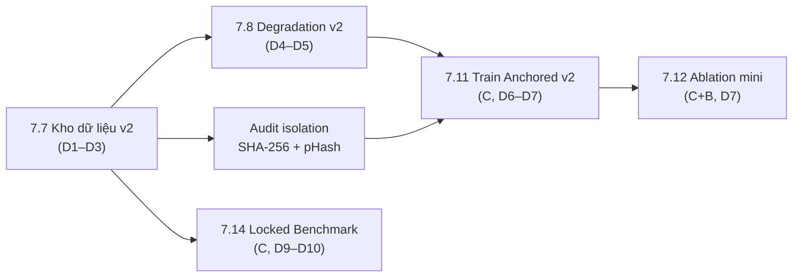

# PHASE 7 — NHÓM NHIỆM VỤ CỦA THÀNH VIÊN A (DATA & INFRA)

> **Giai đoạn**: Phase 7 — Tái lập đo lường & Hợp nhất mô hình (`27/10/2026 → 12/11/2026`)
> **Chủ trì**: Thành viên A (Data & Infrastructure Lead)
> **Số task**: 2 (`7.7`, `7.8`) — cộng hỗ trợ dữ liệu cho `7.11`/`7.12`/`7.14`
> **Kế hoạch gốc**: [`ke_hoach_phase_7_dieu_chinh_toan_dien.md`](../../../plan/ke_hoach_phase_7_dieu_chinh_toan_dien.md)
> **Bảng điều khiển chung**: [`../README_A.md`](../README_A.md)

---

## 1. Danh sách task trong giai đoạn

| Mã | Tệp đặc tả | Tên nhiệm vụ | Ngày | Ước lượng | Cổng | Trạng thái |
| :---: | :--- | :--- | :---: | ---: | :---: | :---: |
| **7.7** | [`task_7.7_kho_du_lieu_v2.md`](task_7.7_kho_du_lieu_v2.md) | Kho dữ liệu đa bộ sinh v2 (CFE-Small phân tầng + ảnh thật đa nguồn) | D1–D3 | 14 h | — (nạp cho 7.11) | `[ ] Sẵn sàng` |
| **7.8** | [`task_7.8_degradation_pipeline_v2.md`](task_7.8_degradation_pipeline_v2.md) | Nâng cấp pipeline suy biến v2 (JPEG 30–85, WebP, double-JPEG, ghép 2 suy biến) | D4–D5 | 5 h | — (nạp cho 7.11) | `[ ] Sẵn sàng` |

**Tổng**: 19 giờ công trong 5 ngày đầu. Sau D5, A chỉ còn vai trò hỗ trợ (không nhận task mới).

---

## 2. Đường găng (Critical Path)

**Chốt chặn**: `7.11` **không được bắt đầu** nếu `audit isolation` chưa trả về **0 vi phạm** và `data_manifest_v2.json` chưa được C xác nhận.

---

## 3. Quy tắc bất di bất dịch cho A trong Phase 7

1. **Không tái sử dụng 2.000 ảnh CFE test** và **không tái sử dụng 18 tập Task 5.1** dưới bất kỳ hình thức nào (kể cả crop/resize/nén lại).
2. **Generator-disjoint**: nếu một generator đã có trong tập test CFE hoặc 18 tập Task 5.1 thì **không được** đưa vào train v2.
3. Mọi ảnh phải có `sha256` + `phash` trong manifest. Ảnh thiếu hash ⇒ không được đưa vào train.
4. **Kill criteria**: stream vượt **4 giờ** hoặc **60 GB** ⇒ hạ xuống 8.000 ảnh (600/họ) và báo ngay cho C.
5. Không đổi `src/models/` hay `src/training/` — chỉ làm việc trong `src/datasets/`, `tools/`, `configs/`, `DATASET/`.

---

## 4. Checklist theo ngày

| Ngày | Việc phải xong | Bằng chứng |
| :---: | :--- | :--- |
| D1 | Khung script stream + đọc manifest test để lấy danh sách generator cấm | `tools/build_manifest_v2.py --dry-run` in ra danh sách generator |
| D2 | Stream 5 họ + ảnh thật; audit isolation vòng 1 | `logs/phase7/data_isolation_report.json` |
| D3 | Chốt `data_manifest_v2.json`, đóng gói `.tar`, báo C | Manifest ≥ 12.000 mẫu, 0 vi phạm |
| D4 | Code `PairedCleanDegradedAugmentation` v2 + `configs/degradation_v2.yaml` | File config + diff code |
| D5 | Test phân phối 10.000 mẫu + histogram + đo tốc độ DataLoader | `logs/phase7/degradation_profile.png` |

---

## 5. Liên kết

- Kế hoạch Phase 7: [`../../../plan/ke_hoach_phase_7_dieu_chinh_toan_dien.md`](../../../plan/ke_hoach_phase_7_dieu_chinh_toan_dien.md)
- Khế ước đo lường v3: [`../../../plan/ke_hoach_test_communityforensics_eval.md`](../../../plan/ke_hoach_test_communityforensics_eval.md) — Phụ lục A
- Task huấn luyện tiêu thụ dữ liệu: [`../../member_c_training_eval/phase_7/task_7.11_train_anchored_v2.md`](../../member_c_training_eval/phase_7/task_7.11_train_anchored_v2.md)
