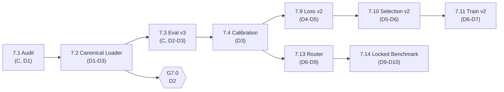

# PHASE 7 — NHÓM NHIỆM VỤ CỦA THÀNH VIÊN B (ARCHITECTURE & LOSS)

> **Giai đoạn**: Phase 7 — Tái lập đo lường & Hợp nhất mô hình (`27/10/2026 → 12/11/2026`)
> **Chủ trì**: Thành viên B (Architecture & Loss Lead)
> **Số task**: 4 (`7.2`, `7.9`, `7.10`, `7.13`) — cộng hỗ trợ `7.1`, `7.3`, `7.12`, `7.15`
> **Kế hoạch gốc**: [`ke_hoach_phase_7_dieu_chinh_toan_dien.md`](../../../plan/ke_hoach_phase_7_dieu_chinh_toan_dien.md)
> **Bảng điều khiển chung**: [`../README_B.md`](../README_B.md)

---

## 1. Danh sách task trong giai đoạn

| Mã | Tệp đặc tả | Tên nhiệm vụ | Ngày | Ước lượng | Cổng | Trạng thái |
| :---: | :--- | :--- | :---: | ---: | :---: | :---: |
| **7.2** | [`task_7.2_canonical_loader.md`](task_7.2_canonical_loader.md) | `canonical_loader` + adapter-index tường minh + test | D1–D3 | 8 h | **G7.0** | `[ ] Sẵn sàng` |
| **7.9** | [`task_7.9_loss_v2_realguard.md`](task_7.9_loss_v2_realguard.md) | Loss v2: `RealGuardLoss` + `FeatureConsistencyLoss` | D4–D5 | 7 h | — (nạp cho G7.2) | `[ ] Sẵn sàng` |
| **7.10** | [`task_7.10_selection_metric_v2.md`](task_7.10_selection_metric_v2.md) | Selection metric v2: worst-group + ràng buộc Real ACC | D5–D6 | 4 h | — (nạp cho G7.2) | `[ ] Sẵn sàng` |
| **7.13** | [`task_7.13_degradation_router.md`](task_7.13_degradation_router.md) | `DegradationRouter` + fusion xác suất đã hiệu chuẩn | D6–D9 | 8 h | — (nạp cho G7.3) | `[ ] Sẵn sàng` |

**Tổng**: 27 giờ công. `7.2` là **chốt chặn cứng**: C không được merge `eval v3` (7.3) trước khi `7.2` xanh.

---

## 2. Đường găng (Critical Path)

**Chốt chặn**: nếu `7.2` chưa đạt `0/0` cho 3 checkpoint hợp lệ thì **G7.0 trượt** và toàn bộ số liệu Phase 7 mất giá trị.

---

## 3. Quy tắc bất di bất dịch cho B trong Phase 7

1. **Cấm `strict=False`** trong mọi đường nạp checkpoint thuộc `tools/` và `src/`. `grep -r "strict=False" tools/ src/` phải rỗng.
2. **Không trộn hai checkpoint khác `num_vit_adapter`**. Ràng buộc vị trí `add_adapter[(i+1)·24/n − 1]` khiến `{7,15,23}` và `{2,5,8,...,23}` không thể biểu diễn bằng cùng một `n`. Phát hiện `dropped ≠ ∅` ⇒ **raise**, không im lặng.
3. **Loss mới mặc định `weight = 0`**: khi tắt, `L_total` phải trùng bản cũ (`torch.allclose`, `atol=1e-6`).
4. **Router không đặt tay hằng số**: mọi trọng số/ngưỡng phải fit trên `val_calib` và lưu vào `router_params.json`.
5. **Không đổi `forward()` mặc định** của model — chỉ thêm cờ (`return_features=True`).

---

## 4. Checklist theo ngày

| Ngày | Việc phải xong | Bằng chứng |
| :---: | :--- | :--- |
| D1 | Khung `canonical_loader.py` + `adapter_block_indices` trong `model.py` | Import thành công, `resolve_layout` chạy trên 4 checkpoint |
| D2 | `load_canonical` + test (a)(b)(d)(e) | `pytest -q tests/test_canonical_loader.py` xanh |
| D3 | Test (c) Gen 1 + smoke `train_crossdomain.py` 1 batch | Log smoke + grep `strict=False` rỗng |
| D4 | `RealGuardLoss` + `FeatureConsistencyLoss` (weight=0) | 3 test loss xanh |
| D5 | Tích hợp `CrossDomainTotalLoss` + `return_features` | Smoke 1 batch T4, không NaN |
| D6 | `worst_group_score` + điều kiện lưu `best.pth` | CSV 6 cột |
| D7–D9 | Router: tín hiệu, fit logistic, fusion, ablation | `router_params.json` + 3 dòng ablation |

---

## 5. Liên kết

- Kế hoạch Phase 7: [`../../../plan/ke_hoach_phase_7_dieu_chinh_toan_dien.md`](../../../plan/ke_hoach_phase_7_dieu_chinh_toan_dien.md)
- Khế ước đo lường v3: [`../../../plan/ke_hoach_test_communityforensics_eval.md`](../../../plan/ke_hoach_test_communityforensics_eval.md) — Phụ lục A
- Đặc tả vị trí adapter: kế hoạch §I.2 và [`../../../bao_cao/overall/tong_quan_du_an.md`](../../../bao_cao/overall/tong_quan_du_an.md) mục ENGINEERING RULES
- Task của C dùng đầu ra B: [`../../member_c_training_eval/phase_7/task_7.11_train_anchored_v2.md`](../../member_c_training_eval/phase_7/task_7.11_train_anchored_v2.md)
