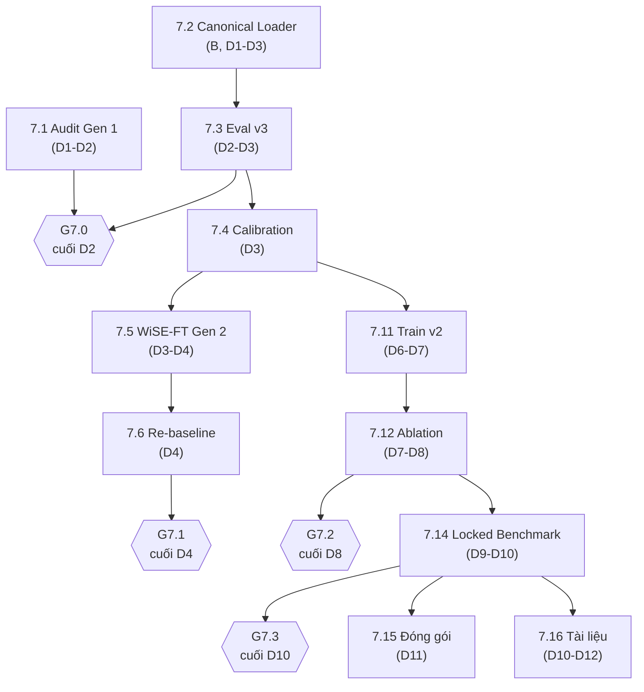

# PHASE 7 — NHÓM NHIỆM VỤ CỦA THÀNH VIÊN C (TRAINING & EVALUATION)

> **Giai đoạn**: Phase 7 — Tái lập đo lường & Hợp nhất mô hình (`27/10/2026 → 12/11/2026`)
> **Chủ trì**: Thành viên C (Training & Evaluation Lead, giữ nhịp 4 cổng)
> **Số task**: 10 (`7.1`, `7.3`, `7.4`, `7.5`, `7.6`, `7.11`, `7.12`, `7.14`, `7.15`, `7.16`)
> **Kế hoạch gốc**: [`ke_hoach_phase_7_dieu_chinh_toan_dien.md`](../../../plan/ke_hoach_phase_7_dieu_chinh_toan_dien.md)
> **Bảng điều khiển chung**: [`../README_C.md`](../README_C.md)

---

## 1. Danh sách task trong giai đoạn

| Mã | Tệp đặc tả | Tên nhiệm vụ | Ngày | Ước lượng | Cổng | Trạng thái |
| :---: | :--- | :--- | :---: | ---: | :---: | :---: |
| **7.1** | [`task_7.1_audit_checkpoint_gen1.md`](task_7.1_audit_checkpoint_gen1.md) | Audit cấu trúc & đo lại Gen 1 (`n=3` vs `n=8`) | D1–D2 | 4 h | **G7.0** | `[x] Đã hoàn thành (PASS G7.0)` |
| **7.3** | [`task_7.3_eval_v3_measurement_contract.md`](task_7.3_eval_v3_measurement_contract.md) | Evaluation v3: khế ước đo lường, bỏ `strict=False`, bỏ ngưỡng batch | D2–D3 | 6 h | **G7.0** | `[x] Đã hoàn thành (Giai đoạn 1 PASS 100%)` |
| **7.4** | [`task_7.4_calibration_threshold_fpr.md`](task_7.4_calibration_threshold_fpr.md) | Hiệu chuẩn nhiệt độ & ngưỡng ràng buộc FPR + ECE | D3 | 4 h | **G7.0** | `[x] Đã hoàn thành (PASS 100%)` |
| **7.5** | [`task_7.5_wise_ft_gen2.md`](task_7.5_wise_ft_gen2.md) | WiSE-FT **Gen 2** + lưới `α×β_srm` + verify | D3–D4 | 5 h | **G7.1** | `[x] Đã hoàn thành (PASS 100%)` |
| **7.6** | [`task_7.6_rebaseline_cfe_v3.md`](task_7.6_rebaseline_cfe_v3.md) | Re-baseline 4 cấu hình trên CFE bằng harness v3 | D4 | 3 h | **G7.1** | `[ ] Sẵn sàng` |
| **7.11** | [`task_7.11_train_anchored_v2.md`](task_7.11_train_anchored_v2.md) | Huấn luyện Anchored Recovery v2 | D6–D7 | 5 h + GPU | **G7.2** | `[ ] Sẵn sàng` |
| **7.12** | [`task_7.12_ablation_mini_v2.md`](task_7.12_ablation_mini_v2.md) | Ablation mini 4 cấu hình (cùng seed 42) | D7–D8 | 4 h + GPU | **G7.2** | `[ ] Sẵn sàng` |
| **7.14** | [`task_7.14_locked_benchmark_phase7.md`](task_7.14_locked_benchmark_phase7.md) | Locked Benchmark Phase 7 (in-dist 82k + CFE + 6 biến thể) | D9–D10 | 5 h | **G7.3** | `[ ] Sẵn sàng` |
| **7.15** | [`task_7.15_unified_packaging.md`](task_7.15_unified_packaging.md) | Đóng gói `UnifiedFatFormerXLA` + báo cáo nghiệm thu | D11 | 4 h | **G7.3** | `[ ] Sẵn sàng` |
| **7.16** | [`task_7.16_cap_nhat_tai_lieu_du_an.md`](task_7.16_cap_nhat_tai_lieu_du_an.md) | Cập nhật tài liệu dự án & Chương 5/Hạn chế | D10–D12 | 6 h | **G7.3** | `[ ] Sẵn sàng` |

**Tổng**: ~46 giờ công + ~14–18 giờ GPU. C là người **duy nhất** được đánh dấu cổng pass/fail.

---

## 2. Đường găng (Critical Path)

---

## 3. Quy tắc bất di bất dịch cho C trong Phase 7

1. **Không chấp nhận** báo cáo thiếu `TPR@FPR` (1/5/10%), AUC/AP, CI 95%, và nguồn gốc tập hiệu chuẩn.
2. **Mọi số của Gen 1** phải gắn nhãn `invalid_layout` — không được xuất hiện như kết quả hiện hành.
3. **Không trích dẫn** `52.05%`, `4.10%`, `96.58%` như số liệu còn hiệu lực (xem kế hoạch §VIII).
4. **Fit và báo cáo phải tách tập**: `val_calib` để fit, `val_select` để chọn checkpoint, CFE/18 tập để báo cáo.
5. **Không đổi metric giữa chừng**: nếu phát hiện metric sai, dừng run, sửa, chạy lại từ checkpoint — không "vá" số liệu.
6. **Kết quả âm vẫn hợp lệ**: nếu G7.2 trượt, Phase 7 vẫn đạt nếu có checkpoint Pareto tốt nhất + ablation đòn bẩy thất bại + mục Hạn chế trung thực (kế hoạch §II.3).

---

## 4. Checklist theo ngày

| Ngày | Việc phải xong | Bằng chứng |
| :---: | :--- | :--- |
| D1 | 7.1 audit JSON cho 4 checkpoint | `logs/phase7/checkpoint_structure_audit.json` |
| D2 | 7.1 kết luận + 7.3 khung eval v3 | `bao_cao_task_7.1_checkpoint_audit.md`; **G7.0** |
| D3 | 7.3 hoàn tất + 7.4 calibration + 7.5 khung | `report_schema v3` JSON; `calibration/*.json` |
| D4 | 7.5 sweep 12 ứng viên + 7.6 re-baseline | `wise_ft_v2_sweep.csv`; `cfe_v3_baseline_matrix.md`; **G7.1** |
| D5 | 7.5 kết luận + chuẩn bị 7.11 | checkpoint Gen 2 `verify 0/0` |
| D6 | 7.11 benchmark 100 step + bắt đầu train | log thời gian/epoch |
| D7 | 7.11 hoàn tất + 7.12 bắt đầu | `train_history.csv` |
| D8 | 7.12 hoàn tất + đánh giá G7.2 | bảng 4×8; **G7.2** |
| D9 | 7.14 in-dist + CFE clean/Q30 | `final_phase7_report.json` (phần 1) |
| D10 | 7.14 hoàn tất 6 biến thể | báo cáo đầy đủ; **G7.3** |
| D11 | 7.15 đóng gói | `infer_unified.py` chạy 20 ảnh |
| D12 | 7.16 hoàn tất + review chéo | 11/11 tài liệu cập nhật |

---

## 5. Liên kết

- Kế hoạch Phase 7: [`../../../plan/ke_hoach_phase_7_dieu_chinh_toan_dien.md`](../../../plan/ke_hoach_phase_7_dieu_chinh_toan_dien.md)
- Khế ước đo lường v3: [`../../../plan/ke_hoach_test_communityforensics_eval.md`](../../../plan/ke_hoach_test_communityforensics_eval.md) — Phụ lục A
- Lịch sử checkpoint: [`../../../plan/tong_hop_checkpoints_va_lich_su_thuc_nghiem.md`](../../../plan/tong_hop_checkpoints_va_lich_su_thuc_nghiem.md)
- Task của B cung cấp loader/loss: [`../../member_b_architecture_loss/phase_7/README.md`](../../member_b_architecture_loss/phase_7/README.md)
